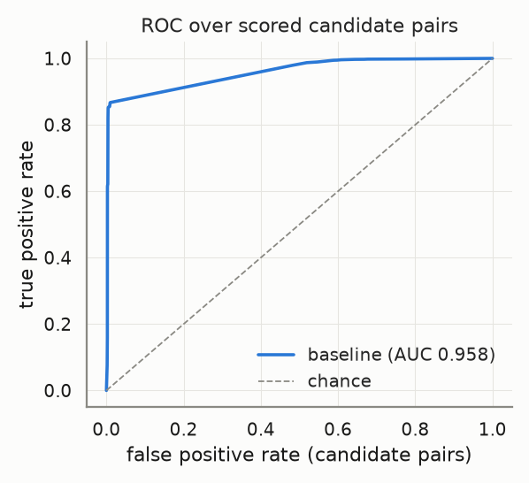
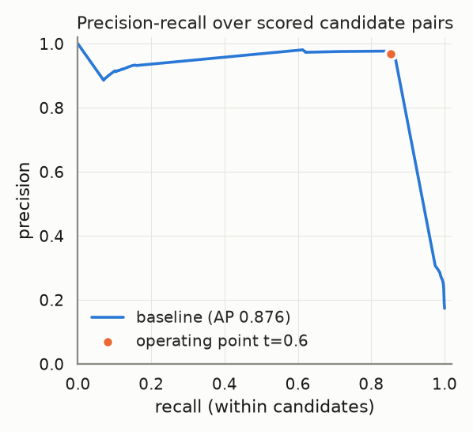
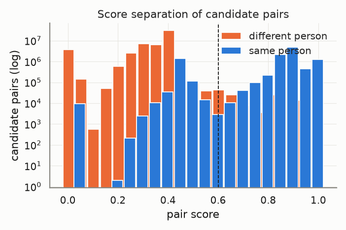
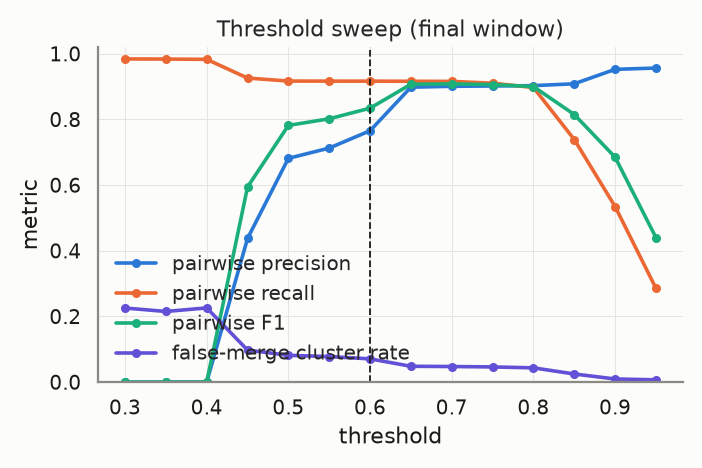
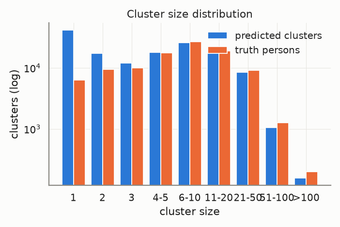
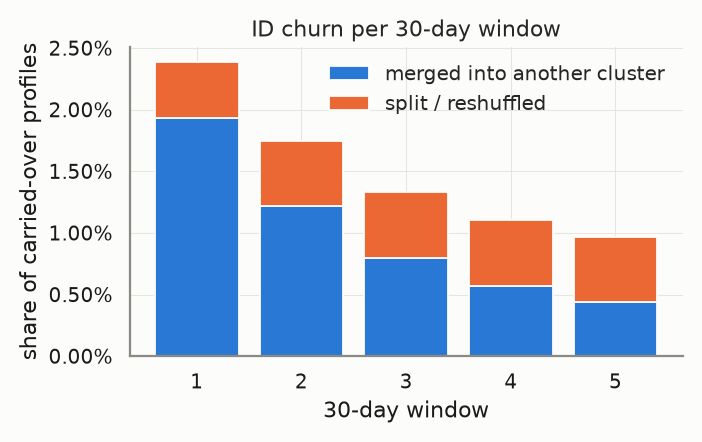
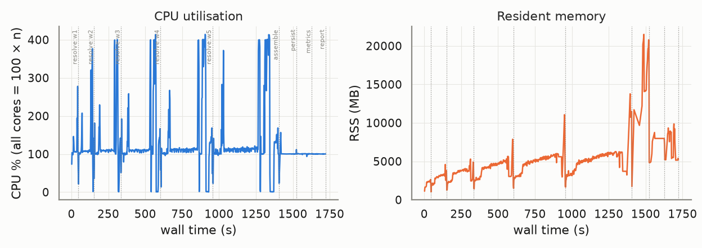

# Evaluation report — `large-fullpairs`

_Generated 2026-10-22T13:18:11 · dataset `large` · resolver `aurora_cdp` · threshold 0.6 (engine scale 3.0) · block cap 100 · seed 20261022_

## Provenance

```json
{
  "adapter": "aurora_cdp",
  "aurora_cdp_commit": "023ad124ed63cf7b24bc43bbf2cfb4cfd927618d",
  "aurora_cdp_commit_source": "git",
  "aurora_cdp_dirty_worktree": false,
  "aurora_cdp_path": "/home/ubuntu/Projects/aurora-cdp",
  "aurora_cdp_version": "0.1.0",
  "harness_commit": "1211f2017a2dcaf198a4002f7323561ee6e8edca",
  "harness_version": "0.1.0",
  "seed": 20261022,
  "dataset": "/home/ubuntu/data/aurora-testdata/large",
  "run_at": "2026-10-22T12:49:28+00:00",
  "host": {
    "platform": "Linux",
    "platform_release": "7.0.0-1014-aws",
    "machine": "x86_64",
    "python": "3.11.17",
    "cpu_count": 16,
    "mem_total_gb": 132.21,
    "hostname": "ip-172-31-45-65"
  },
  "run_name": "large-fullpairs",
  "input_hash": "acbe55882b1bed648818",
  "dataset_manifest_fingerprint": 18066770612093278047,
  "dataset_seed": 42,
  "sample": null
}
```

<details><summary><code>adapter config</code></summary>

```json
{
  "cdp_path": null,
  "config": {
    "matcher": {
      "max_expanded_pairs": 200000000
    }
  },
  "threshold": 0.6,
  "datasource_column": "source",
  "datasource": "input",
  "windows": "replay",
  "deterministic_ids": true,
  "seed": 20261022,
  "isolate_windows": true,
  "max_stored_pairs": 150000000,
  "epoch": "2026-01-01",
  "window_days": 30,
  "retries": 1,
  "timeout_s": 21600.0,
  "threshold_raw": 3.0,
  "score_scale": 5.0,
  "engine_path": "/home/ubuntu/Projects/aurora-cdp"
}
```

</details>

<details><summary><code>aurora_cdp_config (resolved / expanded)</code></summary>

```json
{
  "workspace": ".aurora",
  "outputs_dir": "outputs",
  "db_file": "aurora.duckdb",
  "normalize": {
    "default_region": "US",
    "phone_use_last10_for_match": true,
    "email_strip_plus_tag": true,
    "email_strip_gmail_dots": false,
    "nickname_file": null,
    "address_parsing": false,
    "email_junk_local_parts": [
      "test",
      "no",
      "none",
      "reservation",
      "admin",
      "contact",
      "guest",
      "info",
      "noreply",
      "no-reply",
      "donotreply",
      "unknown"
    ],
    "address_abbreviations": {
      "ST": "STREET",
      "AVE": "AVENUE",
      "RD": "ROAD",
      "BLVD": "BOULEVARD",
      "DR": "DRIVE",
      "LN": "LANE",
      "CT": "COURT",
      "STE": "SUITE",
      "APT": "APARTMENT",
      "N": "NORTH",
      "S": "SOUTH",
      "E": "EAST",
      "W": "WEST",
      "1ST": "FIRST",
      "2ND": "SECOND",
      "3RD": "THIRD"
    }
  },
  "blocklist": {
    "email_max_given_names": 20,
    "email_max_surnames": 20,
    "phone_max_given_names": 20,
    "address_max_given_names": 40,
    "manual": {}
  },
  "blocking": {
    "block_size_limit": 100,
    "fk_block_size_limit": 1000,
    "max_pairs_per_block": 500000,
    "refine_target": 100,
    "sn_window": 25,
    "collapse_trivial_dupes": true,
    "persist_blocking_keys": true,
    "strategy_source": "fixed",
    "learned_strategies_file": null,
    "learned_keep_types": [
      "ck",
      "loy_id",
      "fk"
    ],
    "dnf": {
      "max_terms": 2,
      "min_positive_pairs": 200,
      "min_predicate_pc": 0.01,
      "target_pc": 0.95,
      "min_gain_pairs": 5,
      "pairs_per_record_budget": 20,
      "sample_records": 20000,
      "sample_positive_pairs": 5000,
      "sample_seed": 0,
      "labels": "self"
    },
    "refine_keys": {
      "email": [
        "name3",
        "postal",
        "birthdate",
        "update_month",
        "given3"
      ],
      "phone": [
        "name3",
        "postal",
        "birthdate",
        "update_month",
        "given3"
      ],
      "name_postal": [
        "email",
        "phone",
        "birthdate",
        "house_number",
        "update_month"
      ],
      "name_birthdate": [
        "email",
        "phone",
        "postal",
        "house_number",
        "update_month"
      ],
      "name": [
        "postal",
        "birthdate",
        "email",
        "phone",
        "house_number",
        "update_month"
      ],
      "loy_id": [
        "name3",
        "postal",
        "birthdate",
        "update_month"
      ],
      "ck": [
        "name3",
        "postal",
        "birthdate",
        "update_month"
      ],
      "fk": [
        "name3",
        "postal",
        "birthdate",
        "update_month"
      ],
      "dnf": [
        "postal",
        "birthdate",
        "email",
        "phone",
        "name3",
        "update_month"
      ]
    },
    "strategies": [
      {
        "name": "email_exact",
        "type": "email"
      },
      {
        "name": "phone_exact",
        "type": "phone"
      },
      {
        "name": "name_postal",
        "type": "name_postal"
      },
      {
        "name": "name_birthdate",
        "type": "name_birthdate"
      },
      {
        "name": "name",
        "type": "name",
        "max_pairs_per_block": 50000
      },
      {
        "name": "loy_id_exact",
        "type": "loy_id"
      },
      {
        "name": "ck_exact",
        "type": "ck"
      },
      {
        "name": "fk",
        "type": "fk"
      }
    ]
  },
  "matcher": {
    "match_threshold": 3.25,
    "scorer": "rules",
    "ordinal": {
      "model_file": null,
      "retrain": "auto",
      "save_model": true,
      "apply_rules_first": true,
      "levels": 3,
      "self_train_rounds": 3,
      "confidence_margin": 1.0,
      "negatives_per_positive": 2.0,
      "hard_negative_min_disagreements": 2,
      "max_train_pairs": 40000,
      "min_positive_pairs": 300,
      "min_negative_pairs": 300,
      "l2": 0.001,
      "lr": 0.05,
      "epochs": 300,
      "sample_seed": 0,
      "monotone": false
    },
    "score_chunk_size": 250000,
    "persist_features": false,
    "export_expanded_dupe_pairs": true,
    "max_expanded_pairs": 200000000,
    "deterministic": {
      "ck_exact_score": 5.0,
      "loy_exact_score": 5.0,
      "email_exact_with_name_score": 4.5,
      "phone_exact_with_name_score": 4.2,
      "name_agreement_min": 0.85
    },
    "weights": {
      "bias": -2.5,
      "given_sim": 1.0,
      "surname_sim": 1.2,
      "email_exact": 3.0,
      "email_sim": 0.5,
      "email_sim_min": 0.92,
      "phone_exact": 2.5,
      "address_sim": 1.2,
      "postal_exact": 0.6,
      "birthdate_exact": 1.5,
      "fk_shared": 1.0,
      "name_mismatch_penalty": -1.5,
      "name_mismatch_floor": 0.6,
      "address_house_number_mismatch_cap": 0.3,
      "birthdate_conflict": -3.0
    },
    "trivial_dupe": {
      "fields": [
        "given_name_norm",
        "surname_norm",
        "email_norm",
        "phone_match",
        "address_norm",
        "postal_norm",
        "birthdate_norm"
      ],
      "identifier_fields": [
        "email_norm",
        "phone_match",
        "address_norm"
      ],
      "requires_identifier": true
    },
    "hard_conflicts": {
      "birthdate": true,
      "birthdate_typo_tolerance": 2
    }
  },
  "cluster": {
    "supersized_min_size": 500,
    "linkage": "fusion",
    "fusion": {
      "tiers": [
        4.75,
        4.0
      ],
      "strong_edge_score": 4.0,
      "min_cross_edges": 2,
      "min_cross_edge_ratio": 0.1
    },
    "carve": {
      "enabled": true,
      "max_cluster_size": 500
    },
    "conflict_attributes": [
      "birthdate",
      "given_name"
    ],
    "conflict_tolerances": {
      "birthdate": {
        "measure": "levenshtein_max",
        "value": 2
      },
      "given_name": {
        "measure": "jaro_winkler_min",
        "value": 0.6
      },
      "contact": {
        "measure": "any_overlap"
      }
    },
    "conflict_columns": {
      "birthdate": "birthdate_norm",
      "given_name": "given_name_canon",
      "surname": "surname_norm",
      "ck": "ck",
      "loy_id": "loy_id_norm",
      "contact": [
        "email_norm",
        "phone_match"
      ]
    }
  },
  "identity": {
    "ampid_mode": true,
    "external_id_name": "amperity_id",
    "email_ampid_assignment": true
  },
  "household": {
    "build_with_profile": true,
    "min_evidence_weight": 1.0,
    "evidence_ttl_days": 365,
    "max_customers_per_value": 25,
    "evidence": {
      "shared_address": {
        "weight": 1.0,
        "columns": [
          "address_norm",
          "postal_norm"
        ]
      },
      "shared_surname_postal": {
        "weight": 0.4,
        "columns": [
          "surname_norm",
          "postal_norm"
        ]
      },
      "shared_phone": {
        "weight": 0.6,
        "columns": [
          "phone_match"
        ]
      },
      "relationship": {
        "weight": 1.0
      }
    }
  },
  "labels": {
    "file": null
  },
  "storage": {
    "duckdb": {
      "memory_limit": "3GB",
      "threads": 4,
      "temp_directory": null,
      "preserve_insertion_order": false
    }
  },
  "stable_id": {
    "enabled": true,
    "jitter_alert_pct": 2.0
  },
  "survivorship": {
    "source_priority": {
      "loyalty": 1,
      "crm": 2,
      "ecommerce": 3,
      "pos": 4
    },
    "field_priority": {},
    "recency_field": "update_dt",
    "attributes": [
      "given_name",
      "surname",
      "email",
      "phone",
      "address",
      "address2",
      "city",
      "state",
      "postal",
      "country",
      "birthdate"
    ]
  },
  "sources": {},
  "tuning": {
    "thresholds": [
      2.0,
      2.5,
      3.0,
      3.5,
      4.0
    ],
    "min_precision": 0.98
  }
}
```

</details>

## Key metrics

```
pairwise P=0.986 R=0.851 F1=0.913 | B3 F1=0.931 | false-merge clusters=2.72% (profiles 3.06%) | split persons=38.12% | ID churn/30d mean=1.51% max=2.39% | AUC-ROC=0.958 AP=0.876 blocking-recall=0.874
```

| Metric | Value |
|---|---|
| Pairwise precision / recall / F1 | 0.986 / 0.851 / 0.913 |
| Pairs: TP / FP / FN | 10,455,412 / 147,700 / 1,833,938 |
| B-cubed precision / recall / F1 | 0.986 / 0.881 / 0.931 |
| Clusters predicted / truth persons (ratio) | 143,357 / 100,000 (1.434) |
| Exact-match clusters | 60,878 (60.88% of persons) |
| **False-merge rate** (clusters / profiles / pairs) | 2.72% / 3.06% / 1.39% |
| Over-merged clusters (max persons in one) | 3,896 (158) |
| Split persons (profiles) | 38,115 = 38.12% (56.74% of profiles) |
| **ID churn per 30-day window** mean / max | 1.51% / 2.39% |
| Harmful share of churn (purity dropped) | 5.94% |
| AUC-ROC / average precision (candidate pairs) | 0.958 / 0.876 |
| Blocking recall (true pairs reaching scoring) | 0.874 |
| Operating point P / R-in-candidates / effective R | 0.970 / 0.853 / 0.745 |
| Scored candidate pairs (stored fraction) | 61,775,391 (100.00%) |

> **Notes**
> - Engine scores are normalised from the 0–5 band scale to [0, 1] (score/5); the operating threshold 0.60 is the engine's 3.0 on its own scale.
> - The threshold sweep re-clusters engine pair scores with plain connected components, so it approximates (does not reproduce) the engine's conflict-aware clustering at other thresholds.

## Dataset

| | |
|---|---|
| persons | 100,000 |
| persons_with_profiles | 100,000 |
| profiles | 1,000,000 |
| months | 6 |
| true_pairs | 12,289,350 |
| households | 6,685 |
| movers | 9,963 |
| exact_duplicates | 90,560 |
| profiles_per_person_max | 547 |

Regenerate: `python scripts/generate.py --tier large --seed 42`

## Resolver run

| | |
|---|---|
| time: engine_load | 15.22s |
| time: engine_blocking | 32.01s |
| time: engine_scoring | 796.73s |
| time: engine_clustering | 62.27s |
| time: engine_stable_id | 5.79s |
| time: engine_persist | 9.32s |
| time: resolve_windows | 1363.68s |
| time: wall_total | 1522.72s |
| candidate pairs | 61,775,391 |
| block `engine (final snapshot)` | 24,419,759 pairs, 297,288 groups, 0 over cap (n/a) |

Engine snapshots (one engine run per replayed window; `previous=` carries stable ids forward):

| window | run_date | records | pairs scored | edges | clusters | skipped blocks | jitter % | ids minted | ids retired | engine s |
|---|---|---|---|---|---|---|---|---|---|---|
| 0 | 2026-01-31 | 166,947 | 3,532,637 | 180,227 | 77,742 | 0 | 0.0 | 77742 | 0 | 41.86 |
| 1 | 2026-03-02 | 332,940 | 10,979,967 | 579,724 | 104,882 | 0 | 2.3876 | 29902 | 2762 | 103.02 |
| 2 | 2026-04-01 | 499,787 | 20,306,291 | 1,110,948 | 119,905 | 0 | 1.7487 | 18166 | 3143 | 177.28 |
| 3 | 2026-05-01 | 666,532 | 32,689,407 | 1,726,040 | 129,692 | 0 | 1.3356 | 12737 | 2950 | 260.73 |
| 4 | 2026-05-31 | 833,752 | 46,143,399 | 2,402,089 | 137,243 | 0 | 1.1017 | 10124 | 2573 | 344.31 |
| 5 | 2026-06-30 | 1,000,000 | 61,775,391 | 3,123,510 | 143,357 | 0 | 0.964 | 8362 | 2248 | 436.48 |

## Score quality (candidate pairs)

 



## Threshold sweep (final window)

| threshold | precision | recall | F1 | B³ F1 | false-merge clusters | split persons | clusters |
|---|---|---|---|---|---|---|---|
| 0.30 | 0.000 | 0.984 | 0.000 | 0.173 | 22.58% | 8.30% | 17,070 |
| 0.35 | 0.000 | 0.984 | 0.000 | 0.186 | 21.53% | 8.81% | 18,832 |
| 0.40 | 0.000 | 0.983 | 0.000 | 0.240 | 22.61% | 9.27% | 22,541 |
| 0.45 | 0.438 | 0.926 | 0.594 | 0.864 | 9.76% | 31.29% | 112,270 |
| 0.50 | 0.682 | 0.917 | 0.782 | 0.885 | 8.17% | 33.66% | 121,030 |
| 0.55 | 0.713 | 0.917 | 0.802 | 0.891 | 7.79% | 33.79% | 122,511 |
| 0.60 | 0.766 | 0.917 | 0.834 | 0.901 | 7.09% | 33.84% | 124,504 |
| 0.65 | 0.898 | 0.916 | 0.907 | 0.926 | 4.83% | 33.96% | 129,587 |
| 0.70 | 0.901 | 0.916 | 0.908 | 0.926 | 4.76% | 34.25% | 130,190 |
| 0.75 | 0.902 | 0.911 | 0.906 | 0.924 | 4.64% | 35.77% | 133,070 |
| 0.80 | 0.903 | 0.897 | 0.900 | 0.917 | 4.36% | 39.40% | 140,243 |
| 0.85 | 0.909 | 0.739 | 0.815 | 0.818 | 2.49% | 68.69% | 229,314 |
| 0.90 | 0.953 | 0.535 | 0.685 | 0.623 | 0.97% | 87.15% | 427,321 |
| 0.95 | 0.957 | 0.286 | 0.440 | 0.455 | 0.71% | 90.84% | 514,050 |

Best F1 on this grid: threshold **0.70** (F1 0.908). Run `scripts/tune.py` for finer grids, precision-constrained objectives and weight search.



## Clusters



| | predicted | truth |
|---|---|---|
| mean | 6.98 | 10.00 |
| p50 | 4.00 | 6.00 |
| p90 | 16.00 | 21.00 |
| p99 | 47.00 | 58.00 |
| max | 386 | 547 |
| singletons | 41,517 | 6,356 |

## Over-merge detector

3,896 predicted clusters conflate ≥2 persons, covering 30,603 profiles and 11,943 persons. 287,173 accepted edges cross a person boundary.

Which agreeing feature carried the bad edges (an edge can count in several columns; `only` = that feature was the sole agreement):

| feature | bad edges agreeing | sole agreement |
|---|---|---|
| engine_scored | 183,898 | 183,898 |
| engine_trivial_duplicate | 96,548 | 96,548 |
| engine_deterministic | 6,727 | 6,727 |
| email | 0 | 0 |
| phone | 0 | 0 |
| dob | 0 | 0 |
| postal | 0 | 0 |
| name | 0 | 0 |
| addr | 0 | 0 |

Worst clusters (full list in `overmerge_clusters.json`, edges in `overmerge_edges.parquet`):

| cluster | persons | profiles | dominant feature | sample names by person |
|---|---|---|---|---|
| `w0-9744346270a838b4` | 158 | 176 | engine_trivial_duplicate | ps_0073261: JAMES, james; ps_0027609: James; ps_0015654: james; ps_0098824: James |
| `w0-96f582060bfc8ac7` | 123 | 160 | engine_trivial_duplicate | ps_0011059: James Smith, james smith; ps_0074339: JAMES SMITH, James Smith; ps_0077883: JAMES SMITH, James Smith; ps_0017117: james smith |
| `w0-b05e918f52f11b72` | 86 | 111 | engine_trivial_duplicate | ps_0033464: james johnson; ps_0025882: James Johnson, james johnson; ps_0026022: James Johnson; ps_0071854: JAMES JOHNSON, james johnson |
| `w0-1ae2bddd7f0c9b9f` | 73 | 76 | engine_trivial_duplicate | ps_0072653: john; ps_0067731: John; ps_0096328: John; ps_0025974: john |
| `w0-0c20373bdf1d4dad` | 69 | 96 | engine_trivial_duplicate | ps_0012714: john smith; ps_0063949: JOHN SMITH, john smith; ps_0023489: John Smith, john smith; ps_0001574: John Smith, john smith |
| `w0-65d1e1509e4dc68d` | 59 | 74 | engine_trivial_duplicate | ps_0077235: ROBERT SMITH, Robert Smith; ps_0024659: Robert Smith; ps_0011563: robert smith; ps_0071545: Robert Smith, robert smith |
| `w0-c4c88b800b6a4f47` | 51 | 56 | engine_trivial_duplicate | ps_0079650: Robert; ps_0099705: robert; ps_0005516: robert; ps_0077235: Robert |
| `w0-a0d44b92c711075c` | 50 | 59 | engine_trivial_duplicate | ps_0032339: JAMES WILLIAMS, James Williams; ps_0032984: James Williams; ps_0024746: James Williams; ps_0014807: James Williams |
| `w0-17a5f128366e9817` | 44 | 60 | engine_trivial_duplicate | ps_0093955: James Jones, james jones; ps_0083910: James Jones, james jones; ps_0080077: james jones; ps_0044290: james jones |
| `w0-9e3ab275e73e2d86` | 41 | 62 | engine_trivial_duplicate | ps_0080363: JAMES BROWN, james brown; ps_0079825: James Brown; ps_0002937: james brown; ps_0069615: james brown |
| `w0-d08fe453e91a27a5` | 41 | 56 | engine_trivial_duplicate | ps_0017507: Michael Smith, michael smith; ps_0011774: Michael Smith, michael smith; ps_0048291: Michael Smith; ps_0057525: Michael Smith |
| `w0-57b259e4b2806d03` | 41 | 43 | engine_trivial_duplicate | ps_0084524: Michael; ps_0015967: michael; ps_0020904: MICHAEL; ps_0066941: Michael |

## ID churn per 30-day window

Churn = carried-over profiles whose stable cluster id changed vs the previous window. *merge* = the profile's whole previous cluster was absorbed; *split* = otherwise. *harmful* = the profile's new cluster is less pure for its true person than the old one.



| window | profiles | clusters | new | carried | churned | churn rate | merge | split | harmful | justified |
|---|---|---|---|---|---|---|---|---|---|---|
| 0 | 166,947 | 77,742 | – | – | – | – | – | – | – | – |
| 1 | 332,940 | 104,882 | 165,993 | 166,947 | 3,986 | 2.39% | 3,229 | 757 | 208 | 3,778 |
| 2 | 499,787 | 119,905 | 166,847 | 332,940 | 5,822 | 1.75% | 4,057 | 1,765 | 336 | 5,486 |
| 3 | 666,532 | 129,692 | 166,745 | 499,787 | 6,675 | 1.34% | 3,999 | 2,676 | 409 | 6,266 |
| 4 | 833,752 | 137,243 | 167,220 | 666,532 | 7,343 | 1.10% | 3,786 | 3,557 | 479 | 6,864 |
| 5 | 1,000,000 | 143,357 | 166,248 | 833,752 | 8,037 | 0.96% | 3,662 | 4,375 | 461 | 7,576 |

Quality per window snapshot:

| window | profiles | precision | recall | F1 | false-merge clusters |
|---|---|---|---|---|---|
| 0 | 166,947 | 0.986 | 0.848 | 0.912 | 0.99% |
| 1 | 332,940 | 0.986 | 0.863 | 0.920 | 1.54% |
| 2 | 499,787 | 0.986 | 0.864 | 0.921 | 1.93% |
| 3 | 666,532 | 0.986 | 0.864 | 0.921 | 2.25% |
| 4 | 833,752 | 0.986 | 0.856 | 0.917 | 2.49% |
| 5 | 1,000,000 | 0.986 | 0.851 | 0.913 | 2.72% |

## Resources

Wall 1721.6s · peak RSS 21,498 MB · mean CPU 128% (peak 414%, 16 cores) · 799 samples @ 2.0s



| stage | wall s | peak RSS MB | mean CPU % |
|---|---|---|---|
| resolve:w0 | 44.6 | 2,634 | 120 |
| resolve:w1 | 107.0 | 4,590 | 123 |
| resolve:w2 | 182.6 | 5,296 | 128 |
| resolve:w3 | 267.1 | 7,873 | 129 |
| resolve:w4 | 352.0 | 11,058 | 133 |
| resolve:w5 | 453.1 | 13,773 | 136 |
| assemble | 116.5 | 21,498 | 100 |
| persist | 104.5 | 8,752 | 101 |
| metrics | 93.9 | 9,864 | 100 |
| report | 0.0 | 5,174 | 100 |

## Failures and retries

0 stage failure(s), 0 retry(ies). Full log: `events.jsonl`.

## Metric validation

17 golden/sanity cases, 91 hand-computed checks run through `aurora_eval.score` (the reports' own code path) — **ALL PASSED**. Metrics marked *untrusted* have no independent check and must not be used for gating.

| metric | status | basis |
|---|---|---|
| pairwise.precision/recall/f1 | ✅ validated | A: pairwise |
| pairwise.tp/fp/fn pairs | ✅ validated | A: pairwise |
| cluster.bcubed_precision/recall/f1 | ✅ validated | A: B-cubed |
| cluster.false_merge (cluster/profile/pair) | ✅ validated | A: false-merge |
| cluster.split (persons/profiles) | ✅ validated | A: split |
| cluster.exact_match_rate / cluster_count_ratio | ✅ validated | A: exact / ratio |
| cluster.pred_size_dist / truth_size_dist | ✅ validated | A: size distributions |
| churn.rate / merge vs split | ✅ validated | C: churn rate, merge vs split |
| churn.harmful vs justified | ✅ validated | C: harmful vs justified |
| curves.blocking_recall | ✅ validated | A: blocking recall |
| curves.auc_roc / average_precision | ✅ validated | A: ROC / PR |
| curves.operating_point | ✅ validated | A: operating point @0.75 |
| per_window quality | ✅ validated | C: per-window quality |
| sanity: perfect input | ✅ validated | perfect prediction |
| sanity: all-singleton input | ✅ validated | all singletons |
| sanity: all-merged input | ✅ validated | everything merged |
| sanity: disjoint prediction | ✅ validated | disjoint prediction |
| sanity: disjoint pairs file | ✅ validated | pairs file with no true pair |
| threshold_sweep | ≈ approximation | approximation — harness connected components over engine pair scores; not the engine's conflict-aware clustering |
| overmerge.dominant_feature | ⚠️ untrusted | untrusted — attribution by engine match_type only (engine pair features are not exported) |
| curves.score_hist | ⚠️ untrusted | untrusted — diagnostic histogram, no golden case |
| engine.metrics (pairs_blocked, skipped_blocks, cluster_size_distribution, timings) | ⚠️ untrusted | untrusted — reported verbatim from the engine, not independently recomputed |
| engine.jitter_pct per snapshot | ✅ cross-checked | engine jitter == harness churn rate per window |

## Reproduce

```bash
# dataset: /home/ubuntu/data/aurora-testdata/large  (regenerate: python scripts/generate.py --tier large --seed 42)
python -m aurora_eval.cli run --adapter aurora_cdp --dataset large --seed 20261022 --run-name large-fullpairs --date 2026-10-22 --isolate-windows --resource-interval 2 --timeout-s 21600 --max-stored-pairs 150000000 --cdp-config {"matcher": {"max_expanded_pairs": 200000000}} --data-dir /home/ubuntu/data/aurora-testdata --reports-root ../aurora-cdp/reports
# resume after interruption: same command (checkpoints in /home/ubuntu/Projects/aurora-eval-harness/runs/large-fullpairs/checkpoints)
```

## Files

- `metrics.json` — everything above, machine-readable (same shape as `aurora_eval.score()` output)
- `plots/` — PNGs embedded here
- `overmerge_clusters.json`, `overmerge_edges.parquet` — drill-down for the detector
- `provenance.json`, `resources.jsonl`, `events.jsonl`, `state.json` — provenance, resource samples, failure/retry log, stage state
