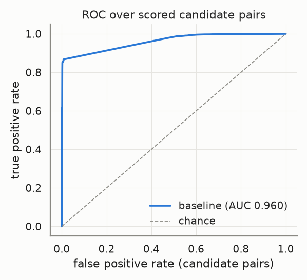
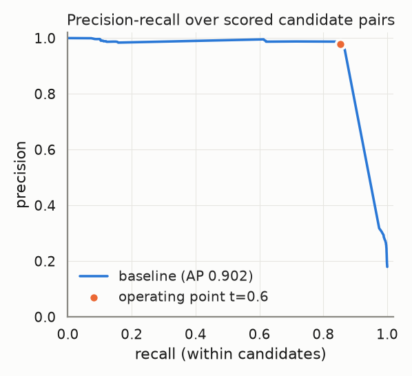
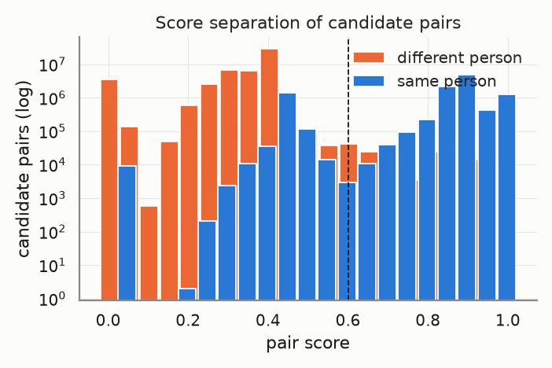
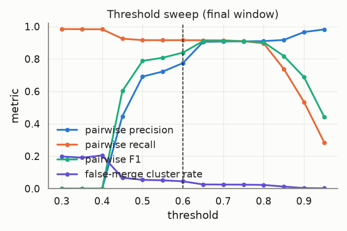
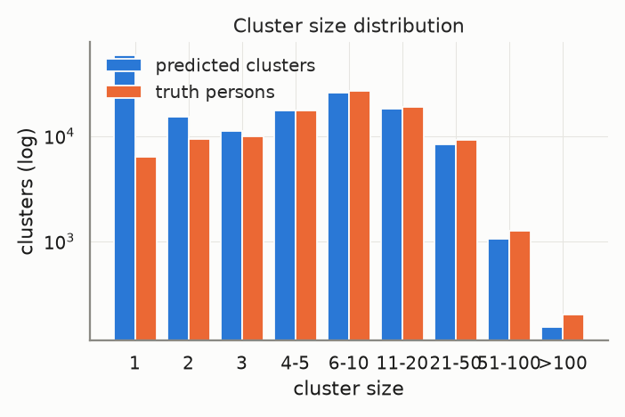
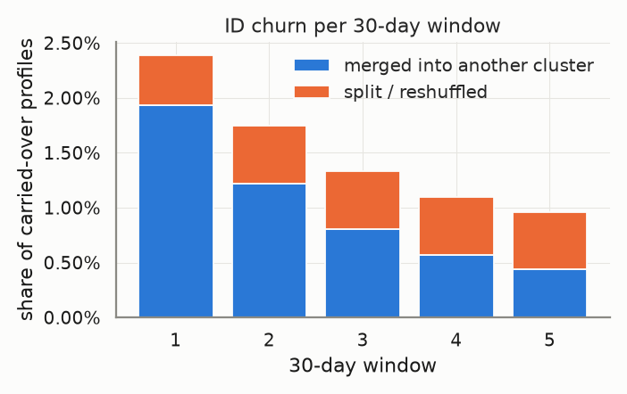
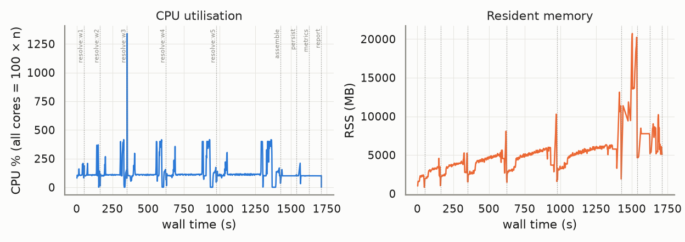

# Evaluation report — `large-v2`

_Generated 2026-10-22T13:21:21 · dataset `large` · resolver `aurora_cdp` · threshold 0.6 (engine scale 3.0) · block cap 100 · seed 20261022_

## Provenance

```json
{
  "adapter": "aurora_cdp",
  "aurora_cdp_commit": "b346bf23acb4d8d1fef0af03b6d03a49ddbd0b9e",
  "aurora_cdp_commit_source": "git",
  "aurora_cdp_dirty_worktree": false,
  "aurora_cdp_path": "/home/ubuntu/Projects/aurora-cdp-v2",
  "aurora_cdp_version": "0.1.0",
  "harness_commit": "1211f2017a2dcaf198a4002f7323561ee6e8edca",
  "harness_version": "0.1.0",
  "seed": 20261022,
  "dataset": "/home/ubuntu/data/aurora-testdata/large",
  "run_at": "2026-10-22T12:52:48+00:00",
  "host": {
    "platform": "Linux",
    "platform_release": "7.0.0-1014-aws",
    "machine": "x86_64",
    "python": "3.11.17",
    "cpu_count": 16,
    "mem_total_gb": 132.21,
    "hostname": "ip-172-31-45-65"
  },
  "run_name": "large-v2",
  "input_hash": "1eb4a7e09922ec747484",
  "dataset_manifest_fingerprint": 18066770612093278047,
  "dataset_seed": 42,
  "sample": null
}
```

<details><summary><code>adapter config</code></summary>

```json
{
  "cdp_path": "/home/ubuntu/Projects/aurora-cdp-v2",
  "config": {
    "matcher": {
      "max_expanded_pairs": 200000000
    }
  },
  "threshold": 0.6,
  "datasource_column": "source",
  "datasource": "input",
  "windows": "replay",
  "deterministic_ids": true,
  "seed": 20261022,
  "isolate_windows": true,
  "max_stored_pairs": 150000000,
  "epoch": "2026-01-01",
  "window_days": 30,
  "retries": 1,
  "timeout_s": 21600.0,
  "threshold_raw": 3.0,
  "score_scale": 5.0,
  "engine_path": "/home/ubuntu/Projects/aurora-cdp-v2"
}
```

</details>

<details><summary><code>aurora_cdp_config (resolved / expanded)</code></summary>

```json
{
  "workspace": ".aurora",
  "outputs_dir": "outputs",
  "db_file": "aurora.duckdb",
  "normalize": {
    "default_region": "US",
    "phone_use_last10_for_match": true,
    "email_strip_plus_tag": true,
    "email_strip_gmail_dots": false,
    "nickname_file": null,
    "address_parsing": false,
    "email_junk_local_parts": [
      "test",
      "no",
      "none",
      "reservation",
      "admin",
      "contact",
      "guest",
      "info",
      "noreply",
      "no-reply",
      "donotreply",
      "unknown"
    ],
    "address_abbreviations": {
      "ST": "STREET",
      "AVE": "AVENUE",
      "RD": "ROAD",
      "BLVD": "BOULEVARD",
      "DR": "DRIVE",
      "LN": "LANE",
      "CT": "COURT",
      "STE": "SUITE",
      "APT": "APARTMENT",
      "N": "NORTH",
      "S": "SOUTH",
      "E": "EAST",
      "W": "WEST",
      "1ST": "FIRST",
      "2ND": "SECOND",
      "3RD": "THIRD"
    }
  },
  "blocklist": {
    "email_max_given_names": 20,
    "email_max_surnames": 20,
    "phone_max_given_names": 20,
    "address_max_given_names": 40,
    "manual": {}
  },
  "blocking": {
    "block_size_limit": 100,
    "fk_block_size_limit": 1000,
    "max_pairs_per_block": 500000,
    "refine_target": 100,
    "sn_window": 25,
    "collapse_trivial_dupes": true,
    "dupe_group_requires_identifier": true,
    "dupe_group_identifier_fields": [
      "email_norm",
      "phone_match",
      "address_norm",
      "loy_id_norm",
      "ck"
    ],
    "persist_blocking_keys": true,
    "strategy_source": "fixed",
    "learned_strategies_file": null,
    "learned_keep_types": [
      "ck",
      "loy_id",
      "fk"
    ],
    "dnf": {
      "max_terms": 2,
      "min_positive_pairs": 200,
      "min_predicate_pc": 0.01,
      "target_pc": 0.95,
      "min_gain_pairs": 5,
      "pairs_per_record_budget": 20,
      "sample_records": 20000,
      "sample_positive_pairs": 5000,
      "sample_seed": 0,
      "labels": "self"
    },
    "refine_keys": {
      "email": [
        "name3",
        "postal",
        "birthdate",
        "update_month",
        "given3"
      ],
      "phone": [
        "name3",
        "postal",
        "birthdate",
        "update_month",
        "given3"
      ],
      "name_postal": [
        "email",
        "phone",
        "birthdate",
        "house_number",
        "update_month"
      ],
      "name_birthdate": [
        "email",
        "phone",
        "postal",
        "house_number",
        "update_month"
      ],
      "name": [
        "postal",
        "birthdate",
        "email",
        "phone",
        "house_number",
        "update_month"
      ],
      "loy_id": [
        "name3",
        "postal",
        "birthdate",
        "update_month"
      ],
      "ck": [
        "name3",
        "postal",
        "birthdate",
        "update_month"
      ],
      "fk": [
        "name3",
        "postal",
        "birthdate",
        "update_month"
      ],
      "dnf": [
        "postal",
        "birthdate",
        "email",
        "phone",
        "name3",
        "update_month"
      ]
    },
    "strategies": [
      {
        "name": "email_exact",
        "type": "email"
      },
      {
        "name": "phone_exact",
        "type": "phone"
      },
      {
        "name": "name_postal",
        "type": "name_postal"
      },
      {
        "name": "name_birthdate",
        "type": "name_birthdate"
      },
      {
        "name": "name",
        "type": "name",
        "max_pairs_per_block": 50000
      },
      {
        "name": "loy_id_exact",
        "type": "loy_id"
      },
      {
        "name": "ck_exact",
        "type": "ck"
      },
      {
        "name": "fk",
        "type": "fk"
      }
    ]
  },
  "matcher": {
    "match_threshold": 3.25,
    "scorer": "rules",
    "ordinal": {
      "model_file": null,
      "retrain": "auto",
      "save_model": true,
      "apply_rules_first": true,
      "levels": 3,
      "self_train_rounds": 3,
      "confidence_margin": 1.0,
      "negatives_per_positive": 2.0,
      "hard_negative_min_disagreements": 2,
      "max_train_pairs": 40000,
      "min_positive_pairs": 300,
      "min_negative_pairs": 300,
      "l2": 0.001,
      "lr": 0.05,
      "epochs": 300,
      "sample_seed": 0,
      "monotone": false
    },
    "score_chunk_size": 250000,
    "persist_features": false,
    "export_expanded_dupe_pairs": true,
    "max_expanded_pairs": 200000000,
    "deterministic": {
      "ck_exact_score": 5.0,
      "loy_exact_score": 5.0,
      "email_exact_with_name_score": 4.5,
      "phone_exact_with_name_score": 4.2,
      "name_agreement_min": 0.85
    },
    "weights": {
      "bias": -2.5,
      "given_sim": 1.0,
      "surname_sim": 1.2,
      "email_exact": 3.0,
      "email_sim": 0.5,
      "email_sim_min": 0.92,
      "phone_exact": 2.5,
      "address_sim": 1.2,
      "postal_exact": 0.6,
      "birthdate_exact": 1.5,
      "fk_shared": 1.0,
      "name_mismatch_penalty": -1.5,
      "name_mismatch_floor": 0.6,
      "address_house_number_mismatch_cap": 0.3,
      "birthdate_conflict": -3.0
    },
    "trivial_dupe": {
      "fields": [
        "given_name_norm",
        "surname_norm",
        "email_norm",
        "phone_match",
        "address_norm",
        "postal_norm",
        "birthdate_norm"
      ],
      "identifier_fields": [
        "email_norm",
        "phone_match",
        "address_norm"
      ],
      "requires_identifier": true
    },
    "hard_conflicts": {
      "birthdate": true,
      "birthdate_typo_tolerance": 2
    }
  },
  "cluster": {
    "supersized_min_size": 500,
    "linkage": "fusion",
    "fusion": {
      "tiers": [
        4.75,
        4.0
      ],
      "strong_edge_score": 4.0,
      "min_cross_edges": 2,
      "min_cross_edge_ratio": 0.1
    },
    "carve": {
      "enabled": true,
      "max_cluster_size": 500
    },
    "conflict_attributes": [
      "birthdate",
      "given_name"
    ],
    "conflict_tolerances": {
      "birthdate": {
        "measure": "levenshtein_max",
        "value": 2
      },
      "given_name": {
        "measure": "jaro_winkler_min",
        "value": 0.6
      },
      "contact": {
        "measure": "any_overlap"
      }
    },
    "conflict_columns": {
      "birthdate": "birthdate_norm",
      "given_name": "given_name_canon",
      "surname": "surname_norm",
      "ck": "ck",
      "loy_id": "loy_id_norm",
      "contact": [
        "email_norm",
        "phone_match"
      ]
    }
  },
  "identity": {
    "ampid_mode": true,
    "external_id_name": "amperity_id",
    "email_ampid_assignment": true
  },
  "household": {
    "build_with_profile": true,
    "min_evidence_weight": 1.0,
    "evidence_ttl_days": 365,
    "max_customers_per_value": 25,
    "evidence": {
      "shared_address": {
        "weight": 1.0,
        "columns": [
          "address_norm",
          "postal_norm"
        ]
      },
      "shared_surname_postal": {
        "weight": 0.4,
        "columns": [
          "surname_norm",
          "postal_norm"
        ]
      },
      "shared_phone": {
        "weight": 0.6,
        "columns": [
          "phone_match"
        ]
      },
      "relationship": {
        "weight": 1.0
      }
    }
  },
  "labels": {
    "file": null
  },
  "storage": {
    "duckdb": {
      "memory_limit": "3GB",
      "threads": 4,
      "temp_directory": null,
      "preserve_insertion_order": false
    }
  },
  "stable_id": {
    "enabled": true,
    "jitter_alert_pct": 2.0,
    "tie_break": "stable"
  },
  "survivorship": {
    "source_priority": {
      "loyalty": 1,
      "crm": 2,
      "ecommerce": 3,
      "pos": 4
    },
    "field_priority": {},
    "recency_field": "update_dt",
    "attributes": [
      "given_name",
      "surname",
      "email",
      "phone",
      "address",
      "address2",
      "city",
      "state",
      "postal",
      "country",
      "birthdate"
    ]
  },
  "sources": {},
  "tuning": {
    "thresholds": [
      2.0,
      2.5,
      3.0,
      3.5,
      4.0
    ],
    "min_precision": 0.98
  }
}
```

</details>

## Key metrics

```
pairwise P=0.995 R=0.850 F1=0.917 | B3 F1=0.934 | false-merge clusters=0.83% (profiles 1.78%) | split persons=38.11% | ID churn/30d mean=1.51% max=2.39% | AUC-ROC=0.960 AP=0.902 blocking-recall=0.872
```

| Metric | Value |
|---|---|
| Pairwise precision / recall / F1 | 0.995 / 0.850 / 0.917 |
| Pairs: TP / FP / FN | 10,446,397 / 51,337 / 1,842,953 |
| B-cubed precision / recall / F1 | 0.995 / 0.881 / 0.934 |
| Clusters predicted / truth persons (ratio) | 155,629 / 100,000 (1.556) |
| Exact-match clusters | 60,977 (60.98% of persons) |
| **False-merge rate** (clusters / profiles / pairs) | 0.83% / 1.78% / 0.49% |
| Over-merged clusters (max persons in one) | 1,291 (3) |
| Split persons (profiles) | 38,112 = 38.11% (56.72% of profiles) |
| **ID churn per 30-day window** mean / max | 1.51% / 2.39% |
| Harmful share of churn (purity dropped) | 5.78% |
| AUC-ROC / average precision (candidate pairs) | 0.960 / 0.902 |
| Blocking recall (true pairs reaching scoring) | 0.872 |
| Operating point P / R-in-candidates / effective R | 0.980 / 0.854 / 0.745 |
| Scored candidate pairs (stored fraction) | 59,767,006 (100.00%) |

> **Notes**
> - Engine scores are normalised from the 0–5 band scale to [0, 1] (score/5); the operating threshold 0.60 is the engine's 3.0 on its own scale.
> - The threshold sweep re-clusters engine pair scores with plain connected components, so it approximates (does not reproduce) the engine's conflict-aware clustering at other thresholds.

## Dataset

| | |
|---|---|
| persons | 100,000 |
| persons_with_profiles | 100,000 |
| profiles | 1,000,000 |
| months | 6 |
| true_pairs | 12,289,350 |
| households | 6,685 |
| movers | 9,963 |
| exact_duplicates | 90,560 |
| profiles_per_person_max | 547 |

Regenerate: `python scripts/generate.py --tier large --seed 42`

## Resolver run

| | |
|---|---|
| time: engine_load | 15.36s |
| time: engine_blocking | 34.14s |
| time: engine_scoring | 814.32s |
| time: engine_clustering | 63.65s |
| time: engine_stable_id | 7.47s |
| time: engine_persist | 9.51s |
| time: resolve_windows | 1382.06s |
| time: wall_total | 1535.93s |
| candidate pairs | 59,767,006 |
| block `engine (final snapshot)` | 25,161,113 pairs, 297,487 groups, 0 over cap (n/a) |

Engine snapshots (one engine run per replayed window; `previous=` carries stable ids forward):

| window | run_date | records | pairs scored | edges | clusters | skipped blocks | jitter % | ids minted | ids retired | engine s |
|---|---|---|---|---|---|---|---|---|---|---|
| 0 | 2026-01-31 | 166,947 | 3,530,613 | 179,333 | 78,641 | 0 | 0.0 | 78641 | 0 | 44.54 |
| 1 | 2026-03-02 | 332,940 | 10,901,213 | 577,184 | 107,511 | 0 | 2.3888 | 31635 | 2765 | 108.27 |
| 2 | 2026-04-01 | 499,787 | 20,083,744 | 1,106,584 | 124,567 | 0 | 1.7505 | 20205 | 3149 | 183.98 |
| 3 | 2026-05-01 | 666,532 | 32,178,002 | 1,719,648 | 136,694 | 0 | 1.3352 | 15084 | 2957 | 266.48 |
| 4 | 2026-05-31 | 833,752 | 44,414,691 | 2,393,781 | 146,864 | 0 | 1.1012 | 12747 | 2577 | 344.43 |
| 5 | 2026-06-30 | 1,000,000 | 59,767,006 | 3,113,343 | 155,629 | 0 | 0.9613 | 11012 | 2247 | 434.36 |

## Score quality (candidate pairs)

 



## Threshold sweep (final window)

| threshold | precision | recall | F1 | B³ F1 | false-merge clusters | split persons | clusters |
|---|---|---|---|---|---|---|---|
| 0.30 | 0.000 | 0.984 | 0.000 | 0.175 | 19.86% | 8.30% | 18,468 |
| 0.35 | 0.000 | 0.984 | 0.000 | 0.189 | 19.09% | 8.82% | 20,252 |
| 0.40 | 0.000 | 0.983 | 0.000 | 0.243 | 20.49% | 9.28% | 23,961 |
| 0.45 | 0.447 | 0.925 | 0.602 | 0.870 | 6.70% | 31.33% | 124,793 |
| 0.50 | 0.691 | 0.916 | 0.788 | 0.891 | 5.43% | 33.69% | 133,527 |
| 0.55 | 0.722 | 0.916 | 0.808 | 0.896 | 5.11% | 33.83% | 134,992 |
| 0.60 | 0.775 | 0.916 | 0.839 | 0.906 | 4.52% | 33.87% | 136,947 |
| 0.65 | 0.905 | 0.916 | 0.910 | 0.930 | 2.58% | 33.99% | 141,908 |
| 0.70 | 0.908 | 0.915 | 0.912 | 0.930 | 2.52% | 34.28% | 142,510 |
| 0.75 | 0.909 | 0.910 | 0.909 | 0.928 | 2.45% | 35.80% | 145,390 |
| 0.80 | 0.910 | 0.897 | 0.903 | 0.921 | 2.29% | 39.44% | 153,053 |
| 0.85 | 0.917 | 0.738 | 0.818 | 0.821 | 1.28% | 68.73% | 242,124 |
| 0.90 | 0.966 | 0.534 | 0.688 | 0.624 | 0.35% | 87.18% | 440,131 |
| 0.95 | 0.982 | 0.285 | 0.442 | 0.455 | 0.20% | 90.88% | 526,860 |

Best F1 on this grid: threshold **0.70** (F1 0.912). Run `scripts/tune.py` for finer grids, precision-constrained objectives and weight search.



## Clusters



| | predicted | truth |
|---|---|---|
| mean | 6.43 | 10.00 |
| p50 | 3.00 | 6.00 |
| p90 | 16.00 | 21.00 |
| p99 | 46.00 | 58.00 |
| max | 386 | 547 |
| singletons | 58,143 | 6,356 |

## Over-merge detector

1,291 predicted clusters conflate ≥2 persons, covering 17,791 profiles and 2,416 persons. 190,178 accepted edges cross a person boundary.

Which agreeing feature carried the bad edges (an edge can count in several columns; `only` = that feature was the sole agreement):

| feature | bad edges agreeing | sole agreement |
|---|---|---|
| engine_scored | 183,272 | 183,272 |
| engine_deterministic | 6,727 | 6,727 |
| engine_trivial_duplicate | 179 | 179 |
| email | 0 | 0 |
| phone | 0 | 0 |
| dob | 0 | 0 |
| postal | 0 | 0 |
| name | 0 | 0 |
| addr | 0 | 0 |

Worst clusters (full list in `overmerge_clusters.json`, edges in `overmerge_edges.parquet`):

| cluster | persons | profiles | dominant feature | sample names by person |
|---|---|---|---|---|
| `w0-59d4eccd6421ec8f` | 3 | 46 | engine_scored | ps_0027470: J SMITH, John Smith; ps_0025740: john smith, jonh smmith; ps_0002109: John Schmidt |
| `w0-cd272df85f8a09fd` | 3 | 45 | engine_scored | ps_0009835: JAMES ROBERTSON, James Robertson; ps_0001098: julie robertson; ps_0029814: J Robertson |
| `w2-5cdc4b97389b0f28` | 3 | 37 | engine_scored | ps_0048503: C CASTILLO, charlse castillo; ps_0082390: Christine Castillo, christine castillo; ps_0041886: Charles Castillo |
| `w0-4c5cd7229f357847` | 3 | 35 | engine_deterministic | ps_0056753: James Smith, jamees smith; ps_0028303: J Smith, Jim Smith; ps_0033404: James Smith |
| `w0-087c04908fb38ca1` | 3 | 34 | engine_scored | ps_0016149: John Smith, john smith; ps_0010033: john smith; ps_0042130: john smith |
| `w0-3814325664f46fd3` | 3 | 32 | engine_scored | ps_0045823: Richard Flores; ps_0057590: Richard Freeeman, richard rfeeman; ps_0013395: Priya Freeman, priya |
| `w0-7fe9748fed8ef3bd` | 3 | 30 | engine_scored | ps_0090959: Rachel, Rachel Perez; ps_0009626: Michael Perez, michael perez; ps_0099369: michael perez |
| `w0-792c625e4bfff1af` | 3 | 22 | engine_scored | ps_0089520: charles brown; ps_0032571: CHRISTOPHER BROWN, christopher brown; ps_0034404: c brown |
| `w0-9ca3e0d98a68b498` | 3 | 22 | engine_scored | ps_0055056: richard avis, richard davis; ps_0082222: Michael Davis, michael davis; ps_0089194: Richard Davis |
| `w2-9b155c23a43c1dc2` | 3 | 22 | engine_scored | ps_0096133: James, James Alexander; ps_0003245: JASON ALEXANDER, jason alexander; ps_0017266: James Alexander |
| `w0-572ab7cbc0078de0` | 3 | 21 | engine_scored | ps_0089628: Michael Rice; ps_0012472: MICHAEL RICE, michael rice; ps_0097049: Daniel Rice, daniel rice |
| `w0-670457b6773e11c2` | 3 | 20 | engine_scored | ps_0063400: Ronald Allen; ps_0060282: John Allen; ps_0094698: John Allen, john allen |

## ID churn per 30-day window

Churn = carried-over profiles whose stable cluster id changed vs the previous window. *merge* = the profile's whole previous cluster was absorbed; *split* = otherwise. *harmful* = the profile's new cluster is less pure for its true person than the old one.



| window | profiles | clusters | new | carried | churned | churn rate | merge | split | harmful | justified |
|---|---|---|---|---|---|---|---|---|---|---|
| 0 | 166,947 | 78,641 | – | – | – | – | – | – | – | – |
| 1 | 332,940 | 107,511 | 165,993 | 166,947 | 3,988 | 2.39% | 3,231 | 757 | 207 | 3,781 |
| 2 | 499,787 | 124,567 | 166,847 | 332,940 | 5,828 | 1.75% | 4,064 | 1,764 | 331 | 5,497 |
| 3 | 666,532 | 136,694 | 166,745 | 499,787 | 6,673 | 1.34% | 4,008 | 2,665 | 415 | 6,258 |
| 4 | 833,752 | 146,864 | 167,220 | 666,532 | 7,340 | 1.10% | 3,794 | 3,546 | 420 | 6,920 |
| 5 | 1,000,000 | 155,629 | 166,248 | 833,752 | 8,015 | 0.96% | 3,657 | 4,358 | 469 | 7,546 |

Quality per window snapshot:

| window | profiles | precision | recall | F1 | false-merge clusters |
|---|---|---|---|---|---|
| 0 | 166,947 | 0.993 | 0.847 | 0.914 | 0.44% |
| 1 | 332,940 | 0.994 | 0.862 | 0.923 | 0.62% |
| 2 | 499,787 | 0.994 | 0.864 | 0.924 | 0.71% |
| 3 | 666,532 | 0.994 | 0.863 | 0.924 | 0.78% |
| 4 | 833,752 | 0.995 | 0.856 | 0.920 | 0.80% |
| 5 | 1,000,000 | 0.995 | 0.850 | 0.917 | 0.83% |

## Resources

Wall 1711.7s · peak RSS 20,715 MB · mean CPU 129% (peak 1340%, 16 cores) · 801 samples @ 2.0s



| stage | wall s | peak RSS MB | mean CPU % |
|---|---|---|---|
| resolve:w0 | 47.7 | 2,433 | 119 |
| resolve:w1 | 112.3 | 4,572 | 126 |
| resolve:w2 | 189.0 | 5,270 | 127 |
| resolve:w3 | 273.1 | 8,076 | 139 |
| resolve:w4 | 352.2 | 10,281 | 133 |
| resolve:w5 | 450.3 | 13,124 | 135 |
| assemble | 111.4 | 20,715 | 100 |
| persist | 88.7 | 8,476 | 102 |
| metrics | 86.5 | 10,219 | 100 |
| report | 0.0 | 5,066 | 50 |

## Failures and retries

0 stage failure(s), 0 retry(ies). Full log: `events.jsonl`.

## Metric validation

17 golden/sanity cases, 91 hand-computed checks run through `aurora_eval.score` (the reports' own code path) — **ALL PASSED**. Metrics marked *untrusted* have no independent check and must not be used for gating.

| metric | status | basis |
|---|---|---|
| pairwise.precision/recall/f1 | ✅ validated | A: pairwise |
| pairwise.tp/fp/fn pairs | ✅ validated | A: pairwise |
| cluster.bcubed_precision/recall/f1 | ✅ validated | A: B-cubed |
| cluster.false_merge (cluster/profile/pair) | ✅ validated | A: false-merge |
| cluster.split (persons/profiles) | ✅ validated | A: split |
| cluster.exact_match_rate / cluster_count_ratio | ✅ validated | A: exact / ratio |
| cluster.pred_size_dist / truth_size_dist | ✅ validated | A: size distributions |
| churn.rate / merge vs split | ✅ validated | C: churn rate, merge vs split |
| churn.harmful vs justified | ✅ validated | C: harmful vs justified |
| curves.blocking_recall | ✅ validated | A: blocking recall |
| curves.auc_roc / average_precision | ✅ validated | A: ROC / PR |
| curves.operating_point | ✅ validated | A: operating point @0.75 |
| per_window quality | ✅ validated | C: per-window quality |
| sanity: perfect input | ✅ validated | perfect prediction |
| sanity: all-singleton input | ✅ validated | all singletons |
| sanity: all-merged input | ✅ validated | everything merged |
| sanity: disjoint prediction | ✅ validated | disjoint prediction |
| sanity: disjoint pairs file | ✅ validated | pairs file with no true pair |
| threshold_sweep | ≈ approximation | approximation — harness connected components over engine pair scores; not the engine's conflict-aware clustering |
| overmerge.dominant_feature | ⚠️ untrusted | untrusted — attribution by engine match_type only (engine pair features are not exported) |
| curves.score_hist | ⚠️ untrusted | untrusted — diagnostic histogram, no golden case |
| engine.metrics (pairs_blocked, skipped_blocks, cluster_size_distribution, timings) | ⚠️ untrusted | untrusted — reported verbatim from the engine, not independently recomputed |
| engine.jitter_pct per snapshot | ✅ cross-checked | engine jitter == harness churn rate per window |

## Reproduce

```bash
# dataset: /home/ubuntu/data/aurora-testdata/large  (regenerate: python scripts/generate.py --tier large --seed 42)
python -m aurora_eval.cli run --adapter aurora_cdp --cdp-path /home/ubuntu/Projects/aurora-cdp-v2 --dataset large --seed 20261022 --run-name large-v2 --date 2026-10-22 --isolate-windows --resource-interval 2 --timeout-s 21600 --max-stored-pairs 150000000 --cdp-config {"matcher": {"max_expanded_pairs": 200000000}} --data-dir /home/ubuntu/data/aurora-testdata --reports-root ../aurora-cdp/reports
# resume after interruption: same command (checkpoints in /home/ubuntu/Projects/aurora-eval-harness/runs/large-v2/checkpoints)
```

## Files

- `metrics.json` — everything above, machine-readable (same shape as `aurora_eval.score()` output)
- `plots/` — PNGs embedded here
- `overmerge_clusters.json`, `overmerge_edges.parquet` — drill-down for the detector
- `provenance.json`, `resources.jsonl`, `events.jsonl`, `state.json` — provenance, resource samples, failure/retry log, stage state
