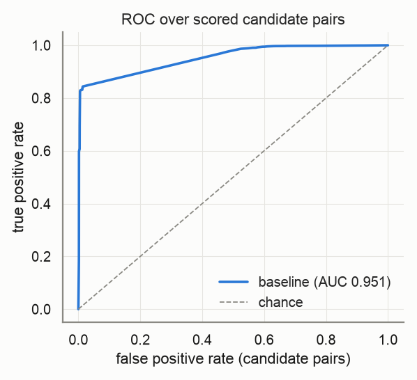
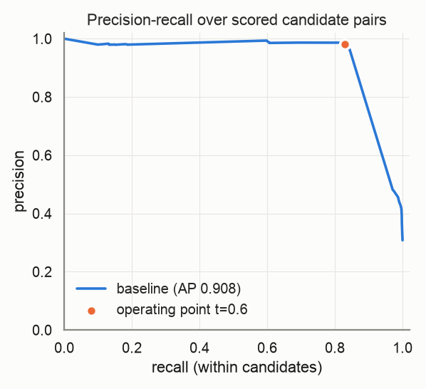
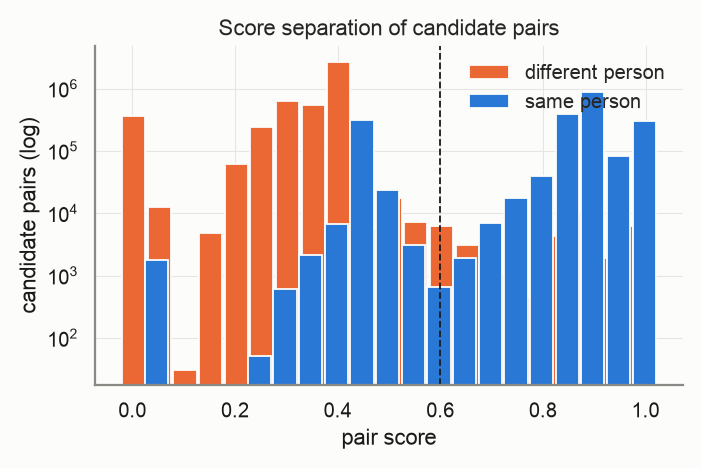
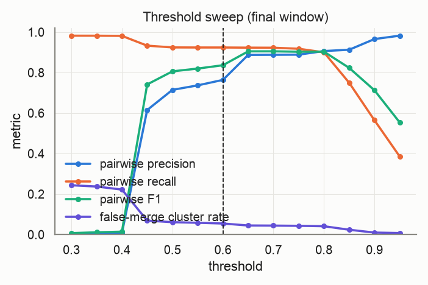
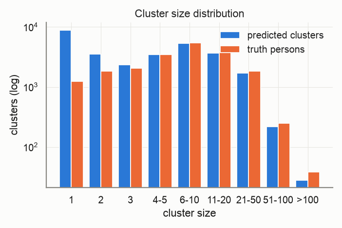
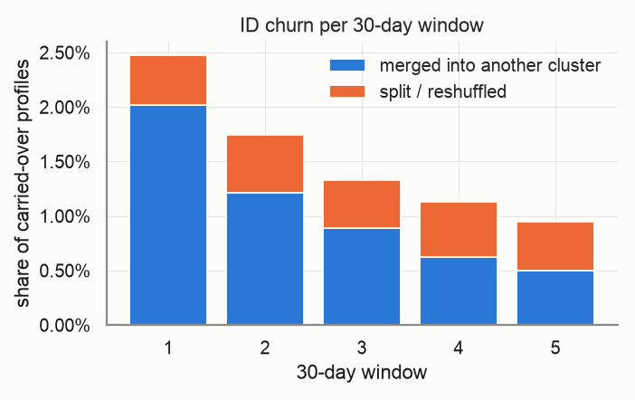
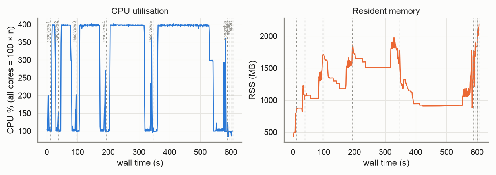

# Evaluation report — `medium-v2`

_Generated 2026-10-22T16:14:52 · dataset `medium` · resolver `aurora_cdp` · threshold 0.6 (engine scale 3.0) · block cap 100 · seed 20261022_

## Provenance

```json
{
  "adapter": "aurora_cdp",
  "aurora_cdp_commit": "26bea50c2f4f85b1f46073e1422dd9bb2032ea1f",
  "aurora_cdp_commit_source": "git",
  "aurora_cdp_dirty_worktree": false,
  "aurora_cdp_path": "/Users/harshmaster/Desktop/Projects/aurora-cdp",
  "aurora_cdp_version": "0.1.0",
  "harness_commit": "1211f2017a2dcaf198a4002f7323561ee6e8edca",
  "harness_version": "0.1.0",
  "seed": 20261022,
  "dataset": "/Users/harshmaster/Documents/aanya/datasets/aurora-testdata/medium",
  "run_at": "2026-10-22T10:34:45+00:00",
  "host": {
    "platform": "macOS",
    "platform_release": "25.5.0",
    "machine": "arm64",
    "python": "3.11.11",
    "cpu_count": 8,
    "mem_total_gb": 8.59,
    "hostname": "Harshs-Macbook-Air"
  },
  "run_name": "medium-v2",
  "input_hash": "dd208b342b6b8a828098",
  "dataset_manifest_fingerprint": 7100844426990289322,
  "dataset_seed": 42,
  "sample": null
}
```

<details><summary><code>adapter config</code></summary>

```json
{
  "cdp_path": null,
  "config": null,
  "threshold": 0.6,
  "datasource_column": "source",
  "datasource": "input",
  "windows": "replay",
  "deterministic_ids": true,
  "seed": 20261022,
  "isolate_windows": false,
  "max_stored_pairs": 20000000,
  "epoch": "2026-01-01",
  "window_days": 30,
  "retries": 1,
  "timeout_s": null,
  "threshold_raw": 3.0,
  "score_scale": 5.0,
  "engine_path": "/Users/harshmaster/Desktop/Projects/aurora-cdp"
}
```

</details>

<details><summary><code>aurora_cdp_config (resolved / expanded)</code></summary>

```json
{
  "workspace": ".aurora",
  "outputs_dir": "outputs",
  "db_file": "aurora.duckdb",
  "normalize": {
    "default_region": "US",
    "phone_use_last10_for_match": true,
    "email_strip_plus_tag": true,
    "email_strip_gmail_dots": false,
    "nickname_file": null,
    "address_parsing": false,
    "email_junk_local_parts": [
      "test",
      "no",
      "none",
      "reservation",
      "admin",
      "contact",
      "guest",
      "info",
      "noreply",
      "no-reply",
      "donotreply",
      "unknown"
    ],
    "address_abbreviations": {
      "ST": "STREET",
      "AVE": "AVENUE",
      "RD": "ROAD",
      "BLVD": "BOULEVARD",
      "DR": "DRIVE",
      "LN": "LANE",
      "CT": "COURT",
      "STE": "SUITE",
      "APT": "APARTMENT",
      "N": "NORTH",
      "S": "SOUTH",
      "E": "EAST",
      "W": "WEST",
      "1ST": "FIRST",
      "2ND": "SECOND",
      "3RD": "THIRD"
    }
  },
  "blocklist": {
    "email_max_given_names": 20,
    "email_max_surnames": 20,
    "phone_max_given_names": 20,
    "address_max_given_names": 40,
    "manual": {}
  },
  "blocking": {
    "block_size_limit": 100,
    "fk_block_size_limit": 1000,
    "max_pairs_per_block": 500000,
    "refine_target": 100,
    "sn_window": 25,
    "collapse_trivial_dupes": true,
    "persist_blocking_keys": true,
    "strategy_source": "fixed",
    "learned_strategies_file": null,
    "learned_keep_types": [
      "ck",
      "loy_id",
      "fk"
    ],
    "dnf": {
      "max_terms": 2,
      "min_positive_pairs": 200,
      "min_predicate_pc": 0.01,
      "target_pc": 0.95,
      "min_gain_pairs": 5,
      "pairs_per_record_budget": 20,
      "sample_records": 20000,
      "sample_positive_pairs": 5000,
      "sample_seed": 0,
      "labels": "self"
    },
    "refine_keys": {
      "email": [
        "name3",
        "postal",
        "birthdate",
        "update_month",
        "given3"
      ],
      "phone": [
        "name3",
        "postal",
        "birthdate",
        "update_month",
        "given3"
      ],
      "name_postal": [
        "email",
        "phone",
        "birthdate",
        "house_number",
        "update_month"
      ],
      "name_birthdate": [
        "email",
        "phone",
        "postal",
        "house_number",
        "update_month"
      ],
      "name": [
        "postal",
        "birthdate",
        "email",
        "phone",
        "house_number",
        "update_month"
      ],
      "loy_id": [
        "name3",
        "postal",
        "birthdate",
        "update_month"
      ],
      "ck": [
        "name3",
        "postal",
        "birthdate",
        "update_month"
      ],
      "fk": [
        "name3",
        "postal",
        "birthdate",
        "update_month"
      ],
      "dnf": [
        "postal",
        "birthdate",
        "email",
        "phone",
        "name3",
        "update_month"
      ]
    },
    "strategies": [
      {
        "name": "email_exact",
        "type": "email"
      },
      {
        "name": "phone_exact",
        "type": "phone"
      },
      {
        "name": "name_postal",
        "type": "name_postal"
      },
      {
        "name": "name_birthdate",
        "type": "name_birthdate"
      },
      {
        "name": "name",
        "type": "name",
        "max_pairs_per_block": 50000
      },
      {
        "name": "loy_id_exact",
        "type": "loy_id"
      },
      {
        "name": "ck_exact",
        "type": "ck"
      },
      {
        "name": "fk",
        "type": "fk"
      }
    ]
  },
  "matcher": {
    "match_threshold": 3.25,
    "scorer": "rules",
    "ordinal": {
      "model_file": null,
      "retrain": "auto",
      "save_model": true,
      "apply_rules_first": true,
      "levels": 3,
      "self_train_rounds": 3,
      "confidence_margin": 1.0,
      "negatives_per_positive": 2.0,
      "hard_negative_min_disagreements": 2,
      "max_train_pairs": 40000,
      "min_positive_pairs": 300,
      "min_negative_pairs": 300,
      "l2": 0.001,
      "lr": 0.05,
      "epochs": 300,
      "sample_seed": 0,
      "monotone": false
    },
    "score_chunk_size": 250000,
    "persist_features": false,
    "export_expanded_dupe_pairs": true,
    "max_expanded_pairs": 50000000,
    "deterministic": {
      "ck_exact_score": 5.0,
      "loy_exact_score": 5.0,
      "email_exact_with_name_score": 4.5,
      "phone_exact_with_name_score": 4.2,
      "name_agreement_min": 0.85
    },
    "weights": {
      "bias": -2.5,
      "given_sim": 1.0,
      "surname_sim": 1.2,
      "email_exact": 3.0,
      "email_sim": 0.5,
      "email_sim_min": 0.92,
      "phone_exact": 2.5,
      "address_sim": 1.2,
      "postal_exact": 0.6,
      "birthdate_exact": 1.5,
      "fk_shared": 1.0,
      "name_mismatch_penalty": -1.5,
      "name_mismatch_floor": 0.6,
      "address_house_number_mismatch_cap": 0.3,
      "birthdate_conflict": -3.0
    },
    "hard_conflicts": {
      "birthdate": true,
      "birthdate_typo_tolerance": 2
    }
  },
  "cluster": {
    "supersized_min_size": 500,
    "conflict_attributes": [
      "birthdate",
      "given_name"
    ],
    "conflict_tolerances": {
      "birthdate": {
        "measure": "levenshtein_max",
        "value": 2
      },
      "given_name": {
        "measure": "jaro_winkler_min",
        "value": 0.6
      }
    },
    "conflict_columns": {
      "birthdate": "birthdate_norm",
      "given_name": "given_name_canon",
      "surname": "surname_norm",
      "ck": "ck",
      "loy_id": "loy_id_norm"
    }
  },
  "labels": {
    "file": null
  },
  "storage": {
    "duckdb": {
      "memory_limit": "3GB",
      "threads": 4,
      "temp_directory": null,
      "preserve_insertion_order": false
    }
  },
  "stable_id": {
    "enabled": true,
    "jitter_alert_pct": 2.0
  },
  "survivorship": {
    "source_priority": {
      "loyalty": 1,
      "crm": 2,
      "ecommerce": 3,
      "pos": 4
    },
    "field_priority": {},
    "recency_field": "update_dt",
    "attributes": [
      "given_name",
      "surname",
      "email",
      "phone",
      "address",
      "address2",
      "city",
      "state",
      "postal",
      "country",
      "birthdate"
    ]
  },
  "sources": {},
  "tuning": {
    "thresholds": [
      2.0,
      2.5,
      3.0,
      3.5,
      4.0
    ],
    "min_precision": 0.98
  }
}
```

</details>

## Key metrics

```
pairwise P=0.990 R=0.869 F1=0.926 | B3 F1=0.934 | false-merge clusters=2.51% (profiles 4.15%) | split persons=38.27% | ID churn/30d mean=1.53% max=2.48% | AUC-ROC=0.951 AP=0.908 blocking-recall=0.893
```

| Metric | Value |
|---|---|
| Pairwise precision / recall / F1 | 0.990 / 0.869 / 0.926 |
| Pairs: TP / FP / FN | 2,021,167 / 19,425 / 304,020 |
| B-cubed precision / recall / F1 | 0.989 / 0.885 / 0.934 |
| Clusters predicted / truth persons (ratio) | 29,180 / 20,000 (1.459) |
| Exact-match clusters | 12,058 (60.29% of persons) |
| **False-merge rate** (clusters / profiles / pairs) | 2.51% / 4.15% / 0.95% |
| Over-merged clusters (max persons in one) | 733 (32) |
| Split persons (profiles) | 7,655 = 38.27% (56.10% of profiles) |
| **ID churn per 30-day window** mean / max | 1.53% / 2.48% |
| Harmful share of churn (purity dropped) | 7.89% |
| AUC-ROC / average precision (candidate pairs) | 0.951 / 0.908 |
| Blocking recall (true pairs reaching scoring) | 0.893 |
| Operating point P / R-in-candidates / effective R | 0.981 / 0.830 / 0.741 |
| Scored candidate pairs (stored fraction) | 6,737,512 (100.00%) |

> **Notes**
> - Engine scores are normalised from the 0–5 band scale to [0, 1] (score/5); the operating threshold 0.60 is the engine's 3.0 on its own scale.
> - The threshold sweep re-clusters engine pair scores with plain connected components, so it approximates (does not reproduce) the engine's conflict-aware clustering at other thresholds.

## Dataset

| | |
|---|---|
| persons | 20,000 |
| persons_with_profiles | 20,000 |
| profiles | 200,000 |
| months | 6 |
| true_pairs | 2,325,187 |
| households | 1,315 |
| movers | 2,038 |
| exact_duplicates | 17,965 |
| profiles_per_person_max | 275 |

Regenerate: `python scripts/generate.py --persons 20000 --profiles 200000 --months 6 --seed 42 --tier medium`

## Resolver run

| | |
|---|---|
| time: engine_load | 2.43s |
| time: engine_blocking | 429.48s |
| time: engine_scoring | 75.95s |
| time: engine_clustering | 6.0s |
| time: engine_stable_id | 0.97s |
| time: engine_persist | 1.9s |
| time: resolve_windows | 580.73s |
| time: wall_total | 592.4s |
| candidate pairs | 6,737,512 |
| block `engine (final snapshot)` | 2,676,111 pairs, 64,008 groups, 0 over cap (n/a) |

Engine snapshots (one engine run per replayed window; `previous=` carries stable ids forward):

| window | run_date | records | pairs scored | edges | clusters | skipped blocks | jitter % | ids minted | ids retired | engine s |
|---|---|---|---|---|---|---|---|---|---|---|
| 0 | 2026-01-31 | 33,331 | 251,312 | 34,665 | 15,644 | 0 | 0.0 | 15644 | 0 | 9.83 |
| 1 | 2026-03-02 | 66,557 | 913,027 | 113,072 | 21,125 | 0 | 2.4752 | 6075 | 594 | 26.52 |
| 2 | 2026-04-01 | 99,677 | 1,927,934 | 215,648 | 24,221 | 0 | 1.7474 | 3735 | 639 | 57.48 |
| 3 | 2026-05-01 | 132,926 | 3,281,654 | 336,123 | 26,309 | 0 | 1.3313 | 2724 | 636 | 95.16 |
| 4 | 2026-05-31 | 166,430 | 4,817,983 | 469,220 | 27,879 | 0 | 1.1307 | 2124 | 554 | 151.83 |
| 5 | 2026-06-30 | 200,000 | 6,737,512 | 613,129 | 29,180 | 0 | 0.9505 | 1811 | 510 | 239.91 |

## Score quality (candidate pairs)

 



## Threshold sweep (final window)

| threshold | precision | recall | F1 | B³ F1 | false-merge clusters | split persons | clusters |
|---|---|---|---|---|---|---|---|
| 0.30 | 0.003 | 0.982 | 0.007 | 0.478 | 24.35% | 9.86% | 7,770 |
| 0.35 | 0.006 | 0.982 | 0.011 | 0.495 | 23.72% | 10.06% | 8,146 |
| 0.40 | 0.007 | 0.981 | 0.014 | 0.552 | 22.22% | 10.40% | 9,220 |
| 0.45 | 0.615 | 0.933 | 0.742 | 0.904 | 6.88% | 31.71% | 24,369 |
| 0.50 | 0.715 | 0.924 | 0.806 | 0.908 | 6.11% | 34.12% | 25,547 |
| 0.55 | 0.737 | 0.924 | 0.820 | 0.912 | 5.81% | 34.26% | 25,788 |
| 0.60 | 0.764 | 0.924 | 0.836 | 0.916 | 5.45% | 34.28% | 25,984 |
| 0.65 | 0.888 | 0.923 | 0.905 | 0.927 | 4.47% | 34.44% | 26,534 |
| 0.70 | 0.888 | 0.923 | 0.905 | 0.927 | 4.42% | 34.77% | 26,649 |
| 0.75 | 0.889 | 0.918 | 0.903 | 0.925 | 4.31% | 36.41% | 27,219 |
| 0.80 | 0.907 | 0.900 | 0.903 | 0.919 | 4.11% | 40.39% | 28,664 |
| 0.85 | 0.913 | 0.750 | 0.823 | 0.822 | 2.37% | 69.17% | 46,041 |
| 0.90 | 0.966 | 0.565 | 0.713 | 0.644 | 0.98% | 87.08% | 80,060 |
| 0.95 | 0.983 | 0.386 | 0.554 | 0.512 | 0.73% | 90.61% | 95,008 |

Best F1 on this grid: threshold **0.70** (F1 0.905). Run `scripts/tune.py` for finer grids, precision-constrained objectives and weight search.



## Clusters



| | predicted | truth |
|---|---|---|
| mean | 6.85 | 10.00 |
| p50 | 3.00 | 6.00 |
| p90 | 16.00 | 21.00 |
| p99 | 47.00 | 60.00 |
| max | 261 | 275 |
| singletons | 8,912 | 1,238 |

## Over-merge detector

733 predicted clusters conflate ≥2 persons, covering 8,292 profiles and 1,782 persons. 33,842 accepted edges cross a person boundary.

Which agreeing feature carried the bad edges (an edge can count in several columns; `only` = that feature was the sole agreement):

| feature | bad edges agreeing | sole agreement |
|---|---|---|
| engine_scored | 28,590 | 28,590 |
| engine_trivial_duplicate | 4,288 | 4,288 |
| engine_deterministic | 964 | 964 |
| email | 0 | 0 |
| phone | 0 | 0 |
| dob | 0 | 0 |
| postal | 0 | 0 |
| name | 0 | 0 |
| addr | 0 | 0 |

Worst clusters (full list in `overmerge_clusters.json`, edges in `overmerge_edges.parquet`):

| cluster | persons | profiles | dominant feature | sample names by person |
|---|---|---|---|---|
| `w0-97a10dbe96a1d761` | 32 | 36 | engine_trivial_duplicate | ps_0008394: James; ps_0011641: JAMES; ps_0019624: James; ps_0011128: James |
| `w0-976b1b7fd1c5a4bd` | 24 | 33 | engine_trivial_duplicate | ps_0017090: James Smith, james; ps_0008688: James Smith; ps_0002773: james smith; ps_0012322: James Smith |
| `w0-b2c6aba90a683270` | 14 | 27 | engine_trivial_duplicate | ps_0019771: James Williams; ps_0002350: james williams; ps_0006157: James Williams; ps_0019898: James Williams |
| `w5-38ebf4b2512adfa2` | 14 | 18 | engine_trivial_duplicate | ps_0015918: John Smith, john smith; ps_0006835: John Smith; ps_0018869: john smith; ps_0007136: john smith |
| `w0-e08048f04bbac63b` | 14 | 14 | engine_trivial_duplicate | ps_0009815: Robert; ps_0014943: robert; ps_0017285: robert; ps_0001224: Robert |
| `w0-db9e0fcf7975c27b` | 13 | 42 | engine_trivial_duplicate | ps_0019014: robert smith, robert smmith; ps_0005925: Robert Smith; ps_0018244: robert smith; ps_0005506: Robert Smith, robert smith |
| `w0-747a30cc17388b95` | 13 | 14 | engine_trivial_duplicate | ps_0000937: John; ps_0000524: JOHN; ps_0000702: John; ps_0002779: John |
| `w0-da8cc3fa90b0ed1f` | 12 | 26 | engine_trivial_duplicate | ps_0004155: james johnson; ps_0003318: james johnson; ps_0008692: James Johnson, james johnson; ps_0003320: James Johnson |
| `w0-2236c6133103bac3` | 11 | 17 | engine_trivial_duplicate | ps_0010098: john johnson; ps_0015281: JOHN JOHNSON, John Johnson; ps_0001914: John Johnson, john johnson; ps_0018731: John Johnson, john johnson |
| `w0-b308bfc929c10b19` | 11 | 12 | engine_trivial_duplicate | ps_0003867: William Smith; ps_0005495: william smith; ps_0015391: william smith; ps_0017134: William Smith |
| `w0-dcfab4cec522ea32` | 10 | 12 | engine_trivial_duplicate | ps_0008162: michael; ps_0001456: michael; ps_0002997: Michael; ps_0017785: MICHAEL |
| `w0-23f1b84ca8585372` | 9 | 22 | engine_trivial_duplicate | ps_0006110: James Miller, james miller; ps_0012297: James Miller, james miller; ps_0003980: James Miller; ps_0007607: james miller |

## ID churn per 30-day window

Churn = carried-over profiles whose stable cluster id changed vs the previous window. *merge* = the profile's whole previous cluster was absorbed; *split* = otherwise. *harmful* = the profile's new cluster is less pure for its true person than the old one.



| window | profiles | clusters | new | carried | churned | churn rate | merge | split | harmful | justified |
|---|---|---|---|---|---|---|---|---|---|---|
| 0 | 33,331 | 15,644 | – | – | – | – | – | – | – | – |
| 1 | 66,557 | 21,125 | 33,226 | 33,331 | 825 | 2.48% | 672 | 153 | 61 | 764 |
| 2 | 99,677 | 24,221 | 33,120 | 66,557 | 1,163 | 1.75% | 805 | 358 | 97 | 1,066 |
| 3 | 132,926 | 26,309 | 33,249 | 99,677 | 1,327 | 1.33% | 888 | 439 | 108 | 1,219 |
| 4 | 166,430 | 27,879 | 33,504 | 132,926 | 1,503 | 1.13% | 827 | 676 | 93 | 1,410 |
| 5 | 200,000 | 29,180 | 33,570 | 166,430 | 1,582 | 0.95% | 828 | 754 | 146 | 1,436 |

Quality per window snapshot:

| window | profiles | precision | recall | F1 | false-merge clusters |
|---|---|---|---|---|---|
| 0 | 33,331 | 0.990 | 0.852 | 0.916 | 0.75% |
| 1 | 66,557 | 0.992 | 0.875 | 0.929 | 1.25% |
| 2 | 99,677 | 0.991 | 0.869 | 0.926 | 1.64% |
| 3 | 132,926 | 0.991 | 0.877 | 0.931 | 2.00% |
| 4 | 166,430 | 0.991 | 0.874 | 0.929 | 2.21% |
| 5 | 200,000 | 0.990 | 0.869 | 0.926 | 2.51% |

## Resources

Wall 605.8s · peak RSS 2,191 MB · mean CPU 303% (peak 401%, 8 cores) · 595 samples @ 1.0s



| stage | wall s | peak RSS MB | mean CPU % |
|---|---|---|---|
| resolve:w0 | 10.3 | 807 | 132 |
| resolve:w1 | 27.2 | 1,229 | 241 |
| resolve:w2 | 58.4 | 1,678 | 275 |
| resolve:w3 | 96.2 | 1,715 | 309 |
| resolve:w4 | 153.1 | 1,978 | 326 |
| resolve:w5 | 242.2 | 1,782 | 323 |
| assemble | 5.1 | 1,764 | 103 |
| persist | 6.6 | 1,899 | 98 |
| metrics | 6.7 | 2,132 | 97 |
| report | 0.0 | 2,191 | 100 |

## Failures and retries

0 stage failure(s), 0 retry(ies). Full log: `events.jsonl`.

## Metric validation

17 golden/sanity cases, 91 hand-computed checks run through `aurora_eval.score` (the reports' own code path) — **ALL PASSED**. Metrics marked *untrusted* have no independent check and must not be used for gating.

| metric | status | basis |
|---|---|---|
| pairwise.precision/recall/f1 | ✅ validated | A: pairwise |
| pairwise.tp/fp/fn pairs | ✅ validated | A: pairwise |
| cluster.bcubed_precision/recall/f1 | ✅ validated | A: B-cubed |
| cluster.false_merge (cluster/profile/pair) | ✅ validated | A: false-merge |
| cluster.split (persons/profiles) | ✅ validated | A: split |
| cluster.exact_match_rate / cluster_count_ratio | ✅ validated | A: exact / ratio |
| cluster.pred_size_dist / truth_size_dist | ✅ validated | A: size distributions |
| churn.rate / merge vs split | ✅ validated | C: churn rate, merge vs split |
| churn.harmful vs justified | ✅ validated | C: harmful vs justified |
| curves.blocking_recall | ✅ validated | A: blocking recall |
| curves.auc_roc / average_precision | ✅ validated | A: ROC / PR |
| curves.operating_point | ✅ validated | A: operating point @0.75 |
| per_window quality | ✅ validated | C: per-window quality |
| sanity: perfect input | ✅ validated | perfect prediction |
| sanity: all-singleton input | ✅ validated | all singletons |
| sanity: all-merged input | ✅ validated | everything merged |
| sanity: disjoint prediction | ✅ validated | disjoint prediction |
| sanity: disjoint pairs file | ✅ validated | pairs file with no true pair |
| threshold_sweep | ≈ approximation | approximation — harness connected components over engine pair scores; not the engine's conflict-aware clustering |
| overmerge.dominant_feature | ⚠️ untrusted | untrusted — attribution by engine match_type only (engine pair features are not exported) |
| curves.score_hist | ⚠️ untrusted | untrusted — diagnostic histogram, no golden case |
| engine.metrics (pairs_blocked, skipped_blocks, cluster_size_distribution, timings) | ⚠️ untrusted | untrusted — reported verbatim from the engine, not independently recomputed |
| engine.jitter_pct per snapshot | ✅ cross-checked | engine jitter == harness churn rate per window |

## Reproduce

```bash
# dataset: /Users/harshmaster/Documents/aanya/datasets/aurora-testdata/medium  (regenerate: python scripts/generate.py --persons 20000 --profiles 200000 --months 6 --seed 42 --tier medium)
python -m aurora_eval.cli run --adapter aurora_cdp --dataset medium --seed 20261022 --run-name medium-v2 --date 2026-10-22 --reports-root /Users/harshmaster/Desktop/Projects/aurora-cdp/reports
# resume after interruption: same command (checkpoints in /Users/harshmaster/Desktop/Projects/aurora-eval-harness/runs/medium-v2/checkpoints)
```

## Files

- `metrics.json` — everything above, machine-readable (same shape as `aurora_eval.score()` output)
- `plots/` — PNGs embedded here
- `overmerge_clusters.json`, `overmerge_edges.parquet` — drill-down for the detector
- `provenance.json`, `resources.jsonl`, `events.jsonl`, `state.json` — provenance, resource samples, failure/retry log, stage state
