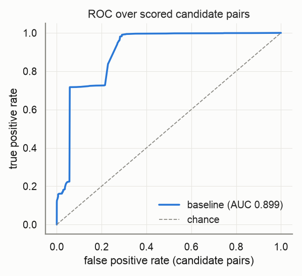
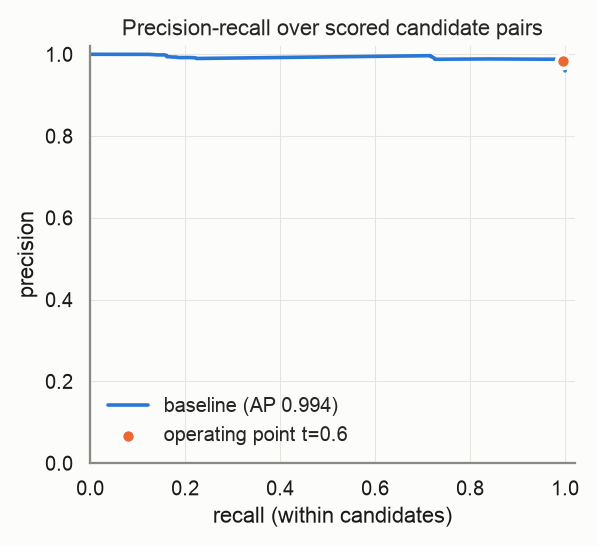
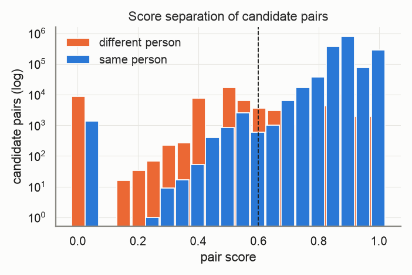
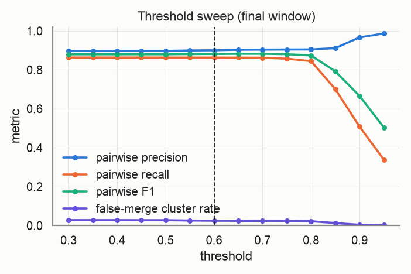
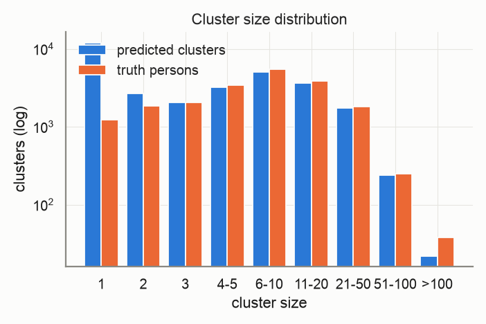
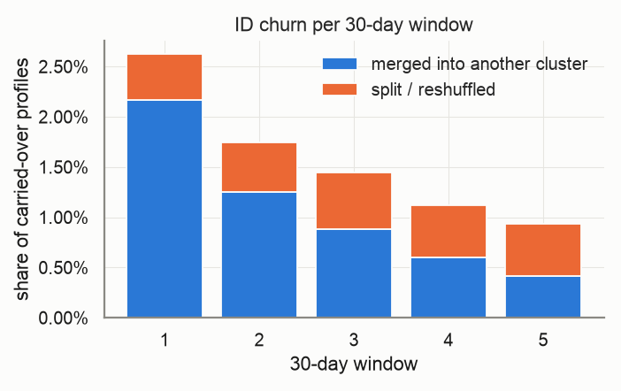
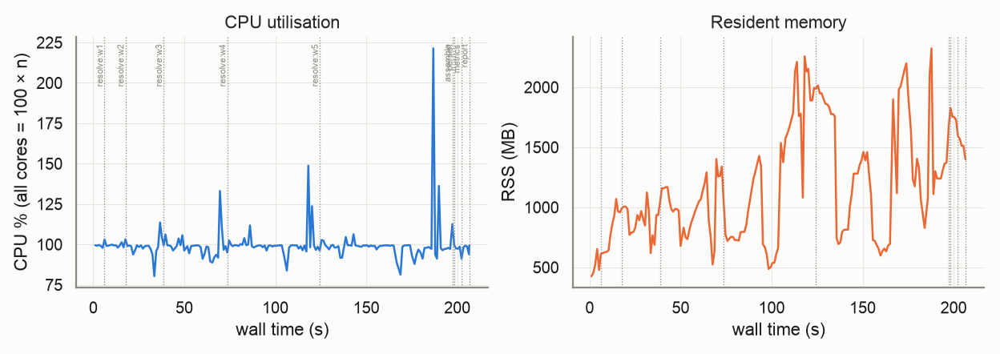

# Evaluation report — `medium`

_Generated 2026-10-22T11:09:05 · dataset `medium` · resolver `aurora_cdp` · threshold 0.6 (engine scale 3.0) · block cap 100 · seed 20261022_

## Provenance

```json
{
  "adapter": "aurora_cdp",
  "aurora_cdp_commit": "08be538f5996b0a909a71b047d33d5b696b470b3",
  "aurora_cdp_commit_source": "git",
  "aurora_cdp_dirty_worktree": false,
  "aurora_cdp_path": "/Users/harshmaster/Desktop/Projects/aurora-cdp",
  "aurora_cdp_version": "0.1.0",
  "harness_commit": "2b160cb3d45caffe557202f1fc37b1e075118051",
  "harness_version": "0.1.0",
  "seed": 20261022,
  "dataset": "/Users/harshmaster/Documents/aanya/datasets/aurora-testdata/medium",
  "run_at": "2026-10-22T05:35:38+00:00",
  "host": {
    "platform": "macOS",
    "platform_release": "25.5.0",
    "machine": "arm64",
    "python": "3.11.11",
    "cpu_count": 8,
    "mem_total_gb": 8.59,
    "hostname": "Harshs-Macbook-Air"
  },
  "run_name": "medium",
  "input_hash": "27f2d0baa63429854460",
  "dataset_manifest_fingerprint": 7100844426990289322,
  "dataset_seed": 42,
  "sample": null
}
```

<details><summary><code>adapter config</code></summary>

```json
{
  "cdp_path": null,
  "config": null,
  "threshold": 0.6,
  "datasource_column": "source",
  "datasource": "input",
  "windows": "replay",
  "deterministic_ids": true,
  "seed": 20261022,
  "isolate_windows": false,
  "max_stored_pairs": 20000000,
  "epoch": "2026-01-01",
  "window_days": 30,
  "retries": 1,
  "timeout_s": null,
  "threshold_raw": 3.0,
  "score_scale": 5.0,
  "engine_path": "/Users/harshmaster/Desktop/Projects/aurora-cdp"
}
```

</details>

<details><summary><code>aurora_cdp_config (resolved / expanded)</code></summary>

```json
{
  "workspace": ".aurora",
  "outputs_dir": "outputs",
  "db_file": "aurora.duckdb",
  "normalize": {
    "default_region": "US",
    "phone_use_last10_for_match": true,
    "email_strip_plus_tag": true,
    "email_strip_gmail_dots": false,
    "email_junk_local_parts": [
      "test",
      "no",
      "none",
      "reservation",
      "admin",
      "contact",
      "guest",
      "info",
      "noreply",
      "no-reply",
      "donotreply",
      "unknown"
    ],
    "address_abbreviations": {
      "ST": "STREET",
      "AVE": "AVENUE",
      "RD": "ROAD",
      "BLVD": "BOULEVARD",
      "DR": "DRIVE",
      "LN": "LANE",
      "CT": "COURT",
      "STE": "SUITE",
      "APT": "APARTMENT",
      "N": "NORTH",
      "S": "SOUTH",
      "E": "EAST",
      "W": "WEST",
      "1ST": "FIRST",
      "2ND": "SECOND",
      "3RD": "THIRD"
    }
  },
  "blocklist": {
    "email_max_given_names": 20,
    "email_max_surnames": 20,
    "phone_max_given_names": 20,
    "address_max_given_names": 40
  },
  "blocking": {
    "block_size_limit": 100,
    "fk_block_size_limit": 1000,
    "strategies": [
      {
        "name": "email_exact",
        "type": "email"
      },
      {
        "name": "phone_exact",
        "type": "phone"
      },
      {
        "name": "name_postal",
        "type": "name_postal"
      },
      {
        "name": "name_birthdate",
        "type": "name_birthdate"
      },
      {
        "name": "loy_id_exact",
        "type": "loy_id"
      },
      {
        "name": "ck_exact",
        "type": "ck"
      },
      {
        "name": "fk",
        "type": "fk"
      }
    ]
  },
  "matcher": {
    "match_threshold": 3.0,
    "deterministic": {
      "ck_exact_score": 5.0,
      "loy_exact_score": 5.0,
      "email_exact_with_name_score": 4.5,
      "phone_exact_with_name_score": 4.2,
      "name_agreement_min": 0.85
    },
    "weights": {
      "bias": -2.5,
      "given_sim": 1.0,
      "surname_sim": 1.2,
      "email_exact": 3.0,
      "email_sim": 0.5,
      "email_sim_min": 0.92,
      "phone_exact": 2.5,
      "address_sim": 1.2,
      "postal_exact": 0.6,
      "birthdate_exact": 1.5,
      "fk_shared": 1.0,
      "name_mismatch_penalty": -1.5,
      "birthdate_conflict": -3.0
    },
    "hard_conflicts": {
      "birthdate": true,
      "birthdate_typo_tolerance": 2
    }
  },
  "cluster": {
    "supersized_min_size": 500,
    "conflict_attributes": [
      "birthdate"
    ]
  },
  "stable_id": {
    "enabled": true,
    "jitter_alert_pct": 2.0
  },
  "survivorship": {
    "source_priority": {
      "loyalty": 1,
      "crm": 2,
      "ecommerce": 3,
      "pos": 4
    },
    "field_priority": {},
    "recency_field": "update_dt",
    "attributes": [
      "given_name",
      "surname",
      "email",
      "phone",
      "address",
      "address2",
      "city",
      "state",
      "postal",
      "country",
      "birthdate"
    ]
  },
  "sources": {},
  "tuning": {
    "thresholds": [
      2.0,
      2.5,
      3.0,
      3.5,
      4.0
    ],
    "min_precision": 0.98
  }
}
```

</details>

## Key metrics

```
pairwise P=0.980 R=0.853 F1=0.912 | B3 F1=0.936 | false-merge clusters=2.12% (profiles 5.62%) | split persons=37.28% | ID churn/30d mean=1.57% max=2.63% | AUC-ROC=0.899 AP=0.994 blocking-recall=0.690
```

| Metric | Value |
|---|---|
| Pairwise precision / recall / F1 | 0.980 / 0.853 / 0.912 |
| Pairs: TP / FP / FN | 1,983,507 / 39,766 / 341,680 |
| B-cubed precision / recall / F1 | 0.983 / 0.894 / 0.936 |
| Clusters predicted / truth persons (ratio) | 30,753 / 20,000 (1.538) |
| Exact-match clusters | 11,997 (59.98% of persons) |
| **False-merge rate** (clusters / profiles / pairs) | 2.12% / 5.62% / 1.97% |
| Over-merged clusters (max persons in one) | 653 (4) |
| Split persons (profiles) | 7,456 = 37.28% (54.12% of profiles) |
| **ID churn per 30-day window** mean / max | 1.57% / 2.63% |
| Harmful share of churn (purity dropped) | 15.17% |
| AUC-ROC / average precision (candidate pairs) | 0.899 / 0.994 |
| Blocking recall (true pairs reaching scoring) | 0.690 |
| Operating point P / R-in-candidates / effective R | 0.983 / 0.996 / 0.688 |
| Scored candidate pairs (stored fraction) | 1,673,355 (100.00%) |

> **Notes**
> - Engine scores are normalised from the 0–5 band scale to [0, 1] (score/5); the operating threshold 0.60 is the engine's 3.0 on its own scale.
> - The threshold sweep re-clusters engine pair scores with plain connected components, so it approximates (does not reproduce) the engine's conflict-aware clustering at other thresholds.

## Dataset

| | |
|---|---|
| persons | 20,000 |
| persons_with_profiles | 20,000 |
| profiles | 200,000 |
| months | 6 |
| true_pairs | 2,325,187 |
| households | 1,315 |
| movers | 2,038 |
| exact_duplicates | 17,965 |
| profiles_per_person_max | 275 |

Regenerate: `python scripts/generate.py --persons 20000 --profiles 200000 --months 6 --seed 42 --tier medium`

## Resolver run

| | |
|---|---|
| time: engine_load | 8.01s |
| time: engine_blocking | 3.28s |
| time: engine_scoring | 75.75s |
| time: engine_clustering | 22.51s |
| time: engine_stable_id | 2.04s |
| time: engine_persist | 8.05s |
| time: resolve_windows | 189.43s |
| time: wall_total | 198.11s |
| candidate pairs | 1,673,355 |
| block `engine (final snapshot)` | 1,673,355 pairs, 59,461 groups, 21 over cap (n/a) |

Engine snapshots (one engine run per replayed window; `previous=` carries stable ids forward):

| window | run_date | records | pairs scored | edges | clusters | skipped blocks | jitter % | ids minted | ids retired | engine s |
|---|---|---|---|---|---|---|---|---|---|---|
| 0 | 2026-01-31 | 33,331 | 48,322 | 47,130 | 15,529 | 0 | 0.0 | 15529 | 0 | 4.75 |
| 1 | 2026-03-02 | 66,557 | 197,787 | 192,882 | 21,009 | 0 | 2.6252 | 6114 | 634 | 10.57 |
| 2 | 2026-04-01 | 99,677 | 444,622 | 433,593 | 24,207 | 0 | 1.7414 | 3854 | 656 | 20.95 |
| 3 | 2026-05-01 | 132,926 | 778,901 | 759,392 | 26,535 | 3 | 1.4457 | 2990 | 662 | 33.32 |
| 4 | 2026-05-31 | 166,430 | 1,193,049 | 1,161,596 | 28,627 | 9 | 1.1179 | 2643 | 551 | 49.78 |
| 5 | 2026-06-30 | 200,000 | 1,673,355 | 1,626,556 | 30,753 | 21 | 0.9355 | 2610 | 484 | 70.06 |

## Score quality (candidate pairs)

 



## Threshold sweep (final window)

| threshold | precision | recall | F1 | B³ F1 | false-merge clusters | split persons | clusters |
|---|---|---|---|---|---|---|---|
| 0.30 | 0.896 | 0.863 | 0.879 | 0.924 | 2.77% | 35.14% | 29,373 |
| 0.35 | 0.897 | 0.863 | 0.880 | 0.924 | 2.76% | 35.14% | 29,376 |
| 0.40 | 0.897 | 0.863 | 0.880 | 0.924 | 2.76% | 35.14% | 29,376 |
| 0.45 | 0.897 | 0.863 | 0.880 | 0.924 | 2.73% | 35.16% | 29,406 |
| 0.50 | 0.897 | 0.863 | 0.880 | 0.924 | 2.73% | 35.25% | 29,441 |
| 0.55 | 0.899 | 0.863 | 0.881 | 0.925 | 2.55% | 35.35% | 29,573 |
| 0.60 | 0.901 | 0.863 | 0.881 | 0.925 | 2.47% | 35.38% | 29,636 |
| 0.65 | 0.903 | 0.862 | 0.882 | 0.926 | 2.41% | 35.44% | 29,727 |
| 0.70 | 0.904 | 0.862 | 0.882 | 0.926 | 2.38% | 35.74% | 29,835 |
| 0.75 | 0.904 | 0.857 | 0.880 | 0.923 | 2.32% | 37.35% | 30,405 |
| 0.80 | 0.905 | 0.845 | 0.874 | 0.916 | 2.19% | 40.86% | 31,855 |
| 0.85 | 0.911 | 0.700 | 0.792 | 0.819 | 1.25% | 69.22% | 49,054 |
| 0.90 | 0.967 | 0.508 | 0.666 | 0.637 | 0.36% | 87.12% | 83,171 |
| 0.95 | 0.987 | 0.339 | 0.504 | 0.505 | 0.22% | 90.66% | 98,006 |

Best F1 on this grid: threshold **0.70** (F1 0.882). Run `scripts/tune.py` for finer grids, precision-constrained objectives and weight search.



## Clusters



| | predicted | truth |
|---|---|---|
| mean | 6.50 | 10.00 |
| p50 | 3.00 | 6.00 |
| p90 | 16.00 | 21.00 |
| p99 | 48.00 | 60.00 |
| max | 173 | 275 |
| singletons | 12,061 | 1,238 |

## Over-merge detector

653 predicted clusters conflate ≥2 persons, covering 11,247 profiles and 1,341 persons. 26,845 accepted edges cross a person boundary.

Which agreeing feature carried the bad edges (an edge can count in several columns; `only` = that feature was the sole agreement):

| feature | bad edges agreeing | sole agreement |
|---|---|---|
| engine_scored | 25,866 | 25,866 |
| engine_deterministic | 964 | 964 |
| engine_trivial_duplicate | 15 | 15 |
| email | 0 | 0 |
| phone | 0 | 0 |
| dob | 0 | 0 |
| postal | 0 | 0 |
| name | 0 | 0 |
| addr | 0 | 0 |

Worst clusters (full list in `overmerge_clusters.json`, edges in `overmerge_edges.parquet`):

| cluster | persons | profiles | dominant feature | sample names by person |
|---|---|---|---|---|
| `w0-861f40545837fb87` | 4 | 78 | engine_scored | ps_0004779: alexander, alexander nelson; ps_0000636: jack nelson; ps_0009976: Barbara Nelson, barbara nelson; ps_0018936: Johh Nelson, john nelson |
| `w0-b272c2785d46f02f` | 4 | 55 | engine_deterministic | ps_0002426: James Henderson; ps_0010140: James, James Henderson; ps_0014711: Jonathan Henderson; ps_0000352: JEFFREY HENDERSON, JEFFREY HENDSRSON |
| `w0-4ee7038d03adaf1d` | 4 | 47 | engine_scored | ps_0011400: Rebecca Wu, rebecca wu; ps_0010748: Anthony Wu, anthony wu; ps_0012037: tim wu, timothy wu; ps_0016528: james wu |
| `w0-0d755ddb9966b5a2` | 4 | 31 | engine_scored | ps_0007081: Rachel Johnsin, rachel johnson; ps_0014101: MICHAEL JOHNSON, michael johnson; ps_0000304: Ruth Johnson, ruth johnson; ps_0013102: matthew johnson |
| `w0-3a1bfc82e7ee188d` | 4 | 30 | engine_scored | ps_0016135: barb sanchez, barbara sanchez; ps_0002019: charles, charles sanchez; ps_0001488: J Sanchez; ps_0017948: Michael Sanchez, michael sanchez |
| `w0-772c45a467dba109` | 4 | 29 | engine_scored | ps_0012595: ashley rodriguez; ps_0014099: George Rodriguez, g rodriguez; ps_0017616: Rahul Rodriguez, rahul rodrigue; ps_0008515: jeffrey rodriguez |
| `w1-32a7d960a886e25a` | 4 | 29 | engine_scored | ps_0014698: STEVEN MARTINEZ, steven martinez; ps_0011938: Charles Artinez, Charles Matrinez; ps_0004923: Joan Martinez, joan; ps_0001267: Mguel Martinez, miguel martinezz |
| `w0-e32c87b512516d4e` | 4 | 28 | engine_scored | ps_0012885: Catherine Castillo; ps_0017112: James Castillo, james castillo; ps_0015625: EDWARD CASTILLO; ps_0009904: eric castillo |
| `w0-0cc0bc7e4612dec5` | 4 | 27 | engine_scored | ps_0009039: j patel; ps_0007958: James Patel, james patel; ps_0013375: an patel, ann patel; ps_0019628: J Patel |
| `w0-db3f78fd97e5f926` | 4 | 20 | engine_scored | ps_0011695: janet perez; ps_0017099: Maria, Maria Perez; ps_0007140: Tony Perez, anthony perez; ps_0019528: J PEREZ |
| `w0-287a312b2f64a420` | 4 | 19 | engine_scored | ps_0013591: Patrick James; ps_0018799: Charles James; ps_0008238: Raymond James, raymond james; ps_0003204: Pooja |
| `w0-91d9290b114558ac` | 4 | 15 | engine_scored | ps_0000833: dennis, dennis davis; ps_0003383: jason davis; ps_0008210: Anthony Davis, anthony davis; ps_0016171: James Davis |

## ID churn per 30-day window

Churn = carried-over profiles whose stable cluster id changed vs the previous window. *merge* = the profile's whole previous cluster was absorbed; *split* = otherwise. *harmful* = the profile's new cluster is less pure for its true person than the old one.



| window | profiles | clusters | new | carried | churned | churn rate | merge | split | harmful | justified |
|---|---|---|---|---|---|---|---|---|---|---|
| 0 | 33,331 | 15,529 | – | – | – | – | – | – | – | – |
| 1 | 66,557 | 21,009 | 33,226 | 33,331 | 875 | 2.63% | 722 | 153 | 145 | 730 |
| 2 | 99,677 | 24,207 | 33,120 | 66,557 | 1,159 | 1.74% | 832 | 327 | 186 | 973 |
| 3 | 132,926 | 26,535 | 33,249 | 99,677 | 1,441 | 1.45% | 878 | 563 | 243 | 1,198 |
| 4 | 166,430 | 28,627 | 33,504 | 132,926 | 1,486 | 1.12% | 797 | 689 | 214 | 1,272 |
| 5 | 200,000 | 30,753 | 33,570 | 166,430 | 1,557 | 0.94% | 692 | 865 | 201 | 1,356 |

Quality per window snapshot:

| window | profiles | precision | recall | F1 | false-merge clusters |
|---|---|---|---|---|---|
| 0 | 33,331 | 0.973 | 0.859 | 0.913 | 1.26% |
| 1 | 66,557 | 0.974 | 0.889 | 0.929 | 1.75% |
| 2 | 99,677 | 0.977 | 0.899 | 0.937 | 1.88% |
| 3 | 132,926 | 0.979 | 0.889 | 0.932 | 2.04% |
| 4 | 166,430 | 0.980 | 0.873 | 0.923 | 2.12% |
| 5 | 200,000 | 0.980 | 0.853 | 0.912 | 2.12% |

## Resources

Wall 206.6s · peak RSS 2,324 MB · mean CPU 100% (peak 221%, 8 cores) · 193 samples @ 1.0s



| stage | wall s | peak RSS MB | mean CPU % |
|---|---|---|---|
| resolve:w0 | 5.2 | 652 | 99 |
| resolve:w1 | 11.3 | 1,070 | 100 |
| resolve:w2 | 21.8 | 1,123 | 98 |
| resolve:w3 | 34.6 | 1,403 | 99 |
| resolve:w4 | 51.2 | 2,257 | 100 |
| resolve:w5 | 72.2 | 2,324 | 100 |
| assemble | 1.7 | 1,673 | 112 |
| persist | 3.1 | 1,828 | 98 |
| metrics | 5.2 | 1,594 | 96 |
| report | 0.0 | 1,399 | 99 |

## Failures and retries

0 stage failure(s), 0 retry(ies). Full log: `events.jsonl`.

## Metric validation

17 golden/sanity cases, 91 hand-computed checks run through `aurora_eval.score` (the reports' own code path) — **ALL PASSED**. Metrics marked *untrusted* have no independent check and must not be used for gating.

| metric | status | basis |
|---|---|---|
| pairwise.precision/recall/f1 | ✅ validated | A: pairwise |
| pairwise.tp/fp/fn pairs | ✅ validated | A: pairwise |
| cluster.bcubed_precision/recall/f1 | ✅ validated | A: B-cubed |
| cluster.false_merge (cluster/profile/pair) | ✅ validated | A: false-merge |
| cluster.split (persons/profiles) | ✅ validated | A: split |
| cluster.exact_match_rate / cluster_count_ratio | ✅ validated | A: exact / ratio |
| cluster.pred_size_dist / truth_size_dist | ✅ validated | A: size distributions |
| churn.rate / merge vs split | ✅ validated | C: churn rate, merge vs split |
| churn.harmful vs justified | ✅ validated | C: harmful vs justified |
| curves.blocking_recall | ✅ validated | A: blocking recall |
| curves.auc_roc / average_precision | ✅ validated | A: ROC / PR |
| curves.operating_point | ✅ validated | A: operating point @0.75 |
| per_window quality | ✅ validated | C: per-window quality |
| sanity: perfect input | ✅ validated | perfect prediction |
| sanity: all-singleton input | ✅ validated | all singletons |
| sanity: all-merged input | ✅ validated | everything merged |
| sanity: disjoint prediction | ✅ validated | disjoint prediction |
| sanity: disjoint pairs file | ✅ validated | pairs file with no true pair |
| threshold_sweep | ≈ approximation | approximation — harness connected components over engine pair scores; not the engine's conflict-aware clustering |
| overmerge.dominant_feature | ⚠️ untrusted | untrusted — attribution by engine match_type only (engine pair features are not exported) |
| curves.score_hist | ⚠️ untrusted | untrusted — diagnostic histogram, no golden case |
| engine.metrics (pairs_blocked, skipped_blocks, cluster_size_distribution, timings) | ⚠️ untrusted | untrusted — reported verbatim from the engine, not independently recomputed |
| engine.jitter_pct per snapshot | ✅ cross-checked | engine jitter == harness churn rate per window |

## Reproduce

```bash
# dataset: /Users/harshmaster/Documents/aanya/datasets/aurora-testdata/medium  (regenerate: python scripts/generate.py --persons 20000 --profiles 200000 --months 6 --seed 42 --tier medium)
python -m aurora_eval.cli run --adapter aurora_cdp --dataset medium --seed 20261022 --run-name medium --date 2026-10-22 --force
# resume after interruption: same command (checkpoints in /Users/harshmaster/Desktop/Projects/aurora-eval-harness/runs/medium/checkpoints)
```

## Files

- `metrics.json` — everything above, machine-readable (same shape as `aurora_eval.score()` output)
- `plots/` — PNGs embedded here
- `overmerge_clusters.json`, `overmerge_edges.parquet` — drill-down for the detector
- `provenance.json`, `resources.jsonl`, `events.jsonl`, `state.json` — provenance, resource samples, failure/retry log, stage state
