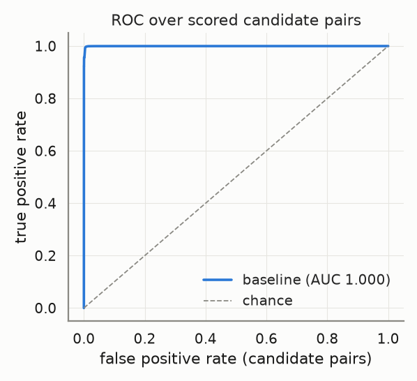
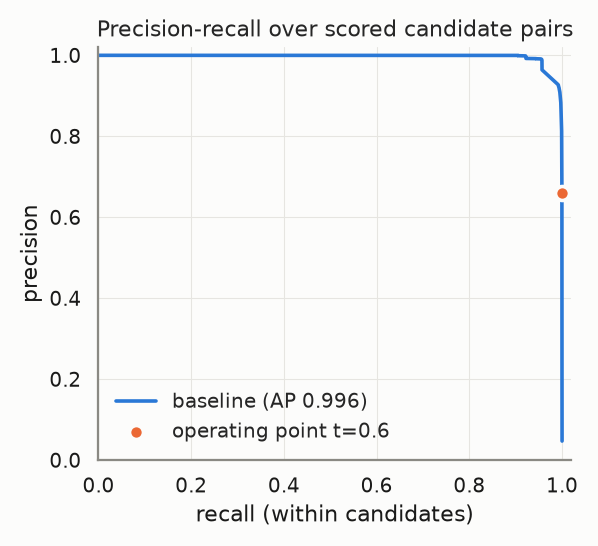
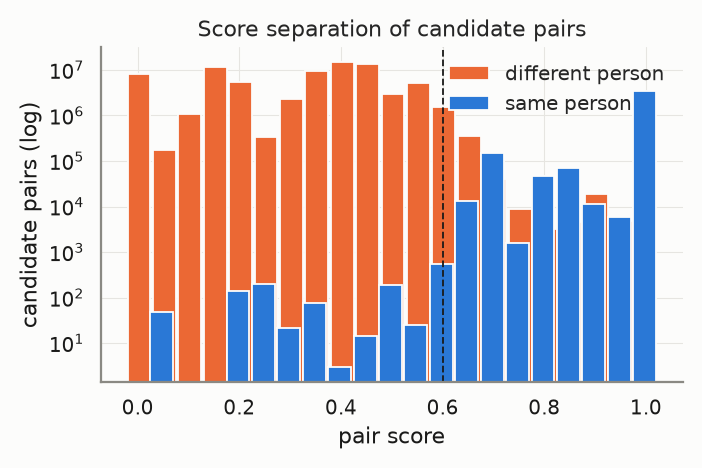
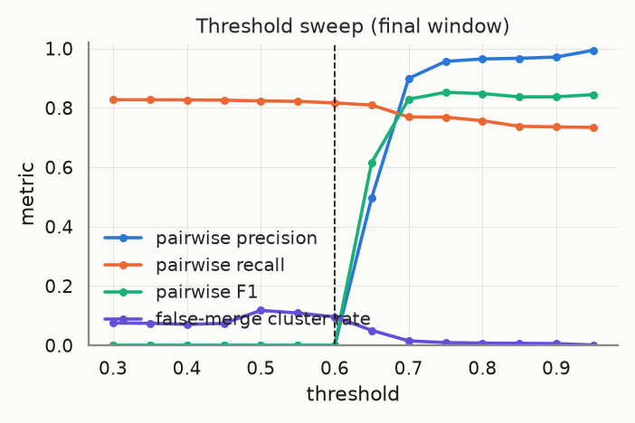
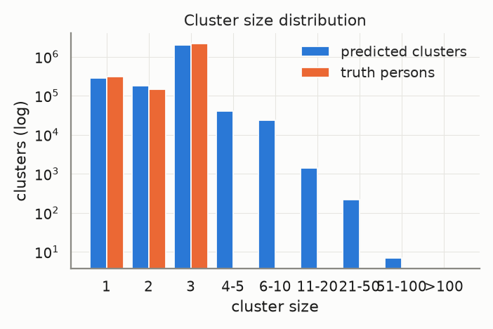
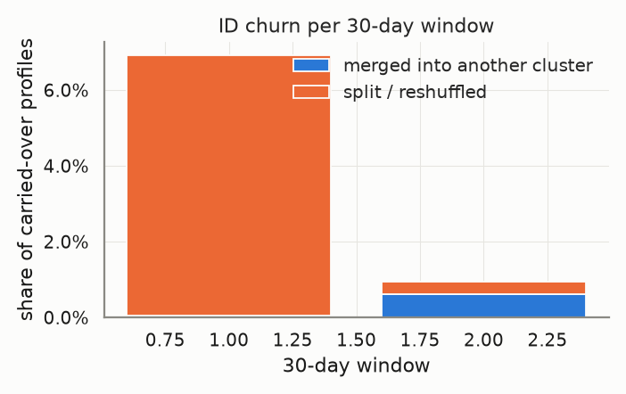
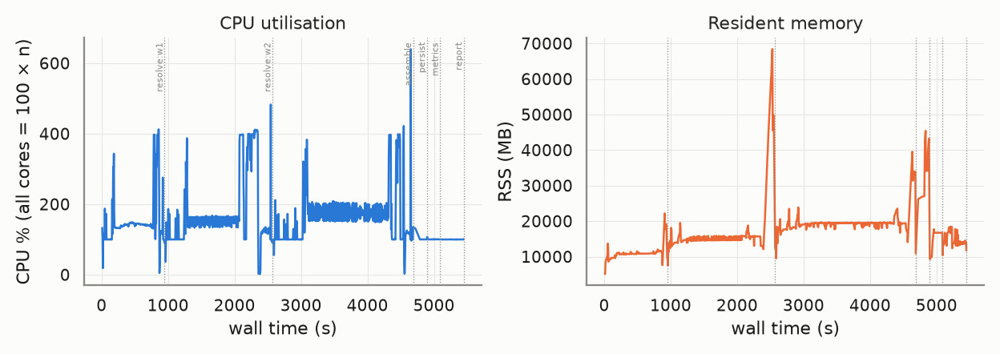

# Evaluation report — `ncvoter-7m`

_Generated 2026-10-22T15:22:03 · dataset `ncvoter-7m` · resolver `aurora_cdp` · threshold 0.6 (engine scale 3.0) · block cap 100 · seed 20261022_

## Provenance

```json
{
  "adapter": "aurora_cdp",
  "aurora_cdp_commit": "c3f4375b7d0ecd2abd4c4ef815f0836f1022881e",
  "aurora_cdp_commit_source": "git",
  "aurora_cdp_dirty_worktree": false,
  "aurora_cdp_path": "/home/ubuntu/Projects/aurora-cdp",
  "aurora_cdp_version": "0.1.0",
  "harness_commit": "1211f2017a2dcaf198a4002f7323561ee6e8edca",
  "harness_version": "0.1.0",
  "seed": 20261022,
  "dataset": "/home/ubuntu/data/aurora-testdata/ncvoter-7m",
  "run_at": "2026-10-22T13:51:14+00:00",
  "host": {
    "platform": "Linux",
    "platform_release": "7.0.0-1014-aws",
    "machine": "x86_64",
    "python": "3.11.17",
    "cpu_count": 32,
    "mem_total_gb": 264.74,
    "hostname": "ip-172-31-37-105"
  },
  "run_name": "ncvoter-7m",
  "input_hash": "759a5504115ce7d13c3e",
  "dataset_manifest_fingerprint": 7871026742800474829,
  "dataset_seed": null,
  "sample": null
}
```

<details><summary><code>adapter config</code></summary>

```json
{
  "cdp_path": null,
  "config": {
    "matcher": {
      "max_expanded_pairs": 300000000
    }
  },
  "threshold": 0.6,
  "datasource_column": "source",
  "datasource": "input",
  "windows": "replay",
  "deterministic_ids": true,
  "seed": 20261022,
  "isolate_windows": true,
  "max_stored_pairs": 80000000,
  "epoch": "2026-01-01",
  "window_days": 30,
  "retries": 1,
  "timeout_s": 36000.0,
  "threshold_raw": 3.0,
  "score_scale": 5.0,
  "engine_path": "/home/ubuntu/Projects/aurora-cdp"
}
```

</details>

<details><summary><code>aurora_cdp_config (resolved / expanded)</code></summary>

```json
{
  "workspace": ".aurora",
  "outputs_dir": "outputs",
  "db_file": "aurora.duckdb",
  "normalize": {
    "default_region": "US",
    "phone_use_last10_for_match": true,
    "email_strip_plus_tag": true,
    "email_strip_gmail_dots": false,
    "nickname_file": null,
    "address_parsing": false,
    "email_junk_local_parts": [
      "test",
      "no",
      "none",
      "reservation",
      "admin",
      "contact",
      "guest",
      "info",
      "noreply",
      "no-reply",
      "donotreply",
      "unknown"
    ],
    "address_abbreviations": {
      "ST": "STREET",
      "AVE": "AVENUE",
      "RD": "ROAD",
      "BLVD": "BOULEVARD",
      "DR": "DRIVE",
      "LN": "LANE",
      "CT": "COURT",
      "STE": "SUITE",
      "APT": "APARTMENT",
      "N": "NORTH",
      "S": "SOUTH",
      "E": "EAST",
      "W": "WEST",
      "1ST": "FIRST",
      "2ND": "SECOND",
      "3RD": "THIRD"
    }
  },
  "blocklist": {
    "email_max_given_names": 20,
    "email_max_surnames": 20,
    "phone_max_given_names": 20,
    "address_max_given_names": 40,
    "manual": {}
  },
  "blocking": {
    "block_size_limit": 100,
    "fk_block_size_limit": 1000,
    "max_pairs_per_block": 500000,
    "refine_target": 100,
    "sn_window": 25,
    "collapse_trivial_dupes": true,
    "dupe_group_requires_identifier": true,
    "dupe_group_identifier_fields": [
      "email_norm",
      "phone_match",
      "address_norm",
      "loy_id_norm",
      "ck"
    ],
    "persist_blocking_keys": true,
    "strategy_source": "fixed",
    "learned_strategies_file": null,
    "learned_keep_types": [
      "ck",
      "loy_id",
      "fk"
    ],
    "dnf": {
      "max_terms": 2,
      "min_positive_pairs": 200,
      "min_predicate_pc": 0.01,
      "target_pc": 0.95,
      "min_gain_pairs": 5,
      "pairs_per_record_budget": 20,
      "sample_records": 20000,
      "sample_positive_pairs": 5000,
      "sample_seed": 0,
      "labels": "self"
    },
    "refine_keys": {
      "email": [
        "name3",
        "postal",
        "birthdate",
        "update_month",
        "given3"
      ],
      "phone": [
        "name3",
        "postal",
        "birthdate",
        "update_month",
        "given3"
      ],
      "name_postal": [
        "email",
        "phone",
        "birthdate",
        "house_number",
        "update_month"
      ],
      "name_birthdate": [
        "email",
        "phone",
        "postal",
        "house_number",
        "update_month"
      ],
      "name": [
        "postal",
        "birthdate",
        "email",
        "phone",
        "house_number",
        "update_month"
      ],
      "loy_id": [
        "name3",
        "postal",
        "birthdate",
        "update_month"
      ],
      "ck": [
        "name3",
        "postal",
        "birthdate",
        "update_month"
      ],
      "fk": [
        "name3",
        "postal",
        "birthdate",
        "update_month"
      ],
      "dnf": [
        "postal",
        "birthdate",
        "email",
        "phone",
        "name3",
        "update_month"
      ]
    },
    "strategies": [
      {
        "name": "email_exact",
        "type": "email"
      },
      {
        "name": "phone_exact",
        "type": "phone"
      },
      {
        "name": "name_postal",
        "type": "name_postal"
      },
      {
        "name": "name_birthdate",
        "type": "name_birthdate"
      },
      {
        "name": "name",
        "type": "name",
        "max_pairs_per_block": 50000
      },
      {
        "name": "loy_id_exact",
        "type": "loy_id"
      },
      {
        "name": "ck_exact",
        "type": "ck"
      },
      {
        "name": "fk",
        "type": "fk"
      }
    ]
  },
  "matcher": {
    "match_threshold": 3.25,
    "scorer": "rules",
    "ordinal": {
      "model_file": null,
      "retrain": "auto",
      "save_model": true,
      "apply_rules_first": true,
      "levels": 3,
      "self_train_rounds": 3,
      "confidence_margin": 1.0,
      "negatives_per_positive": 2.0,
      "hard_negative_min_disagreements": 2,
      "max_train_pairs": 40000,
      "min_positive_pairs": 300,
      "min_negative_pairs": 300,
      "l2": 0.001,
      "lr": 0.05,
      "epochs": 300,
      "sample_seed": 0,
      "monotone": false
    },
    "score_chunk_size": 250000,
    "persist_features": false,
    "export_expanded_dupe_pairs": true,
    "max_expanded_pairs": 300000000,
    "deterministic": {
      "ck_exact_score": 5.0,
      "loy_exact_score": 5.0,
      "email_exact_with_name_score": 4.5,
      "phone_exact_with_name_score": 4.2,
      "name_agreement_min": 0.85
    },
    "weights": {
      "bias": -2.5,
      "given_sim": 1.0,
      "surname_sim": 1.2,
      "email_exact": 3.0,
      "email_sim": 0.5,
      "email_sim_min": 0.92,
      "phone_exact": 2.5,
      "address_sim": 1.2,
      "postal_exact": 0.6,
      "birthdate_exact": 1.5,
      "fk_shared": 1.0,
      "name_mismatch_penalty": -1.5,
      "name_mismatch_floor": 0.6,
      "address_house_number_mismatch_cap": 0.3,
      "birthdate_conflict": -3.0
    },
    "trivial_dupe": {
      "fields": [
        "given_name_norm",
        "surname_norm",
        "email_norm",
        "phone_match",
        "address_norm",
        "postal_norm",
        "birthdate_norm"
      ],
      "identifier_fields": [
        "email_norm",
        "phone_match",
        "address_norm"
      ],
      "requires_identifier": true
    },
    "hard_conflicts": {
      "birthdate": true,
      "birthdate_typo_tolerance": 2
    }
  },
  "cluster": {
    "supersized_min_size": 500,
    "linkage": "fusion",
    "fusion": {
      "tiers": [
        4.75,
        4.0
      ],
      "strong_edge_score": 4.0,
      "min_cross_edges": 2,
      "min_cross_edge_ratio": 0.1
    },
    "carve": {
      "enabled": true,
      "max_cluster_size": 500
    },
    "conflict_attributes": [
      "birthdate",
      "given_name"
    ],
    "conflict_tolerances": {
      "birthdate": {
        "measure": "levenshtein_max",
        "value": 2
      },
      "given_name": {
        "measure": "jaro_winkler_min",
        "value": 0.6
      },
      "contact": {
        "measure": "any_overlap"
      }
    },
    "conflict_columns": {
      "birthdate": "birthdate_norm",
      "given_name": "given_name_canon",
      "surname": "surname_norm",
      "ck": "ck",
      "loy_id": "loy_id_norm",
      "contact": [
        "email_norm",
        "phone_match"
      ]
    }
  },
  "identity": {
    "ampid_mode": true,
    "external_id_name": "amperity_id",
    "email_ampid_assignment": true
  },
  "household": {
    "build_with_profile": true,
    "min_evidence_weight": 1.0,
    "evidence_ttl_days": 365,
    "max_customers_per_value": 25,
    "evidence": {
      "shared_address": {
        "weight": 1.0,
        "columns": [
          "address_norm",
          "postal_norm"
        ]
      },
      "shared_surname_postal": {
        "weight": 0.4,
        "columns": [
          "surname_norm",
          "postal_norm"
        ]
      },
      "shared_phone": {
        "weight": 0.6,
        "columns": [
          "phone_match"
        ]
      },
      "relationship": {
        "weight": 1.0
      }
    }
  },
  "labels": {
    "file": null
  },
  "storage": {
    "duckdb": {
      "memory_limit": "3GB",
      "threads": 4,
      "temp_directory": null,
      "preserve_insertion_order": false
    }
  },
  "stable_id": {
    "enabled": true,
    "jitter_alert_pct": 2.0,
    "tie_break": "stable"
  },
  "survivorship": {
    "source_priority": {
      "loyalty": 1,
      "crm": 2,
      "ecommerce": 3,
      "pos": 4
    },
    "field_priority": {},
    "recency_field": "update_dt",
    "attributes": [
      "given_name",
      "surname",
      "email",
      "phone",
      "address",
      "address2",
      "city",
      "state",
      "postal",
      "country",
      "birthdate"
    ]
  },
  "sources": {},
  "tuning": {
    "thresholds": [
      2.0,
      2.5,
      3.0,
      3.5,
      4.0
    ],
    "min_precision": 0.98
  }
}
```

</details>

## Key metrics

```
pairwise P=0.911 R=0.987 F1=0.947 | B3 F1=0.983 | false-merge clusters=3.00% (profiles 5.28%) | split persons=1.73% | ID churn/30d mean=3.93% max=6.92% | AUC-ROC=1.000 AP=0.996 blocking-recall=0.577
```

| Metric | Value |
|---|---|
| Pairwise precision / recall / F1 | 0.911 / 0.987 / 0.947 |
| Pairs: TP / FP / FN | 6,460,549 / 630,695 / 87,459 |
| B-cubed precision / recall / F1 | 0.974 / 0.992 / 0.983 |
| Clusters predicted / truth persons (ratio) | 2,533,376 / 2,585,325 (0.980) |
| Exact-match clusters | 2,386,030 (92.29% of persons) |
| **False-merge rate** (clusters / profiles / pairs) | 3.00% / 5.28% / 8.89% |
| Over-merged clusters (max persons in one) | 75,996 (34) |
| Split persons (profiles) | 44,679 = 1.73% (1.89% of profiles) |
| **ID churn per 30-day window** mean / max | 3.93% / 6.92% |
| Harmful share of churn (purity dropped) | 14.81% |
| AUC-ROC / average precision (candidate pairs) | 1.000 / 0.996 |
| Blocking recall (true pairs reaching scoring) | 0.577 |
| Operating point P / R-in-candidates / effective R | 0.660 / 1.000 / 0.577 |
| Scored candidate pairs (stored fraction) | 80,001,029 (85.52%) |

> **Notes**
> - scores.parquet holds a seeded 85.5% sample of candidate pairs; ROC/PR/sweep use the sample.
> - Engine scores are normalised from the 0–5 band scale to [0, 1] (score/5); the operating threshold 0.60 is the engine's 3.0 on its own scale.
> - The threshold sweep re-clusters engine pair scores with plain connected components, so it approximates (does not reproduce) the engine's conflict-aware clustering at other thresholds.

## Dataset

| | |
|---|---|
| profiles | 7,000,002 |
| persons | 2,585,325 |
| true_pairs | 6,548,008 |
| profiles_per_person_max | 3 |
| singleton_persons | 303,979 |
| status | {'ACTIVE': 6149540, 'INACTIVE': 850462} |
| records_with_phone | 3,296,245 |
| records_with_dob | 6,998,811 |
| records_with_address | 7,000,002 |

## Resolver run

| | |
|---|---|
| time: engine_load | 67.9s |
| time: engine_blocking | 54.72s |
| time: engine_scoring | 2745.6s |
| time: engine_clustering | 118.72s |
| time: engine_stable_id | 22.32s |
| time: engine_persist | 27.99s |
| time: resolve_windows | 4519.72s |
| time: wall_total | 4886.46s |
| candidate pairs | 93,548,137 |
| block `engine (final snapshot)` | 89,552,647 pairs, 998,467 groups, 0 over cap (n/a) |

Engine snapshots (one engine run per replayed window; `previous=` carries stable ids forward):

| window | run_date | records | pairs scored | edges | clusters | skipped blocks | jitter % | ids minted | ids retired | engine s |
|---|---|---|---|---|---|---|---|---|---|---|
| 0 | 2024-01-01 | 2,295,862 | 58,829,653 | 288,911 | 2,100,653 | 0 | 0.0 | 2100653 | 0 | 897.24 |
| 1 | 2024-12-31 | 4,571,862 | 228,491,507 | 2,511,990 | 2,356,035 | 0 | 6.9209 | 256629 | 1247 | 1575.82 |
| 2 | 2025-12-31 | 7,000,002 | 93,548,137 | 4,911,204 | 2,533,376 | 0 | 0.9461 | 192151 | 14810 | 2046.66 |

## Score quality (candidate pairs)

 



## Threshold sweep (final window)

| threshold | precision | recall | F1 | B³ F1 | false-merge clusters | split persons | clusters |
|---|---|---|---|---|---|---|---|
| 0.30 | 0.000 | 0.828 | 0.000 | 0.322 | 7.54% | 21.44% | 915,735 |
| 0.35 | 0.000 | 0.828 | 0.000 | 0.326 | 7.45% | 21.45% | 923,125 |
| 0.40 | 0.000 | 0.827 | 0.000 | 0.342 | 7.10% | 21.48% | 958,941 |
| 0.45 | 0.000 | 0.826 | 0.000 | 0.388 | 7.40% | 21.59% | 1,065,192 |
| 0.50 | 0.000 | 0.824 | 0.000 | 0.501 | 11.80% | 21.89% | 1,348,942 |
| 0.55 | 0.000 | 0.822 | 0.000 | 0.556 | 10.91% | 22.07% | 1,513,412 |
| 0.60 | 0.000 | 0.817 | 0.000 | 0.762 | 9.60% | 22.73% | 2,273,441 |
| 0.65 | 0.498 | 0.810 | 0.617 | 0.895 | 5.06% | 23.59% | 2,977,897 |
| 0.70 | 0.900 | 0.770 | 0.830 | 0.913 | 1.53% | 28.40% | 3,327,871 |
| 0.75 | 0.957 | 0.769 | 0.853 | 0.917 | 0.95% | 28.49% | 3,359,199 |
| 0.80 | 0.965 | 0.757 | 0.849 | 0.913 | 0.78% | 29.88% | 3,409,998 |
| 0.85 | 0.967 | 0.738 | 0.837 | 0.906 | 0.71% | 32.12% | 3,482,441 |
| 0.90 | 0.972 | 0.736 | 0.838 | 0.906 | 0.62% | 32.30% | 3,495,085 |
| 0.95 | 0.995 | 0.735 | 0.845 | 0.908 | 0.13% | 32.49% | 3,518,996 |

Best F1 on this grid: threshold **0.75** (F1 0.853). Run `scripts/tune.py` for finer grids, precision-constrained objectives and weight search.



## Clusters



| | predicted | truth |
|---|---|---|
| mean | 2.76 | 2.71 |
| p50 | 3.00 | 3.00 |
| p90 | 3.00 | 3.00 |
| p99 | 5.00 | 3.00 |
| max | 95 | 3 |
| singletons | 282,648 | 303,979 |

## Over-merge detector

75,996 predicted clusters conflate ≥2 persons, covering 369,415 profiles and 171,737 persons. 1,940,520 accepted edges cross a person boundary.

Which agreeing feature carried the bad edges (an edge can count in several columns; `only` = that feature was the sole agreement):

| feature | bad edges agreeing | sole agreement |
|---|---|---|
| engine_scored | 1,938,900 | 1,938,900 |
| engine_deterministic | 1,099 | 1,099 |
| engine_trivial_duplicate | 521 | 521 |
| email | 0 | 0 |
| phone | 0 | 0 |
| dob | 0 | 0 |
| postal | 0 | 0 |
| name | 0 | 0 |
| addr | 0 | 0 |

Worst clusters (full list in `overmerge_clusters.json`, edges in `overmerge_edges.parquet`):

| cluster | persons | profiles | dominant feature | sample names by person |
|---|---|---|---|---|
| `w0-df74313f9511ca39` | 34 | 95 | engine_scored | AY44176: ALEXANDER HAINES; BH181564: ALEXIS HUNTER; BL504089: ALEXANDER HIGH; BM77440: ALEXIA HALE |
| `w0-a03e474e7a6d6208` | 27 | 73 | engine_scored | AA178449: STEPHEN HARDEN; AL374050: STEPHANIE HERNANDEZ; AN239261: STEPHEN HAMMONDS; AN244169: STEPHAN HALIBEJ |
| `w0-5eb915cb8451dc6b` | 24 | 69 | engine_scored | AM111579: DAVID BRIAN; AM87716: DAVID BRITTAIN; AP76752: DAVID BRUNER; AZ6783: DAVID BIGGS |
| `w0-39bb03bd4dfcc6c6` | 24 | 52 | engine_scored | AN195702: ALEC MAIN; AX80914: ALEC MIKELL; BE396432: ALEXIA MASSENGALE; BL476848: ALEXIA MCCREE |
| `w0-66db26831e387473` | 22 | 49 | engine_scored | AL366404: MADISON MCDANIEL; AL379127: MADISON MAYNARD; BF42817: MADELYN MCDANIEL; BH195107: MADYSON MCCRARY |
| `w0-ff014d00bc3365c1` | 22 | 37 | engine_scored | AL359027: ALEX BAZEMORE; BN488594: ALEXANDER BOYER; BN517568: ALEXANDER BAUMAN; BY783701: ALEXANDER BAKER |
| `w0-22797d331db83b07` | 21 | 61 | engine_scored | BD77849: MICHAEL SMITH; BJ4334: MICHAEL SMITH; BK18851: MICHAEL SMITH; BN189021: MICHAEL SMITH |
| `w0-8738a6f00cc13bad` | 21 | 58 | engine_scored | AH16342: MARY WARREN; AN164446: MARYANN WEST NUNN; AN198397: MARION WRENN; AN237002: MARY WRENN |
| `w0-dc9ac05d8f92d962` | 20 | 49 | engine_scored | BB117521: ALEXIS BARBUR; BE424985: ALEXIS BARTON; BE446932: ALEXIS BROWN; BH180446: ALEXIS BRYANT |
| `w0-7875375ca16aa2db` | 19 | 53 | engine_scored | AN227762: ANDREW COLEMAN; BL496769: ANDREW CARLINS; BR214212: ANDREW COATES; BR217179: ANDREW CARRINGER |
| `w0-bbcb95098121c4ad` | 18 | 45 | engine_scored | AW79661: MICHAEL SMITH; BN507159: MICHAEL SMITH; BN543330: MICHAEL SMITH; BN558531: MICHAEL SMITH |
| `w0-6c8ce6618093527a` | 18 | 44 | engine_scored | AM61704: ROBIN BURDICK; BB94483: ROBERT BURRIS; BE343124: BOBBY BRAY; BH175989: ROBERT BIESECKER |

## ID churn per 30-day window

Churn = carried-over profiles whose stable cluster id changed vs the previous window. *merge* = the profile's whole previous cluster was absorbed; *split* = otherwise. *harmful* = the profile's new cluster is less pure for its true person than the old one.



| window | profiles | clusters | new | carried | churned | churn rate | merge | split | harmful | justified |
|---|---|---|---|---|---|---|---|---|---|---|
| 0 | 2,295,862 | 2,100,653 | – | – | – | – | – | – | – | – |
| 1 | 4,571,862 | 2,356,035 | 2,276,000 | 2,295,862 | 158,895 | 6.92% | 1,310 | 157,585 | 1,520 | 157,375 |
| 2 | 7,000,002 | 2,533,376 | 2,428,140 | 4,571,862 | 43,256 | 0.95% | 28,262 | 14,994 | 28,428 | 14,828 |

Quality per window snapshot:

| window | profiles | precision | recall | F1 | false-merge clusters |
|---|---|---|---|---|---|
| 0 | 2,295,862 | 0.000 | 1.000 | 0.000 | 6.09% |
| 1 | 4,571,862 | 0.920 | 0.995 | 0.956 | 1.88% |
| 2 | 7,000,002 | 0.911 | 0.987 | 0.947 | 3.00% |

## Resources

Wall 5446.9s · peak RSS 68,424 MB · mean CPU 160% (peak 640%, 32 cores) · 1039 samples @ 5.0s



| stage | wall s | peak RSS MB | mean CPU % |
|---|---|---|---|
| resolve:w0 | 932.9 | 22,173 | 152 |
| resolve:w1 | 1619.8 | 68,424 | 176 |
| resolve:w2 | 2125.7 | 39,540 | 166 |
| assemble | 210.4 | 45,415 | 104 |
| persist | 197.4 | 24,394 | 101 |
| metrics | 357.0 | 18,468 | 100 |
| report | 0.0 | 11,746 | 101 |

## Failures and retries

0 stage failure(s), 0 retry(ies). Full log: `events.jsonl`.

## Metric validation

17 golden/sanity cases, 91 hand-computed checks run through `aurora_eval.score` (the reports' own code path) — **ALL PASSED**. Metrics marked *untrusted* have no independent check and must not be used for gating.

| metric | status | basis |
|---|---|---|
| pairwise.precision/recall/f1 | ✅ validated | A: pairwise |
| pairwise.tp/fp/fn pairs | ✅ validated | A: pairwise |
| cluster.bcubed_precision/recall/f1 | ✅ validated | A: B-cubed |
| cluster.false_merge (cluster/profile/pair) | ✅ validated | A: false-merge |
| cluster.split (persons/profiles) | ✅ validated | A: split |
| cluster.exact_match_rate / cluster_count_ratio | ✅ validated | A: exact / ratio |
| cluster.pred_size_dist / truth_size_dist | ✅ validated | A: size distributions |
| churn.rate / merge vs split | ✅ validated | C: churn rate, merge vs split |
| churn.harmful vs justified | ✅ validated | C: harmful vs justified |
| curves.blocking_recall | ✅ validated | A: blocking recall |
| curves.auc_roc / average_precision | ✅ validated | A: ROC / PR |
| curves.operating_point | ✅ validated | A: operating point @0.75 |
| per_window quality | ✅ validated | C: per-window quality |
| sanity: perfect input | ✅ validated | perfect prediction |
| sanity: all-singleton input | ✅ validated | all singletons |
| sanity: all-merged input | ✅ validated | everything merged |
| sanity: disjoint prediction | ✅ validated | disjoint prediction |
| sanity: disjoint pairs file | ✅ validated | pairs file with no true pair |
| threshold_sweep | ≈ approximation | approximation — harness connected components over engine pair scores; not the engine's conflict-aware clustering |
| overmerge.dominant_feature | ⚠️ untrusted | untrusted — attribution by engine match_type only (engine pair features are not exported) |
| curves.score_hist | ⚠️ untrusted | untrusted — diagnostic histogram, no golden case |
| engine.metrics (pairs_blocked, skipped_blocks, cluster_size_distribution, timings) | ⚠️ untrusted | untrusted — reported verbatim from the engine, not independently recomputed |
| engine.jitter_pct per snapshot | ✅ cross-checked | engine jitter == harness churn rate per window |

## Reproduce

```bash
# dataset: /home/ubuntu/data/aurora-testdata/ncvoter-7m
python -m aurora_eval.cli run --adapter aurora_cdp --dataset /home/ubuntu/data/aurora-testdata/ncvoter-7m --seed 20261022 --run-name ncvoter-7m --date 2026-10-22 --isolate-windows --resource-interval 5 --timeout-s 36000 --max-stored-pairs 80000000 --cdp-config {"matcher": {"max_expanded_pairs": 300000000}} --reports-root ../aurora-cdp/reports
# resume after interruption: same command (checkpoints in /home/ubuntu/Projects/aurora-eval-harness/runs/ncvoter-7m/checkpoints)
```

## Files

- `metrics.json` — everything above, machine-readable (same shape as `aurora_eval.score()` output)
- `plots/` — PNGs embedded here
- `overmerge_clusters.json`, `overmerge_edges.parquet` — drill-down for the detector
- `provenance.json`, `resources.jsonl`, `events.jsonl`, `state.json` — provenance, resource samples, failure/retry log, stage state
