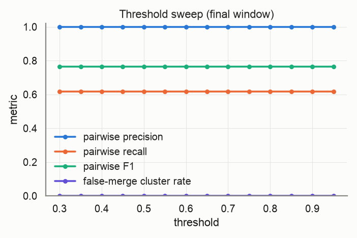
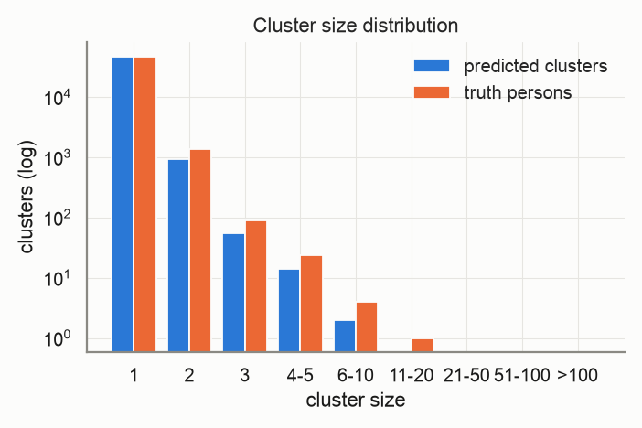
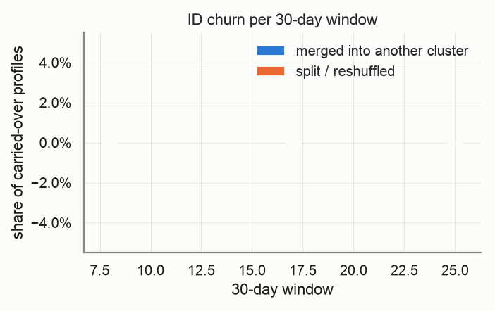
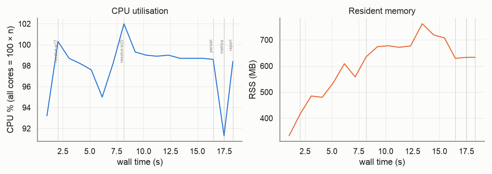

# Evaluation report — `public-olist`

_Generated 2026-10-22T11:09:26 · dataset `sample-50000` · resolver `aurora_cdp` · threshold 0.6 (engine scale 3.0) · block cap 100 · seed 20261022_

## Provenance

```json
{
  "adapter": "aurora_cdp",
  "aurora_cdp_commit": "08be538f5996b0a909a71b047d33d5b696b470b3",
  "aurora_cdp_commit_source": "git",
  "aurora_cdp_dirty_worktree": true,
  "aurora_cdp_path": "/Users/harshmaster/Desktop/Projects/aurora-cdp",
  "aurora_cdp_version": "0.1.0",
  "harness_commit": "01795d854517e2c3a1540f4f0290be9ec53bf450",
  "harness_version": "0.1.0",
  "seed": 20261022,
  "dataset": "/Users/harshmaster/Documents/aanya/datasets/aurora-testdata/public/olist/sample-50000",
  "run_at": "2026-10-22T05:39:07+00:00",
  "host": {
    "platform": "macOS",
    "platform_release": "25.5.0",
    "machine": "arm64",
    "python": "3.11.11",
    "cpu_count": 8,
    "mem_total_gb": 8.59,
    "hostname": "Harshs-Macbook-Air"
  },
  "run_name": "public-olist",
  "input_hash": "87ce1685a11eb001d904",
  "dataset_manifest_fingerprint": 17468295455860884585,
  "dataset_seed": null,
  "sample": null
}
```

<details><summary><code>adapter config</code></summary>

```json
{
  "cdp_path": null,
  "config": null,
  "threshold": 0.6,
  "datasource_column": "source",
  "datasource": "input",
  "windows": 4,
  "deterministic_ids": true,
  "seed": 20261022,
  "isolate_windows": false,
  "max_stored_pairs": 20000000,
  "epoch": "2026-01-01",
  "window_days": 30,
  "retries": 1,
  "timeout_s": null,
  "threshold_raw": 3.0,
  "score_scale": 5.0,
  "engine_path": "/Users/harshmaster/Desktop/Projects/aurora-cdp"
}
```

</details>

<details><summary><code>aurora_cdp_config (resolved / expanded)</code></summary>

```json
{
  "workspace": ".aurora",
  "outputs_dir": "outputs",
  "db_file": "aurora.duckdb",
  "normalize": {
    "default_region": "US",
    "phone_use_last10_for_match": true,
    "email_strip_plus_tag": true,
    "email_strip_gmail_dots": false,
    "email_junk_local_parts": [
      "test",
      "no",
      "none",
      "reservation",
      "admin",
      "contact",
      "guest",
      "info",
      "noreply",
      "no-reply",
      "donotreply",
      "unknown"
    ],
    "address_abbreviations": {
      "ST": "STREET",
      "AVE": "AVENUE",
      "RD": "ROAD",
      "BLVD": "BOULEVARD",
      "DR": "DRIVE",
      "LN": "LANE",
      "CT": "COURT",
      "STE": "SUITE",
      "APT": "APARTMENT",
      "N": "NORTH",
      "S": "SOUTH",
      "E": "EAST",
      "W": "WEST",
      "1ST": "FIRST",
      "2ND": "SECOND",
      "3RD": "THIRD"
    }
  },
  "blocklist": {
    "email_max_given_names": 20,
    "email_max_surnames": 20,
    "phone_max_given_names": 20,
    "address_max_given_names": 40
  },
  "blocking": {
    "block_size_limit": 100,
    "fk_block_size_limit": 1000,
    "strategies": [
      {
        "name": "email_exact",
        "type": "email"
      },
      {
        "name": "phone_exact",
        "type": "phone"
      },
      {
        "name": "name_postal",
        "type": "name_postal"
      },
      {
        "name": "name_birthdate",
        "type": "name_birthdate"
      },
      {
        "name": "loy_id_exact",
        "type": "loy_id"
      },
      {
        "name": "ck_exact",
        "type": "ck"
      },
      {
        "name": "fk",
        "type": "fk"
      }
    ]
  },
  "matcher": {
    "match_threshold": 3.0,
    "deterministic": {
      "ck_exact_score": 5.0,
      "loy_exact_score": 5.0,
      "email_exact_with_name_score": 4.5,
      "phone_exact_with_name_score": 4.2,
      "name_agreement_min": 0.85
    },
    "weights": {
      "bias": -2.5,
      "given_sim": 1.0,
      "surname_sim": 1.2,
      "email_exact": 3.0,
      "email_sim": 0.5,
      "email_sim_min": 0.92,
      "phone_exact": 2.5,
      "address_sim": 1.2,
      "postal_exact": 0.6,
      "birthdate_exact": 1.5,
      "fk_shared": 1.0,
      "name_mismatch_penalty": -1.5,
      "birthdate_conflict": -3.0
    },
    "hard_conflicts": {
      "birthdate": true,
      "birthdate_typo_tolerance": 2
    }
  },
  "cluster": {
    "supersized_min_size": 500,
    "conflict_attributes": [
      "birthdate"
    ]
  },
  "stable_id": {
    "enabled": true,
    "jitter_alert_pct": 2.0
  },
  "survivorship": {
    "source_priority": {
      "loyalty": 1,
      "crm": 2,
      "ecommerce": 3,
      "pos": 4
    },
    "field_priority": {},
    "recency_field": "update_dt",
    "attributes": [
      "given_name",
      "surname",
      "email",
      "phone",
      "address",
      "address2",
      "city",
      "state",
      "postal",
      "country",
      "birthdate"
    ]
  },
  "sources": {},
  "tuning": {
    "thresholds": [
      2.0,
      2.5,
      3.0,
      3.5,
      4.0
    ],
    "min_precision": 0.98
  }
}
```

</details>

## Limitations

- Public-corpus sanity check on a 50,000-profile sample (whole customers sampled, seed 20261022); the full corpus was not evaluated locally. See aurora-eval-harness/datasets/public/olist/README.md for the mapping and the pseudonymous loy_id assumption (recall ceiling ~0.64).

## Key metrics

```
pairwise P=1.000 R=0.617 F1=0.763 | B3 F1=0.994 | false-merge clusters=0.00% (profiles 0.00%) | split persons=1.16% | ID churn/30d mean=0.00% max=0.00%
```

| Metric | Value |
|---|---|
| Pairwise precision / recall / F1 | 1.000 / 0.617 / 0.763 |
| Pairs: TP / FP / FN | 1,258 / 0 / 781 |
| B-cubed precision / recall / F1 | 1.000 / 0.988 / 0.994 |
| Clusters predicted / truth persons (ratio) | 48,888 / 48,306 (1.012) |
| Exact-match clusters | 47,748 (98.84% of persons) |
| **False-merge rate** (clusters / profiles / pairs) | 0.00% / 0.00% / 0.00% |
| Over-merged clusters (max persons in one) | 0 (1) |
| Split persons (profiles) | 558 = 1.16% (2.44% of profiles) |
| **ID churn per 30-day window** mean / max | 0.00% / 0.00% |
| Harmful share of churn (purity dropped) | 0.00% |

> **Notes**
> - Engine scores are normalised from the 0–5 band scale to [0, 1] (score/5); the operating threshold 0.60 is the engine's 3.0 on its own scale.
> - The threshold sweep re-clusters engine pair scores with plain connected components, so it approximates (does not reproduce) the engine's conflict-aware clustering at other thresholds.

## Dataset

| | |
|---|---|
| profiles | 50,001 |
| persons | 48,306 |
| true_pairs | 2,039 |
| profiles_per_person_max | 17 |
| singleton_persons | 46,786 |
| raw_customer_rows | 99,441 |

## Resolver run

| | |
|---|---|
| time: engine_load | 1.03s |
| time: engine_blocking | 0.58s |
| time: engine_scoring | 0.05s |
| time: engine_clustering | 0.72s |
| time: engine_stable_id | 0.5s |
| time: engine_persist | 0.98s |
| time: resolve_windows | 12.59s |
| time: wall_total | 16.07s |
| candidate pairs | 1,258 |
| block `engine (final snapshot)` | 1,258 pairs, 1,015 groups, 0 over cap (n/a) |

Engine snapshots (one engine run per replayed window; `previous=` carries stable ids forward):

| window | run_date | records | pairs scored | edges | clusters | skipped blocks | jitter % | ids minted | ids retired | engine s |
|---|---|---|---|---|---|---|---|---|---|---|
| 0 | 2016-10-04 | 9 | 0 | 0 | 9 | 0 | 0.0 | 9 | 0 | 0.33 |
| 8 | 2017-06-01 | 5,924 | 85 | 85 | 5,843 | 0 | 0.0 | 5834 | 0 | 0.97 |
| 17 | 2018-02-26 | 29,522 | 675 | 675 | 28,910 | 0 | 0.0 | 23067 | 0 | 4.63 |
| 25 | 2018-10-24 | 50,001 | 1,258 | 1,258 | 48,888 | 0 | 0.0 | 19978 | 0 | 6.66 |

## Threshold sweep (final window)

| threshold | precision | recall | F1 | B³ F1 | false-merge clusters | split persons | clusters |
|---|---|---|---|---|---|---|---|
| 0.30 | 1.000 | 0.617 | 0.763 | 0.994 | 0.00% | 1.16% | 48,888 |
| 0.35 | 1.000 | 0.617 | 0.763 | 0.994 | 0.00% | 1.16% | 48,888 |
| 0.40 | 1.000 | 0.617 | 0.763 | 0.994 | 0.00% | 1.16% | 48,888 |
| 0.45 | 1.000 | 0.617 | 0.763 | 0.994 | 0.00% | 1.16% | 48,888 |
| 0.50 | 1.000 | 0.617 | 0.763 | 0.994 | 0.00% | 1.16% | 48,888 |
| 0.55 | 1.000 | 0.617 | 0.763 | 0.994 | 0.00% | 1.16% | 48,888 |
| 0.60 | 1.000 | 0.617 | 0.763 | 0.994 | 0.00% | 1.16% | 48,888 |
| 0.65 | 1.000 | 0.617 | 0.763 | 0.994 | 0.00% | 1.16% | 48,888 |
| 0.70 | 1.000 | 0.617 | 0.763 | 0.994 | 0.00% | 1.16% | 48,888 |
| 0.75 | 1.000 | 0.617 | 0.763 | 0.994 | 0.00% | 1.16% | 48,888 |
| 0.80 | 1.000 | 0.617 | 0.763 | 0.994 | 0.00% | 1.16% | 48,888 |
| 0.85 | 1.000 | 0.617 | 0.763 | 0.994 | 0.00% | 1.16% | 48,888 |
| 0.90 | 1.000 | 0.617 | 0.763 | 0.994 | 0.00% | 1.16% | 48,888 |
| 0.95 | 1.000 | 0.617 | 0.763 | 0.994 | 0.00% | 1.16% | 48,888 |

Best F1 on this grid: threshold **0.30** (F1 0.763). Run `scripts/tune.py` for finer grids, precision-constrained objectives and weight search.



## Clusters



| | predicted | truth |
|---|---|---|
| mean | 1.02 | 1.04 |
| p50 | 1.00 | 1.00 |
| p90 | 1.00 | 1.00 |
| p99 | 2.00 | 2.00 |
| max | 9 | 17 |
| singletons | 47,873 | 46,786 |

## Over-merge detector

0 predicted clusters conflate ≥2 persons, covering 0 profiles and 0 persons. 0 accepted edges cross a person boundary.

Which agreeing feature carried the bad edges (an edge can count in several columns; `only` = that feature was the sole agreement):

| feature | bad edges agreeing | sole agreement |
|---|---|---|
| email | 0 | 0 |
| phone | 0 | 0 |
| dob | 0 | 0 |
| postal | 0 | 0 |
| name | 0 | 0 |
| addr | 0 | 0 |
| engine_deterministic | 0 | 0 |
| engine_scored | 0 | 0 |
| engine_trivial_duplicate | 0 | 0 |

## ID churn per 30-day window

Churn = carried-over profiles whose stable cluster id changed vs the previous window. *merge* = the profile's whole previous cluster was absorbed; *split* = otherwise. *harmful* = the profile's new cluster is less pure for its true person than the old one.



| window | profiles | clusters | new | carried | churned | churn rate | merge | split | harmful | justified |
|---|---|---|---|---|---|---|---|---|---|---|
| 0 | 9 | 9 | – | – | – | – | – | – | – | – |
| 8 | 5,924 | 5,843 | 5,915 | 9 | 0 | 0.00% | 0 | 0 | 0 | 0 |
| 17 | 29,522 | 28,910 | 23,598 | 5,924 | 0 | 0.00% | 0 | 0 | 0 | 0 |
| 25 | 50,001 | 48,888 | 20,479 | 29,522 | 0 | 0.00% | 0 | 0 | 0 | 0 |

Quality per window snapshot:

| window | profiles | precision | recall | F1 | false-merge clusters |
|---|---|---|---|---|---|
| 0 | 9 | 1.000 | 1.000 | 1.000 | 0.00% |
| 8 | 5,924 | 1.000 | 0.582 | 0.736 | 0.00% |
| 17 | 29,522 | 1.000 | 0.623 | 0.767 | 0.00% |
| 25 | 50,001 | 1.000 | 0.617 | 0.763 | 0.00% |

## Resources

Wall 18.3s · peak RSS 762 MB · mean CPU 98% (peak 102%, 8 cores) · 18 samples @ 1.0s



| stage | wall s | peak RSS MB | mean CPU % |
|---|---|---|---|
| resolve:w8 | 1.2 | 333 | 93 |
| resolve:w17 | 5.7 | 609 | 98 |
| resolve:w25 | 8.6 | 762 | 99 |
| persist | 0.3 | 629 | 99 |
| metrics | 1.7 | 633 | 91 |
| report | 0.0 | 633 | 98 |

## Failures and retries

0 stage failure(s), 0 retry(ies). Full log: `events.jsonl`.

## Metric validation

17 golden/sanity cases, 91 hand-computed checks run through `aurora_eval.score` (the reports' own code path) — **ALL PASSED**. Metrics marked *untrusted* have no independent check and must not be used for gating.

| metric | status | basis |
|---|---|---|
| pairwise.precision/recall/f1 | ✅ validated | A: pairwise |
| pairwise.tp/fp/fn pairs | ✅ validated | A: pairwise |
| cluster.bcubed_precision/recall/f1 | ✅ validated | A: B-cubed |
| cluster.false_merge (cluster/profile/pair) | ✅ validated | A: false-merge |
| cluster.split (persons/profiles) | ✅ validated | A: split |
| cluster.exact_match_rate / cluster_count_ratio | ✅ validated | A: exact / ratio |
| cluster.pred_size_dist / truth_size_dist | ✅ validated | A: size distributions |
| churn.rate / merge vs split | ✅ validated | C: churn rate, merge vs split |
| churn.harmful vs justified | ✅ validated | C: harmful vs justified |
| curves.blocking_recall | ✅ validated | A: blocking recall |
| curves.auc_roc / average_precision | ✅ validated | A: ROC / PR |
| curves.operating_point | ✅ validated | A: operating point @0.75 |
| per_window quality | ✅ validated | C: per-window quality |
| sanity: perfect input | ✅ validated | perfect prediction |
| sanity: all-singleton input | ✅ validated | all singletons |
| sanity: all-merged input | ✅ validated | everything merged |
| sanity: disjoint prediction | ✅ validated | disjoint prediction |
| sanity: disjoint pairs file | ✅ validated | pairs file with no true pair |
| threshold_sweep | ≈ approximation | approximation — harness connected components over engine pair scores; not the engine's conflict-aware clustering |
| overmerge.dominant_feature | ⚠️ untrusted | untrusted — attribution by engine match_type only (engine pair features are not exported) |
| curves.score_hist | ⚠️ untrusted | untrusted — diagnostic histogram, no golden case |
| engine.metrics (pairs_blocked, skipped_blocks, cluster_size_distribution, timings) | ⚠️ untrusted | untrusted — reported verbatim from the engine, not independently recomputed |
| engine.jitter_pct per snapshot | ✅ cross-checked | engine jitter == harness churn rate per window |

## Reproduce

```bash
# dataset: /Users/harshmaster/Documents/aanya/datasets/aurora-testdata/public/olist/sample-50000
python -m aurora_eval.cli run --adapter aurora_cdp --windows 4 --seed 20261022 --date 2026-10-22 --force --dataset /Users/harshmaster/Documents/aanya/datasets/aurora-testdata/public/olist/sample-50000 --run-name public-olist --limitation Public-corpus sanity check on a 50,000-profile sample (whole customers sampled, seed 20261022); the full corpus was not evaluated locally. See aurora-eval-harness/datasets/public/olist/README.md for the mapping and the pseudonymous loy_id assumption (recall ceiling ~0.64).
# resume after interruption: same command (checkpoints in /Users/harshmaster/Desktop/Projects/aurora-eval-harness/runs/public-olist/checkpoints)
```

## Files

- `metrics.json` — everything above, machine-readable (same shape as `aurora_eval.score()` output)
- `plots/` — PNGs embedded here
- `overmerge_clusters.json`, `overmerge_edges.parquet` — drill-down for the detector
- `provenance.json`, `resources.jsonl`, `events.jsonl`, `state.json` — provenance, resource samples, failure/retry log, stage state
