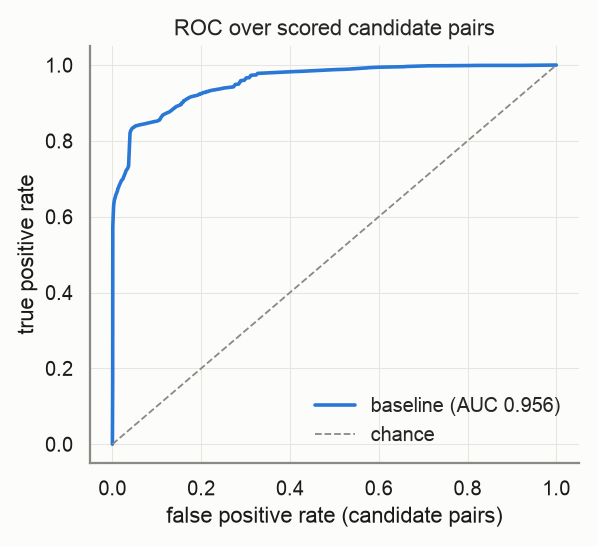
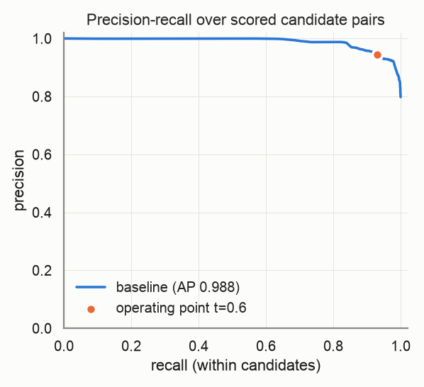
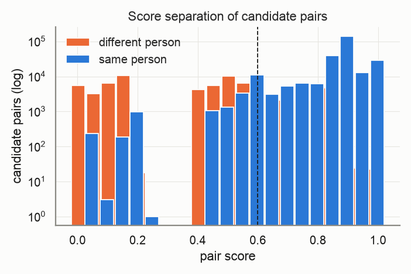
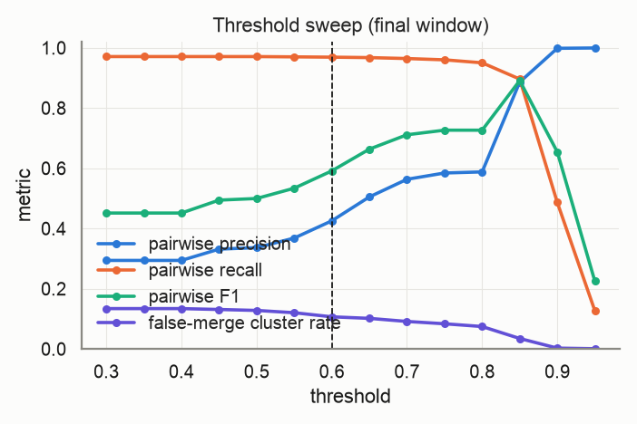
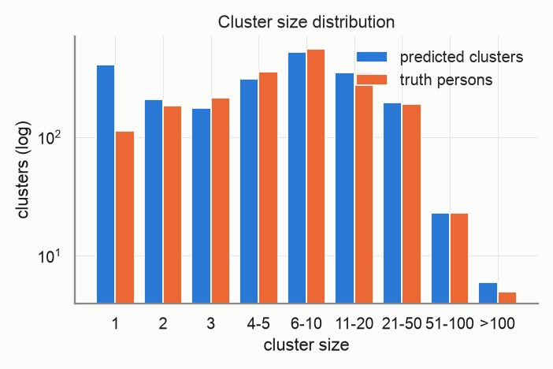
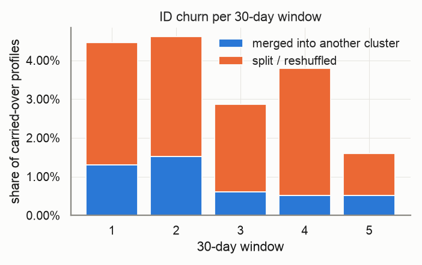
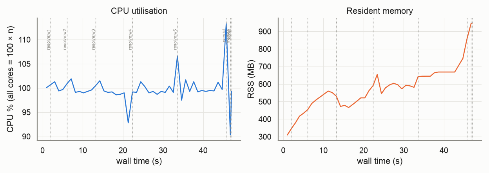

# Evaluation report — `small-ordinal`

_Generated 2026-10-22T15:05:58 · dataset `small` · resolver `aurora_cdp` · threshold 0.6 (engine scale 3.0) · block cap 100 · seed 20261022_

## Provenance

```json
{
  "adapter": "aurora_cdp",
  "aurora_cdp_commit": "dc2387ee4397dae7df3a9d0ffc1f2aee8983bb86",
  "aurora_cdp_commit_source": "git",
  "aurora_cdp_dirty_worktree": true,
  "aurora_cdp_path": "/Users/harshmaster/Desktop/Projects/aurora-cdp",
  "aurora_cdp_version": "0.1.0",
  "harness_commit": "1211f2017a2dcaf198a4002f7323561ee6e8edca",
  "harness_version": "0.1.0",
  "seed": 20261022,
  "dataset": "/Users/harshmaster/Documents/aanya/datasets/aurora-testdata/small",
  "run_at": "2026-10-22T09:35:11+00:00",
  "host": {
    "platform": "macOS",
    "platform_release": "25.5.0",
    "machine": "arm64",
    "python": "3.11.11",
    "cpu_count": 8,
    "mem_total_gb": 8.59,
    "hostname": "Harshs-Macbook-Air"
  },
  "run_name": "small-ordinal",
  "input_hash": "c1f6aaa50c8acc7e60d9",
  "dataset_manifest_fingerprint": 1314847783426890627,
  "dataset_seed": 42,
  "sample": null
}
```

<details><summary><code>adapter config</code></summary>

```json
{
  "cdp_path": null,
  "config": "/Users/harshmaster/Desktop/Projects/aurora-cdp/.tmp/overlays/ordinal.yaml",
  "threshold": 0.6,
  "datasource_column": "source",
  "datasource": "input",
  "windows": "replay",
  "deterministic_ids": true,
  "seed": 20261022,
  "isolate_windows": false,
  "max_stored_pairs": 20000000,
  "epoch": "2026-01-01",
  "window_days": 30,
  "retries": 1,
  "timeout_s": null,
  "threshold_raw": 3.0,
  "score_scale": 5.0,
  "engine_path": "/Users/harshmaster/Desktop/Projects/aurora-cdp"
}
```

</details>

<details><summary><code>aurora_cdp_config (resolved / expanded)</code></summary>

```json
{
  "workspace": ".aurora",
  "outputs_dir": "outputs",
  "db_file": "aurora.duckdb",
  "normalize": {
    "default_region": "US",
    "phone_use_last10_for_match": true,
    "email_strip_plus_tag": true,
    "email_strip_gmail_dots": false,
    "nickname_file": null,
    "address_parsing": false,
    "email_junk_local_parts": [
      "test",
      "no",
      "none",
      "reservation",
      "admin",
      "contact",
      "guest",
      "info",
      "noreply",
      "no-reply",
      "donotreply",
      "unknown"
    ],
    "address_abbreviations": {
      "ST": "STREET",
      "AVE": "AVENUE",
      "RD": "ROAD",
      "BLVD": "BOULEVARD",
      "DR": "DRIVE",
      "LN": "LANE",
      "CT": "COURT",
      "STE": "SUITE",
      "APT": "APARTMENT",
      "N": "NORTH",
      "S": "SOUTH",
      "E": "EAST",
      "W": "WEST",
      "1ST": "FIRST",
      "2ND": "SECOND",
      "3RD": "THIRD"
    }
  },
  "blocklist": {
    "email_max_given_names": 20,
    "email_max_surnames": 20,
    "phone_max_given_names": 20,
    "address_max_given_names": 40
  },
  "blocking": {
    "block_size_limit": 100,
    "fk_block_size_limit": 1000,
    "max_pairs_per_block": 500000,
    "refine_target": 100,
    "sn_window": 25,
    "collapse_trivial_dupes": true,
    "persist_blocking_keys": true,
    "strategy_source": "fixed",
    "learned_strategies_file": null,
    "learned_keep_types": [
      "ck",
      "loy_id",
      "fk"
    ],
    "dnf": {
      "max_terms": 2,
      "min_positive_pairs": 200,
      "min_predicate_pc": 0.01,
      "target_pc": 0.95,
      "min_gain_pairs": 5,
      "pairs_per_record_budget": 20,
      "sample_records": 20000,
      "sample_positive_pairs": 5000,
      "sample_seed": 0,
      "labels": "self"
    },
    "refine_keys": {
      "email": [
        "name3",
        "postal",
        "birthdate",
        "update_month",
        "given3"
      ],
      "phone": [
        "name3",
        "postal",
        "birthdate",
        "update_month",
        "given3"
      ],
      "name_postal": [
        "email",
        "phone",
        "birthdate",
        "house_number",
        "update_month"
      ],
      "name_birthdate": [
        "email",
        "phone",
        "postal",
        "house_number",
        "update_month"
      ],
      "name": [
        "postal",
        "birthdate",
        "email",
        "phone",
        "house_number",
        "update_month"
      ],
      "loy_id": [
        "name3",
        "postal",
        "birthdate",
        "update_month"
      ],
      "ck": [
        "name3",
        "postal",
        "birthdate",
        "update_month"
      ],
      "fk": [
        "name3",
        "postal",
        "birthdate",
        "update_month"
      ],
      "dnf": [
        "postal",
        "birthdate",
        "email",
        "phone",
        "name3",
        "update_month"
      ]
    },
    "strategies": [
      {
        "name": "email_exact",
        "type": "email"
      },
      {
        "name": "phone_exact",
        "type": "phone"
      },
      {
        "name": "name_postal",
        "type": "name_postal"
      },
      {
        "name": "name_birthdate",
        "type": "name_birthdate"
      },
      {
        "name": "name",
        "type": "name",
        "max_pairs_per_block": 50000
      },
      {
        "name": "loy_id_exact",
        "type": "loy_id"
      },
      {
        "name": "ck_exact",
        "type": "ck"
      },
      {
        "name": "fk",
        "type": "fk"
      }
    ]
  },
  "matcher": {
    "match_threshold": 3.0,
    "scorer": "ordinal",
    "ordinal": {
      "model_file": null,
      "retrain": "auto",
      "save_model": true,
      "apply_rules_first": true,
      "levels": 3,
      "self_train_rounds": 3,
      "confidence_margin": 1.0,
      "negatives_per_positive": 2.0,
      "max_train_pairs": 40000,
      "min_positive_pairs": 300,
      "min_negative_pairs": 300,
      "l2": 0.001,
      "lr": 0.05,
      "epochs": 300,
      "sample_seed": 0
    },
    "score_chunk_size": 250000,
    "persist_features": false,
    "export_expanded_dupe_pairs": true,
    "max_expanded_pairs": 50000000,
    "deterministic": {
      "ck_exact_score": 5.0,
      "loy_exact_score": 5.0,
      "email_exact_with_name_score": 4.5,
      "phone_exact_with_name_score": 4.2,
      "name_agreement_min": 0.85
    },
    "weights": {
      "bias": -2.5,
      "given_sim": 1.0,
      "surname_sim": 1.2,
      "email_exact": 3.0,
      "email_sim": 0.5,
      "email_sim_min": 0.92,
      "phone_exact": 2.5,
      "address_sim": 1.2,
      "postal_exact": 0.6,
      "birthdate_exact": 1.5,
      "fk_shared": 1.0,
      "name_mismatch_penalty": -1.5,
      "name_mismatch_floor": 0.6,
      "address_house_number_mismatch_cap": 0.3,
      "birthdate_conflict": -3.0
    },
    "hard_conflicts": {
      "birthdate": true,
      "birthdate_typo_tolerance": 2
    }
  },
  "cluster": {
    "supersized_min_size": 500,
    "conflict_attributes": [
      "birthdate"
    ]
  },
  "storage": {
    "duckdb": {
      "memory_limit": "3GB",
      "threads": 4,
      "temp_directory": null,
      "preserve_insertion_order": false
    }
  },
  "stable_id": {
    "enabled": true,
    "jitter_alert_pct": 2.0
  },
  "survivorship": {
    "source_priority": {
      "loyalty": 1,
      "crm": 2,
      "ecommerce": 3,
      "pos": 4
    },
    "field_priority": {},
    "recency_field": "update_dt",
    "attributes": [
      "given_name",
      "surname",
      "email",
      "phone",
      "address",
      "address2",
      "city",
      "state",
      "postal",
      "country",
      "birthdate"
    ]
  },
  "sources": {},
  "tuning": {
    "thresholds": [
      2.0,
      2.5,
      3.0,
      3.5,
      4.0
    ],
    "min_precision": 0.98
  }
}
```

</details>

## Key metrics

```
pairwise P=0.952 R=0.957 F1=0.955 | B3 F1=0.949 | false-merge clusters=8.66% (profiles 17.33%) | split persons=20.25% | ID churn/30d mean=3.46% max=4.61% | AUC-ROC=0.956 AP=0.988 blocking-recall=0.878
```

| Metric | Value |
|---|---|
| Pairwise precision / recall / F1 | 0.952 / 0.957 / 0.955 |
| Pairs: TP / FP / FN | 286,334 / 14,318 / 12,912 |
| B-cubed precision / recall / F1 | 0.948 / 0.950 / 0.949 |
| Clusters predicted / truth persons (ratio) | 2,205 / 2,000 (1.103) |
| Exact-match clusters | 1,335 (66.75% of persons) |
| **False-merge rate** (clusters / profiles / pairs) | 8.66% / 17.33% / 4.76% |
| Over-merged clusters (max persons in one) | 191 (6) |
| Split persons (profiles) | 405 = 20.25% (31.52% of profiles) |
| **ID churn per 30-day window** mean / max | 3.46% / 4.61% |
| Harmful share of churn (purity dropped) | 29.64% |
| AUC-ROC / average precision (candidate pairs) | 0.956 / 0.988 |
| Blocking recall (true pairs reaching scoring) | 0.878 |
| Operating point P / R-in-candidates / effective R | 0.944 / 0.931 / 0.817 |
| Scored candidate pairs (stored fraction) | 329,263 (100.00%) |

> **Notes**
> - Engine scores are normalised from the 0–5 band scale to [0, 1] (score/5); the operating threshold 0.60 is the engine's 3.0 on its own scale.
> - The threshold sweep re-clusters engine pair scores with plain connected components, so it approximates (does not reproduce) the engine's conflict-aware clustering at other thresholds.

## Dataset

| | |
|---|---|
| persons | 2,000 |
| persons_with_profiles | 2,000 |
| profiles | 20,000 |
| months | 6 |
| true_pairs | 299,246 |
| households | 131 |
| movers | 198 |
| exact_duplicates | 1,864 |
| profiles_per_person_max | 368 |

Regenerate: `python scripts/generate.py --tier small --seed 42`

## Resolver run

| | |
|---|---|
| time: engine_load | 0.34s |
| time: engine_blocking | 4.7s |
| time: engine_scoring | 32.03s |
| time: engine_clustering | 0.6s |
| time: engine_stable_id | 0.14s |
| time: engine_persist | 0.33s |
| time: resolve_windows | 44.74s |
| time: wall_total | 45.55s |
| candidate pairs | 329,263 |
| block `engine (final snapshot)` | 97,863 pairs, 6,896 groups, 0 over cap (n/a) |

Engine snapshots (one engine run per replayed window; `previous=` carries stable ids forward):

| window | run_date | records | pairs scored | edges | clusters | skipped blocks | jitter % | ids minted | ids retired | engine s |
|---|---|---|---|---|---|---|---|---|---|---|
| 0 | 2026-01-31 | 3,213 | 8,798 | 4,477 | 1,264 | 0 | 0.0 | 1264 | 0 | 1.49 |
| 1 | 2026-03-02 | 6,614 | 35,373 | 13,898 | 1,717 | 0 | 4.4507 | 492 | 39 | 3.61 |
| 2 | 2026-04-01 | 9,981 | 83,412 | 28,229 | 1,879 | 0 | 4.6114 | 236 | 74 | 6.86 |
| 3 | 2026-05-01 | 13,381 | 149,235 | 45,140 | 2,010 | 0 | 2.8654 | 177 | 46 | 9.73 |
| 4 | 2026-05-31 | 16,720 | 229,027 | 57,813 | 2,141 | 0 | 3.789 | 175 | 44 | 10.94 |
| 5 | 2026-06-30 | 20,000 | 329,263 | 75,510 | 2,205 | 0 | 1.5969 | 113 | 49 | 12.11 |

## Score quality (candidate pairs)

 



## Threshold sweep (final window)

| threshold | precision | recall | F1 | B³ F1 | false-merge clusters | split persons | clusters |
|---|---|---|---|---|---|---|---|
| 0.30 | 0.294 | 0.971 | 0.451 | 0.825 | 13.40% | 12.75% | 1,620 |
| 0.35 | 0.294 | 0.971 | 0.451 | 0.825 | 13.40% | 12.75% | 1,620 |
| 0.40 | 0.294 | 0.971 | 0.451 | 0.825 | 13.40% | 12.75% | 1,620 |
| 0.45 | 0.331 | 0.971 | 0.494 | 0.832 | 13.10% | 12.80% | 1,641 |
| 0.50 | 0.336 | 0.971 | 0.500 | 0.835 | 12.79% | 12.90% | 1,658 |
| 0.55 | 0.368 | 0.970 | 0.534 | 0.847 | 12.03% | 13.65% | 1,721 |
| 0.60 | 0.425 | 0.969 | 0.591 | 0.867 | 10.67% | 14.80% | 1,809 |
| 0.65 | 0.505 | 0.967 | 0.664 | 0.873 | 10.15% | 15.65% | 1,852 |
| 0.70 | 0.563 | 0.964 | 0.711 | 0.881 | 9.13% | 17.85% | 1,950 |
| 0.75 | 0.584 | 0.960 | 0.726 | 0.885 | 8.36% | 20.55% | 2,046 |
| 0.80 | 0.588 | 0.950 | 0.726 | 0.883 | 7.44% | 24.25% | 2,190 |
| 0.85 | 0.886 | 0.896 | 0.891 | 0.897 | 3.47% | 46.15% | 3,196 |
| 0.90 | 0.998 | 0.486 | 0.654 | 0.591 | 0.27% | 88.05% | 8,753 |
| 0.95 | 0.999 | 0.127 | 0.225 | 0.352 | 0.09% | 92.30% | 11,547 |

Best F1 on this grid: threshold **0.85** (F1 0.891). Run `scripts/tune.py` for finer grids, precision-constrained objectives and weight search.



## Clusters



| | predicted | truth |
|---|---|---|
| mean | 9.07 | 10.00 |
| p50 | 5.00 | 6.00 |
| p90 | 21.00 | 21.00 |
| p99 | 54.00 | 55.02 |
| max | 363 | 368 |
| singletons | 413 | 113 |

## Over-merge detector

191 predicted clusters conflate ≥2 persons, covering 3,466 profiles and 421 persons. 14,422 accepted edges cross a person boundary.

Which agreeing feature carried the bad edges (an edge can count in several columns; `only` = that feature was the sole agreement):

| feature | bad edges agreeing | sole agreement |
|---|---|---|
| engine_scored | 14,311 | 14,311 |
| engine_deterministic | 89 | 89 |
| engine_trivial_duplicate | 22 | 22 |
| email | 0 | 0 |
| phone | 0 | 0 |
| dob | 0 | 0 |
| postal | 0 | 0 |
| name | 0 | 0 |
| addr | 0 | 0 |

Worst clusters (full list in `overmerge_clusters.json`, edges in `overmerge_edges.parquet`):

| cluster | persons | profiles | dominant feature | sample names by person |
|---|---|---|---|---|
| `w0-58f11bbee4bf5646` | 6 | 110 | engine_scored | ps_0000762: james rodriguez; ps_0001010: Patrick Rodriguez, patrick rodriguez; ps_0001991: Jack Rodriguez, jack rodriguez; ps_0001414: john rodriguez |
| `w0-5488df64ab91a5fe` | 6 | 31 | engine_scored | ps_0001095: matthew smith, matthew ssmith; ps_0001037: Matthew Smith, matthew sith; ps_0000791: Matt Smith, Matthew Smith; ps_0001281: MATTHEW SMITH, Matt Smith |
| `w0-2f5ae7e656872474` | 6 | 13 | engine_scored | ps_0000362: John Smith; ps_0001528: John Smith, Johnny Smith; ps_0000059: John Smith; ps_0000984: Jack Smith, john smith |
| `w0-a6df328489323f8a` | 5 | 34 | engine_scored | ps_0001140: thomas smiht, thomas smith; ps_0000986: Thomas Smith; ps_0001598: Anna Smith, anna smith; ps_0001992: RHOMAS SMITH, Thomas Smithh |
| `w1-fe8a5adba1144379` | 5 | 28 | engine_scored | ps_0000731: James Rodriguez, j rodriguez; ps_0000594: James Rodriguez, james rodriguez; ps_0001314: james rodriguez; ps_0000762: james rodriguez |
| `w4-aec303089cebc56b` | 5 | 22 | engine_scored | ps_0001939: James Johnson; ps_0000423: James, james hohnson; ps_0001965: James Johnson; ps_0001235: J Johnsoh, james johnson |
| `w0-e5df2d44fb469f6e` | 5 | 19 | engine_scored | ps_0000081: M BROWN, matthew brown; ps_0000132: gray; ps_0000123: Matthew Brown; ps_0001629: matthew brown |
| `w2-df17e5b950a2ddf5` | 5 | 15 | engine_scored | ps_0000617: Thomas Smith; ps_0000066: Jason Smith, jason smith; ps_0000128: James Smith; ps_0000227: jason smith |
| `w0-b0fe719d285beec5` | 5 | 14 | engine_scored | ps_0001442: JOHN GUTIERREZ, KOHN GUTIERREZ; ps_0000552: Robert Gutisrrez, robert gutierrez; ps_0001628: Robert Gutierrez, roberg gutierrez; ps_0000600: Andrew Gutierrez, andrew gutierrez |
| `w0-c0f0f62ec742a5a3` | 4 | 59 | engine_scored | ps_0001239: John Hernandez; ps_0001574: John Heranndez; ps_0001545: Daniek Hernandez; ps_0000736: Robert Hernandez |
| `w0-d5bf7dc1e9d7b46f` | 4 | 55 | engine_scored | ps_0001935: JAMES MILLER, James Miller; ps_0001389: James Miller; ps_0000734: James Miller, james miller; ps_0000246: j miller |
| `w2-39960bb98caf91c9` | 4 | 28 | engine_scored | ps_0001440: MICHAEL MILLER, michael miller; ps_0000692: m mills; ps_0000837: M Miller; ps_0001090: M Mills |

## ID churn per 30-day window

Churn = carried-over profiles whose stable cluster id changed vs the previous window. *merge* = the profile's whole previous cluster was absorbed; *split* = otherwise. *harmful* = the profile's new cluster is less pure for its true person than the old one.



| window | profiles | clusters | new | carried | churned | churn rate | merge | split | harmful | justified |
|---|---|---|---|---|---|---|---|---|---|---|
| 0 | 3,213 | 1,264 | – | – | – | – | – | – | – | – |
| 1 | 6,614 | 1,717 | 3,401 | 3,213 | 143 | 4.45% | 42 | 101 | 29 | 114 |
| 2 | 9,981 | 1,879 | 3,367 | 6,614 | 305 | 4.61% | 100 | 205 | 153 | 152 |
| 3 | 13,381 | 2,010 | 3,400 | 9,981 | 286 | 2.87% | 61 | 225 | 128 | 158 |
| 4 | 16,720 | 2,141 | 3,339 | 13,381 | 507 | 3.79% | 68 | 439 | 62 | 445 |
| 5 | 20,000 | 2,205 | 3,280 | 16,720 | 267 | 1.60% | 87 | 180 | 75 | 192 |

Quality per window snapshot:

| window | profiles | precision | recall | F1 | false-merge clusters |
|---|---|---|---|---|---|
| 0 | 3,213 | 0.859 | 0.949 | 0.902 | 6.33% |
| 1 | 6,614 | 0.927 | 0.957 | 0.942 | 6.81% |
| 2 | 9,981 | 0.925 | 0.957 | 0.940 | 9.05% |
| 3 | 13,381 | 0.921 | 0.946 | 0.933 | 10.20% |
| 4 | 16,720 | 0.951 | 0.955 | 0.953 | 8.69% |
| 5 | 20,000 | 0.952 | 0.957 | 0.955 | 8.66% |

## Resources

Wall 47.0s · peak RSS 944 MB · mean CPU 100% (peak 113%, 8 cores) · 47 samples @ 1.0s



| stage | wall s | peak RSS MB | mean CPU % |
|---|---|---|---|
| resolve:w0 | 1.6 | 310 | 100 |
| resolve:w1 | 3.7 | 434 | 100 |
| resolve:w2 | 7.0 | 560 | 100 |
| resolve:w3 | 9.9 | 562 | 99 |
| resolve:w4 | 11.1 | 654 | 100 |
| resolve:w5 | 12.3 | 745 | 100 |
| persist | 0.4 | 855 | 113 |
| metrics | 1.0 | 944 | 90 |
| report | 0.0 | 944 | 99 |

## Failures and retries

0 stage failure(s), 0 retry(ies). Full log: `events.jsonl`.

## Metric validation

17 golden/sanity cases, 91 hand-computed checks run through `aurora_eval.score` (the reports' own code path) — **ALL PASSED**. Metrics marked *untrusted* have no independent check and must not be used for gating.

| metric | status | basis |
|---|---|---|
| pairwise.precision/recall/f1 | ✅ validated | A: pairwise |
| pairwise.tp/fp/fn pairs | ✅ validated | A: pairwise |
| cluster.bcubed_precision/recall/f1 | ✅ validated | A: B-cubed |
| cluster.false_merge (cluster/profile/pair) | ✅ validated | A: false-merge |
| cluster.split (persons/profiles) | ✅ validated | A: split |
| cluster.exact_match_rate / cluster_count_ratio | ✅ validated | A: exact / ratio |
| cluster.pred_size_dist / truth_size_dist | ✅ validated | A: size distributions |
| churn.rate / merge vs split | ✅ validated | C: churn rate, merge vs split |
| churn.harmful vs justified | ✅ validated | C: harmful vs justified |
| curves.blocking_recall | ✅ validated | A: blocking recall |
| curves.auc_roc / average_precision | ✅ validated | A: ROC / PR |
| curves.operating_point | ✅ validated | A: operating point @0.75 |
| per_window quality | ✅ validated | C: per-window quality |
| sanity: perfect input | ✅ validated | perfect prediction |
| sanity: all-singleton input | ✅ validated | all singletons |
| sanity: all-merged input | ✅ validated | everything merged |
| sanity: disjoint prediction | ✅ validated | disjoint prediction |
| sanity: disjoint pairs file | ✅ validated | pairs file with no true pair |
| threshold_sweep | ≈ approximation | approximation — harness connected components over engine pair scores; not the engine's conflict-aware clustering |
| overmerge.dominant_feature | ⚠️ untrusted | untrusted — attribution by engine match_type only (engine pair features are not exported) |
| curves.score_hist | ⚠️ untrusted | untrusted — diagnostic histogram, no golden case |
| engine.metrics (pairs_blocked, skipped_blocks, cluster_size_distribution, timings) | ⚠️ untrusted | untrusted — reported verbatim from the engine, not independently recomputed |
| engine.jitter_pct per snapshot | ✅ cross-checked | engine jitter == harness churn rate per window |

## Reproduce

```bash
# dataset: /Users/harshmaster/Documents/aanya/datasets/aurora-testdata/small  (regenerate: python scripts/generate.py --tier small --seed 42)
python -m aurora_eval.cli run --adapter aurora_cdp --dataset small --seed 20261022 --run-name small-ordinal --date 2026-10-22 --reports-root /Users/harshmaster/Desktop/Projects/aurora-cdp/reports --cdp-config /Users/harshmaster/Desktop/Projects/aurora-cdp/.tmp/overlays/ordinal.yaml
# resume after interruption: same command (checkpoints in /Users/harshmaster/Desktop/Projects/aurora-eval-harness/runs/small-ordinal/checkpoints)
```

## Files

- `metrics.json` — everything above, machine-readable (same shape as `aurora_eval.score()` output)
- `plots/` — PNGs embedded here
- `overmerge_clusters.json`, `overmerge_edges.parquet` — drill-down for the detector
- `provenance.json`, `resources.jsonl`, `events.jsonl`, `state.json` — provenance, resource samples, failure/retry log, stage state
