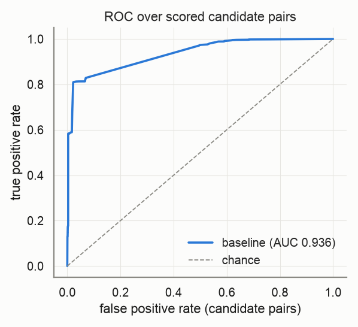
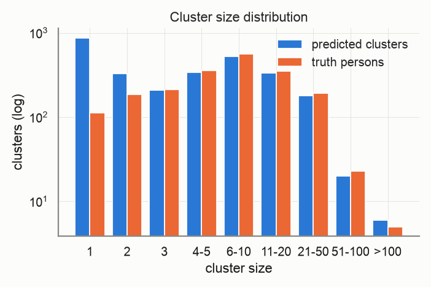
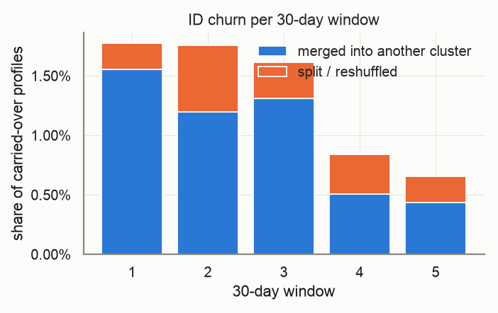
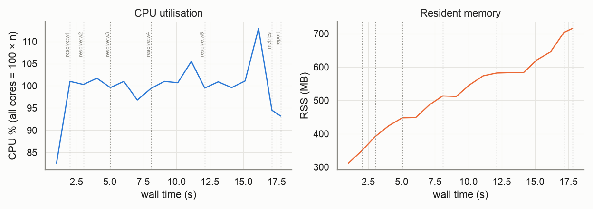

# Evaluation report — `small-v3`

_Generated 2026-10-22T14:58:44 · dataset `small` · resolver `aurora_cdp` · threshold 0.6 (engine scale 3.0) · block cap 100 · seed 20261022_

## Provenance

```json
{
  "adapter": "aurora_cdp",
  "aurora_cdp_commit": "6d2cf9b8f9fb8ddae75f9df497de9e562e8afdaf",
  "aurora_cdp_commit_source": "git",
  "aurora_cdp_dirty_worktree": false,
  "aurora_cdp_path": "/Users/harshmaster/Desktop/Projects/aurora-cdp",
  "aurora_cdp_version": "0.1.0",
  "harness_commit": "c7db02bd172753c14100c4faff54cd1c0c84ad4f",
  "harness_version": "0.1.0",
  "seed": 20261022,
  "dataset": "/Users/harshmaster/Documents/aanya/datasets/aurora-testdata/small",
  "run_at": "2026-10-22T09:28:26+00:00",
  "host": {
    "platform": "macOS",
    "platform_release": "25.5.0",
    "machine": "arm64",
    "python": "3.11.11",
    "cpu_count": 8,
    "mem_total_gb": 8.59,
    "hostname": "Harshs-Macbook-Air"
  },
  "run_name": "small-v3",
  "input_hash": "a4af30b814cc0bf7ff15",
  "dataset_manifest_fingerprint": 1314847783426890627,
  "dataset_seed": 42,
  "sample": null
}
```

<details><summary><code>adapter config</code></summary>

```json
{
  "cdp_path": null,
  "config": null,
  "threshold": 0.6,
  "datasource_column": "source",
  "datasource": "input",
  "windows": "replay",
  "deterministic_ids": true,
  "seed": 20261022,
  "isolate_windows": false,
  "max_stored_pairs": 20000000,
  "epoch": "2026-01-01",
  "window_days": 30,
  "retries": 1,
  "timeout_s": null,
  "threshold_raw": 3.0,
  "score_scale": 5.0,
  "engine_path": "/Users/harshmaster/Desktop/Projects/aurora-cdp"
}
```

</details>

<details><summary><code>aurora_cdp_config (resolved / expanded)</code></summary>

```json
{
  "workspace": ".aurora",
  "outputs_dir": "outputs",
  "db_file": "aurora.duckdb",
  "normalize": {
    "default_region": "US",
    "phone_use_last10_for_match": true,
    "email_strip_plus_tag": true,
    "email_strip_gmail_dots": false,
    "nickname_file": null,
    "address_parsing": false,
    "email_junk_local_parts": [
      "test",
      "no",
      "none",
      "reservation",
      "admin",
      "contact",
      "guest",
      "info",
      "noreply",
      "no-reply",
      "donotreply",
      "unknown"
    ],
    "address_abbreviations": {
      "ST": "STREET",
      "AVE": "AVENUE",
      "RD": "ROAD",
      "BLVD": "BOULEVARD",
      "DR": "DRIVE",
      "LN": "LANE",
      "CT": "COURT",
      "STE": "SUITE",
      "APT": "APARTMENT",
      "N": "NORTH",
      "S": "SOUTH",
      "E": "EAST",
      "W": "WEST",
      "1ST": "FIRST",
      "2ND": "SECOND",
      "3RD": "THIRD"
    }
  },
  "blocklist": {
    "email_max_given_names": 20,
    "email_max_surnames": 20,
    "phone_max_given_names": 20,
    "address_max_given_names": 40
  },
  "blocking": {
    "block_size_limit": 100,
    "fk_block_size_limit": 1000,
    "max_pairs_per_block": 500000,
    "refine_target": 100,
    "sn_window": 25,
    "collapse_trivial_dupes": true,
    "persist_blocking_keys": true,
    "strategy_source": "fixed",
    "learned_strategies_file": null,
    "learned_keep_types": [
      "ck",
      "loy_id",
      "fk"
    ],
    "dnf": {
      "max_terms": 2,
      "min_positive_pairs": 200,
      "min_predicate_pc": 0.01,
      "target_pc": 0.95,
      "min_gain_pairs": 5,
      "pairs_per_record_budget": 20,
      "sample_records": 20000,
      "sample_positive_pairs": 5000,
      "sample_seed": 0,
      "labels": "self"
    },
    "refine_keys": {
      "email": [
        "name3",
        "postal",
        "birthdate",
        "update_month",
        "given3"
      ],
      "phone": [
        "name3",
        "postal",
        "birthdate",
        "update_month",
        "given3"
      ],
      "name_postal": [
        "email",
        "phone",
        "birthdate",
        "house_number",
        "update_month"
      ],
      "name_birthdate": [
        "email",
        "phone",
        "postal",
        "house_number",
        "update_month"
      ],
      "name": [
        "postal",
        "birthdate",
        "email",
        "phone",
        "house_number",
        "update_month"
      ],
      "loy_id": [
        "name3",
        "postal",
        "birthdate",
        "update_month"
      ],
      "ck": [
        "name3",
        "postal",
        "birthdate",
        "update_month"
      ],
      "fk": [
        "name3",
        "postal",
        "birthdate",
        "update_month"
      ],
      "dnf": [
        "postal",
        "birthdate",
        "email",
        "phone",
        "name3",
        "update_month"
      ]
    },
    "strategies": [
      {
        "name": "email_exact",
        "type": "email"
      },
      {
        "name": "phone_exact",
        "type": "phone"
      },
      {
        "name": "name_postal",
        "type": "name_postal"
      },
      {
        "name": "name_birthdate",
        "type": "name_birthdate"
      },
      {
        "name": "name",
        "type": "name",
        "max_pairs_per_block": 50000
      },
      {
        "name": "loy_id_exact",
        "type": "loy_id"
      },
      {
        "name": "ck_exact",
        "type": "ck"
      },
      {
        "name": "fk",
        "type": "fk"
      }
    ]
  },
  "matcher": {
    "match_threshold": 3.0,
    "score_chunk_size": 250000,
    "persist_features": false,
    "export_expanded_dupe_pairs": true,
    "max_expanded_pairs": 50000000,
    "deterministic": {
      "ck_exact_score": 5.0,
      "loy_exact_score": 5.0,
      "email_exact_with_name_score": 4.5,
      "phone_exact_with_name_score": 4.2,
      "name_agreement_min": 0.85
    },
    "weights": {
      "bias": -2.5,
      "given_sim": 1.0,
      "surname_sim": 1.2,
      "email_exact": 3.0,
      "email_sim": 0.5,
      "email_sim_min": 0.92,
      "phone_exact": 2.5,
      "address_sim": 1.2,
      "postal_exact": 0.6,
      "birthdate_exact": 1.5,
      "fk_shared": 1.0,
      "name_mismatch_penalty": -1.5,
      "name_mismatch_floor": 0.6,
      "address_house_number_mismatch_cap": 0.3,
      "birthdate_conflict": -3.0
    },
    "hard_conflicts": {
      "birthdate": true,
      "birthdate_typo_tolerance": 2
    }
  },
  "cluster": {
    "supersized_min_size": 500,
    "conflict_attributes": [
      "birthdate"
    ]
  },
  "storage": {
    "duckdb": {
      "memory_limit": "3GB",
      "threads": 4,
      "temp_directory": null,
      "preserve_insertion_order": false
    }
  },
  "stable_id": {
    "enabled": true,
    "jitter_alert_pct": 2.0
  },
  "survivorship": {
    "source_priority": {
      "loyalty": 1,
      "crm": 2,
      "ecommerce": 3,
      "pos": 4
    },
    "field_priority": {},
    "recency_field": "update_dt",
    "attributes": [
      "given_name",
      "surname",
      "email",
      "phone",
      "address",
      "address2",
      "city",
      "state",
      "postal",
      "country",
      "birthdate"
    ]
  },
  "sources": {},
  "tuning": {
    "thresholds": [
      2.0,
      2.5,
      3.0,
      3.5,
      4.0
    ],
    "min_precision": 0.98
  }
}
```

</details>

## Key metrics

```
pairwise P=0.983 R=0.914 F1=0.947 | B3 F1=0.944 | false-merge clusters=2.51% (profiles 5.41%) | split persons=35.55% | ID churn/30d mean=1.33% max=1.77% | AUC-ROC=0.936 AP=0.977 blocking-recall=0.878
```

| Metric | Value |
|---|---|
| Pairwise precision / recall / F1 | 0.983 / 0.914 / 0.947 |
| Pairs: TP / FP / FN | 273,438 / 4,844 / 25,808 |
| B-cubed precision / recall / F1 | 0.983 / 0.908 / 0.944 |
| Clusters predicted / truth persons (ratio) | 2,827 / 2,000 (1.413) |
| Exact-match clusters | 1,225 (61.25% of persons) |
| **False-merge rate** (clusters / profiles / pairs) | 2.51% / 5.41% / 1.74% |
| Over-merged clusters (max persons in one) | 71 (4) |
| Split persons (profiles) | 711 = 35.55% (51.12% of profiles) |
| **ID churn per 30-day window** mean / max | 1.33% / 1.77% |
| Harmful share of churn (purity dropped) | 15.11% |
| AUC-ROC / average precision (candidate pairs) | 0.936 / 0.977 |
| Blocking recall (true pairs reaching scoring) | 0.878 |
| Operating point P / R-in-candidates / effective R | 0.990 / 0.813 / 0.713 |
| Scored candidate pairs (stored fraction) | 329,263 (100.00%) |

> **Notes**
> - Engine scores are normalised from the 0–5 band scale to [0, 1] (score/5); the operating threshold 0.60 is the engine's 3.0 on its own scale.
> - The threshold sweep re-clusters engine pair scores with plain connected components, so it approximates (does not reproduce) the engine's conflict-aware clustering at other thresholds.

## Dataset

| | |
|---|---|
| persons | 2,000 |
| persons_with_profiles | 2,000 |
| profiles | 20,000 |
| months | 6 |
| true_pairs | 299,246 |
| households | 131 |
| movers | 198 |
| exact_duplicates | 1,864 |
| profiles_per_person_max | 368 |

Regenerate: `python scripts/generate.py --tier small --seed 42`

## Resolver run

| | |
|---|---|
| time: engine_load | 0.35s |
| time: engine_blocking | 4.55s |
| time: engine_scoring | 3.11s |
| time: engine_clustering | 0.48s |
| time: engine_stable_id | 0.12s |
| time: engine_persist | 0.3s |
| time: resolve_windows | 15.54s |
| time: wall_total | 16.36s |
| candidate pairs | 329,263 |
| block `engine (final snapshot)` | 97,863 pairs, 6,896 groups, 0 over cap (n/a) |

Engine snapshots (one engine run per replayed window; `previous=` carries stable ids forward):

| window | run_date | records | pairs scored | edges | clusters | skipped blocks | jitter % | ids minted | ids retired | engine s |
|---|---|---|---|---|---|---|---|---|---|---|
| 0 | 2026-01-31 | 3,213 | 8,798 | 3,418 | 1,490 | 0 | 0.0 | 1490 | 0 | 0.78 |
| 1 | 2026-03-02 | 6,614 | 35,373 | 11,523 | 2,092 | 0 | 1.774 | 647 | 45 | 1.13 |
| 2 | 2026-04-01 | 9,981 | 83,412 | 22,739 | 2,380 | 0 | 1.7539 | 351 | 63 | 1.88 |
| 3 | 2026-05-01 | 13,381 | 149,235 | 35,433 | 2,551 | 0 | 1.6131 | 260 | 89 | 2.86 |
| 4 | 2026-05-31 | 16,720 | 229,027 | 48,560 | 2,717 | 0 | 0.837 | 214 | 48 | 3.88 |
| 5 | 2026-06-30 | 20,000 | 329,263 | 62,460 | 2,827 | 0 | 0.6579 | 159 | 49 | 5.01 |

## Score quality (candidate pairs)

 


## Threshold sweep (final window)

| threshold | precision | recall | F1 | B³ F1 | false-merge clusters | split persons | clusters |
|---|---|---|---|---|---|---|---|
| 0.30 | 0.254 | 0.971 | 0.402 | 0.817 | 13.94% | 12.75% | 1,600 |
| 0.35 | 0.268 | 0.971 | 0.420 | 0.828 | 12.97% | 12.80% | 1,634 |
| 0.40 | 0.352 | 0.970 | 0.517 | 0.850 | 12.04% | 12.90% | 1,702 |
| 0.45 | 0.931 | 0.931 | 0.931 | 0.935 | 3.62% | 31.20% | 2,597 |
| 0.50 | 0.932 | 0.921 | 0.927 | 0.931 | 3.31% | 33.70% | 2,691 |
| 0.55 | 0.934 | 0.921 | 0.927 | 0.933 | 2.99% | 33.90% | 2,712 |
| 0.60 | 0.937 | 0.921 | 0.929 | 0.934 | 2.91% | 33.90% | 2,719 |
| 0.65 | 0.943 | 0.921 | 0.932 | 0.936 | 2.70% | 34.20% | 2,744 |
| 0.70 | 0.943 | 0.920 | 0.932 | 0.936 | 2.69% | 34.30% | 2,748 |
| 0.75 | 0.944 | 0.915 | 0.929 | 0.933 | 2.65% | 35.85% | 2,797 |
| 0.80 | 0.944 | 0.895 | 0.919 | 0.926 | 2.52% | 39.40% | 2,934 |
| 0.85 | 0.950 | 0.757 | 0.842 | 0.827 | 1.45% | 68.35% | 4,680 |
| 0.90 | 0.983 | 0.609 | 0.752 | 0.643 | 0.43% | 87.55% | 8,141 |
| 0.95 | 0.991 | 0.478 | 0.645 | 0.527 | 0.28% | 91.35% | 9,503 |

Best F1 on this grid: threshold **0.65** (F1 0.932). Run `scripts/tune.py` for finer grids, precision-constrained objectives and weight search.


## Clusters



| | predicted | truth |
|---|---|---|
| mean | 7.07 | 10.00 |
| p50 | 3.00 | 6.00 |
| p90 | 17.00 | 21.00 |
| p99 | 47.74 | 55.02 |
| max | 353 | 368 |
| singletons | 877 | 113 |

## Over-merge detector

71 predicted clusters conflate ≥2 persons, covering 1,082 profiles and 147 persons. 2,163 accepted edges cross a person boundary.

Which agreeing feature carried the bad edges (an edge can count in several columns; `only` = that feature was the sole agreement):

| feature | bad edges agreeing | sole agreement |
|---|---|---|
| engine_scored | 2,052 | 2,052 |
| engine_deterministic | 89 | 89 |
| engine_trivial_duplicate | 22 | 22 |
| email | 0 | 0 |
| phone | 0 | 0 |
| dob | 0 | 0 |
| postal | 0 | 0 |
| name | 0 | 0 |
| addr | 0 | 0 |

Worst clusters (full list in `overmerge_clusters.json`, edges in `overmerge_edges.parquet`):

| cluster | persons | profiles | dominant feature | sample names by person |
|---|---|---|---|---|
| `w0-7b58aa4b1d968ec2` | 4 | 18 | engine_scored | ps_0001290: Steven, steven dvis; ps_0001220: James Davis, james davis; ps_0000858: Christopher Davis; ps_0000080: Frank Davis, f davis |
| `w0-58f11bbee4bf5646` | 3 | 104 | engine_scored | ps_0000762: james rodriguez; ps_0001010: Patrick Rodriguez, paddy rodriguez; ps_0001991: Jack Rodriguez, jack rodriguez |
| `w0-48a87a2e3d49ec6b` | 3 | 61 | engine_scored | ps_0000325: Alex Lin, alexander lin; ps_0000800: Betty Lin, betty; ps_0001987: trish lin |
| `w0-b95b440e1bac9f6d` | 3 | 27 | engine_scored | ps_0001095: matthew smith, matthew ssmith; ps_0000362: John Smith, john smith; ps_0001041: raymod smith, raymond smith |
| `w0-ad2d6dfb3f10e2ce` | 3 | 22 | engine_scored | ps_0001314: James Rodriguez; ps_0000640: Margaret Rodriguez; ps_0001237: anthony rodriguez, tony rodriguez |
| `w0-3b112016b79cc03b` | 3 | 21 | engine_scored | ps_0001670: RICHARD SMITH, RIHARD; ps_0001530: Richard Smith; ps_0000584: Rahul, rahul smith |
| `w1-ca74b78d5cbfbfb3` | 3 | 19 | engine_scored | ps_0000140: Joshua Dunn, joshua dunn; ps_0000682: James Dunm, james dunn; ps_0001458: riya dunn |
| `w0-c147442332addb32` | 3 | 15 | engine_deterministic | ps_0001434: Bobby Smith, Robert Smith; ps_0000715: Robert Smith, robert smith; ps_0001974: Rob, rogert simth |
| `w3-18d8f3a26014d957` | 3 | 15 | engine_scored | ps_0001178: Michael, michael mith; ps_0000349: J SMITH, James Smiht; ps_0000697: nicholas smith |
| `w0-6c90db3ecdd0e6ea` | 3 | 13 | engine_scored | ps_0000617: Thomas Smith; ps_0000066: Jason Smith, jason smith; ps_0000128: James Smith |
| `w2-8614aa45e6fd236b` | 3 | 12 | engine_scored | ps_0000167: Shirley Huang; ps_0000306: Christopher Huang, c huang; ps_0000939: jsmes huang |
| `w0-b192a5e969176646` | 3 | 11 | engine_scored | ps_0000008: John Soctt, john scott; ps_0001502: Charles Scott; ps_0001336: Robert Csott, Robert Scoft |

## ID churn per 30-day window

Churn = carried-over profiles whose stable cluster id changed vs the previous window. *merge* = the profile's whole previous cluster was absorbed; *split* = otherwise. *harmful* = the profile's new cluster is less pure for its true person than the old one.



| window | profiles | clusters | new | carried | churned | churn rate | merge | split | harmful | justified |
|---|---|---|---|---|---|---|---|---|---|---|
| 0 | 3,213 | 1,490 | – | – | – | – | – | – | – | – |
| 1 | 6,614 | 2,092 | 3,401 | 3,213 | 57 | 1.77% | 50 | 7 | 9 | 48 |
| 2 | 9,981 | 2,380 | 3,367 | 6,614 | 116 | 1.75% | 79 | 37 | 18 | 98 |
| 3 | 13,381 | 2,551 | 3,400 | 9,981 | 161 | 1.61% | 131 | 30 | 12 | 149 |
| 4 | 16,720 | 2,717 | 3,339 | 13,381 | 112 | 0.84% | 68 | 44 | 19 | 93 |
| 5 | 20,000 | 2,827 | 3,280 | 16,720 | 110 | 0.66% | 73 | 37 | 26 | 84 |

Quality per window snapshot:

| window | profiles | precision | recall | F1 | false-merge clusters |
|---|---|---|---|---|---|
| 0 | 3,213 | 0.988 | 0.869 | 0.925 | 1.07% |
| 1 | 6,614 | 0.991 | 0.895 | 0.941 | 1.53% |
| 2 | 9,981 | 0.984 | 0.910 | 0.946 | 1.93% |
| 3 | 13,381 | 0.984 | 0.914 | 0.948 | 2.04% |
| 4 | 16,720 | 0.983 | 0.910 | 0.945 | 2.17% |
| 5 | 20,000 | 0.983 | 0.914 | 0.947 | 2.51% |

## Resources

Wall 17.8s · peak RSS 716 MB · mean CPU 100% (peak 113%, 8 cores) · 18 samples @ 1.0s



| stage | wall s | peak RSS MB | mean CPU % |
|---|---|---|---|
| resolve:w0 | 0.9 | 312 | 83 |
| resolve:w1 | 1.2 | 349 | 101 |
| resolve:w2 | 2.0 | 424 | 101 |
| resolve:w3 | 3.0 | 486 | 99 |
| resolve:w4 | 4.0 | 574 | 102 |
| resolve:w5 | 5.2 | 645 | 103 |
| metrics | 0.9 | 703 | 94 |
| report | 0.0 | 716 | 93 |

## Failures and retries

0 stage failure(s), 0 retry(ies). Full log: `events.jsonl`.

## Metric validation

17 golden/sanity cases, 91 hand-computed checks run through `aurora_eval.score` (the reports' own code path) — **ALL PASSED**. Metrics marked *untrusted* have no independent check and must not be used for gating.

| metric | status | basis |
|---|---|---|
| pairwise.precision/recall/f1 | ✅ validated | A: pairwise |
| pairwise.tp/fp/fn pairs | ✅ validated | A: pairwise |
| cluster.bcubed_precision/recall/f1 | ✅ validated | A: B-cubed |
| cluster.false_merge (cluster/profile/pair) | ✅ validated | A: false-merge |
| cluster.split (persons/profiles) | ✅ validated | A: split |
| cluster.exact_match_rate / cluster_count_ratio | ✅ validated | A: exact / ratio |
| cluster.pred_size_dist / truth_size_dist | ✅ validated | A: size distributions |
| churn.rate / merge vs split | ✅ validated | C: churn rate, merge vs split |
| churn.harmful vs justified | ✅ validated | C: harmful vs justified |
| curves.blocking_recall | ✅ validated | A: blocking recall |
| curves.auc_roc / average_precision | ✅ validated | A: ROC / PR |
| curves.operating_point | ✅ validated | A: operating point @0.75 |
| per_window quality | ✅ validated | C: per-window quality |
| sanity: perfect input | ✅ validated | perfect prediction |
| sanity: all-singleton input | ✅ validated | all singletons |
| sanity: all-merged input | ✅ validated | everything merged |
| sanity: disjoint prediction | ✅ validated | disjoint prediction |
| sanity: disjoint pairs file | ✅ validated | pairs file with no true pair |
| threshold_sweep | ≈ approximation | approximation — harness connected components over engine pair scores; not the engine's conflict-aware clustering |
| overmerge.dominant_feature | ⚠️ untrusted | untrusted — attribution by engine match_type only (engine pair features are not exported) |
| curves.score_hist | ⚠️ untrusted | untrusted — diagnostic histogram, no golden case |
| engine.metrics (pairs_blocked, skipped_blocks, cluster_size_distribution, timings) | ⚠️ untrusted | untrusted — reported verbatim from the engine, not independently recomputed |
| engine.jitter_pct per snapshot | ✅ cross-checked | engine jitter == harness churn rate per window |

## Reproduce

```bash
# dataset: /Users/harshmaster/Documents/aanya/datasets/aurora-testdata/small  (regenerate: python scripts/generate.py --tier small --seed 42)
python -m aurora_eval.cli run --adapter aurora_cdp --dataset small --seed 20261022 --run-name small-v3 --date 2026-10-22 --reports-root /Users/harshmaster/Desktop/Projects/aurora-cdp/reports
# resume after interruption: same command (checkpoints in /Users/harshmaster/Desktop/Projects/aurora-eval-harness/runs/small-v3/checkpoints)
```

## Files

- `metrics.json` — everything above, machine-readable (same shape as `aurora_eval.score()` output)
- `plots/` — PNGs embedded here
- `overmerge_clusters.json`, `overmerge_edges.parquet` — drill-down for the detector
- `provenance.json`, `resources.jsonl`, `events.jsonl`, `state.json` — provenance, resource samples, failure/retry log, stage state
